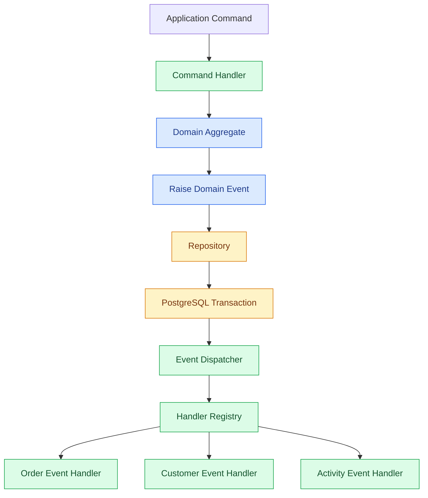

# Application Events and Handlers

## 1. Purpose

Domain events describe important business changes.

Application event handlers define what the application should do when those changes happen.

For example, when an order is placed:
- The ordering module records the order.
- The application dispatches the `OrderPlaced` event.
- Other handlers can react to that event.
- External notifications can be prepared after the transaction commits.

The goal is to keep business logic independent while allowing modules to communicate.

## 2. Responsibilities

We separate event responsibilities into three parts.

### Domain

The domain layer:
- Defines domain events.
- Raises events from aggregates.
- Contains business rules.
- Does not execute event handlers.

### Application

The application layer:
- Dispatches domain events.
- Registers event handlers.
- Coordinates handler execution.
- Manages application-level workflows.
- Handles failures.

### Infrastructure

The infrastructure layer:
- Provides database transactions.
- Persists aggregate changes.
- Provides external integrations.
- Implements background processing when needed.

## 3. Architecture



The dispatcher does not know the business purpose of each handler.

It only knows how to find and execute registered handlers.

## 4. Event Dispatcher

The event dispatcher is responsible for delivering domain events to their registered handlers.

Its responsibilities are:

1. Receive collected domain events.
2. Identify the event type.
3. Find registered handlers.
4. Execute handlers.
5. Collect execution errors.
6. Return the result to the application workflow.

The dispatcher should remain small and independent of business rules.

### Example interface

```rust
pub trait EventDispatcher {
    async fn dispatch(
        &self,
        events: Vec<DomainEvent>,
    ) -> Result<(), EventDispatchError>;
}
```

This is an architectural example. The final implementation should use the project's chosen async runtime and error conventions consistently.

## 5. Event Handlers

An event handler reacts to one specific event.

For example:

```rust
pub struct OrderPlacedHandler {
    customer_repository: Arc<dyn CustomerRepository>,
}

impl OrderPlacedHandler {
    pub async fn handle(
        &self,
        event: &OrderPlaced,
    ) -> Result<(), ApplicationError> {
        // Execute the required application operation.
        Ok(())
    }
}
```

A handler can:
- Update another aggregate through its repository.
- Record business activity.
- Trigger an application workflow.
- Prepare an integration event.

A handler should not:
- Contain unrelated business responsibilities.
- Directly modify another module's database tables.
- Bypass aggregate business rules.
- Perform external operations before transaction commit.

## 6. Handler Registration

Handlers must be registered explicitly.

For the first version, we will use a simple registry during application startup.

Example:

```rust
let dispatcher = EventDispatcherBuilder::new()
    .register::<OrderPlaced, OrderPlacedHandler>()
    .register::<PaymentCompleted, PaymentCompletedHandler>()
    .build();
```

The exact implementation will depend on the final event abstraction.

We do not need automatic handler discovery or a complex dependency injection framework.

Explicit registration makes the system easier to understand and debug.

## 7. Handler Execution Order

By default, handlers for the same event should execute sequentially.

Example:

```text
OrderPlaced
    |
    v
Handler 1: Record Activity
    |
    v
Handler 2: Update Customer Summary
    |
    v
Handler 3: Prepare Integration Event
```

Why sequential execution?

- Easier debugging.
- Predictable behavior.
- Simpler transaction management.
- Easier error handling.

If two handlers are truly independent and do not share transactional requirements, parallel execution can be considered later.

Handler ordering must not be used to hide business dependencies. If one operation requires another to have completed, model that dependency explicitly.

## 8. Transaction Management

Transaction management is one of the most important parts of event handling.

For `bio-com`, we distinguish two types of handlers.

### Transactional handlers

These handlers participate in the same database transaction as the original command when atomic consistency is required.

Example:

- Place order.
- Persist order.
- Record a required business record.

If one required operation fails, the transaction rolls back.

### Post-commit handlers

These handlers run after the database transaction commits.

Example:

- Send email.
- Call an external API.
- Publish an integration event through an external system.

They must not cause an already committed transaction to be treated as rolled back.

### Recommended execution model

```text
Command
   |
   v
Load Aggregate
   |
   v
Execute Business Operation
   |
   v
Collect Domain Events
   |
   v
Begin Database Transaction
   |
   v
Persist Aggregate
   |
   v
Execute Required Transactional Handlers
   |
   v
Commit Transaction
   |
   v
Execute Post-Commit Actions
```

If reliable post-commit processing becomes necessary, use a transactional outbox rather than relying only on in-memory execution.

## 9. Error Handling

Every handler must return a clear result.

Example:

```rust
pub enum EventDispatchError {
    HandlerFailed {
        event_name: String,
        reason: String,
    },
}
```

The application should distinguish between:

- Required handler failure.
- Optional handler failure.
- Post-commit failure.

### Required handler failure

The transaction should roll back.

### Optional handler failure

The system should follow an explicitly defined policy. Optional operations should not silently compromise required business behavior.

### Post-commit failure

The original business transaction remains committed.

A retry mechanism or outbox worker should handle reliable processing where required.

Never assume that retrying a handler is safe. Handlers that can be retried must be idempotent.

## 10. Idempotency

A handler is idempotent when processing the same event multiple times does not produce duplicate business effects.

For example, processing `OrderPlaced` twice should not create two identical customer activity records if only one is expected.

Possible techniques:

- Unique event identifiers.
- Database unique constraints.
- Processed-event records.
- Idempotent domain operations.

For the initial implementation, use database constraints and idempotent operations where duplicate execution is possible.

Do not introduce a distributed idempotency service without a real requirement.

## 11. Module Boundaries

Modules should communicate through well-defined contracts.

For example:

```text
Ordering Module
    |
    | OrderPlaced
    v
Application Event Dispatcher
    |
    v
Customer Module Handler
```

The customer module should not access the ordering module's internal database tables.

It should use an appropriate application or domain contract.

Each module remains responsible for its own data and business rules.

## 12. Logging and Observability

Event dispatching should provide enough information to troubleshoot failures.

Record:

- Event type.
- Event ID.
- Correlation ID.
- Handler name.
- Execution duration.
- Success or failure.
- Error details.

Avoid logging sensitive customer information or payment data.

Use structured logs rather than plain text messages.

## 13. Testing Strategy

Event handling requires several levels of testing.

### Unit tests

Test each handler independently.

Examples:
- Correct response to `OrderPlaced`.
- Correct behavior when a repository fails.
- Duplicate event handling.
- Invalid business conditions.

### Integration tests

Test:
- Dispatcher registration.
- Event-to-handler mapping.
- Sequential execution.
- Transaction rollback.
- Persistence behavior.

### Application workflow tests

Test the complete flow:

```text
PlaceOrder
    |
    v
OrderPlaced
    |
    v
Event Dispatcher
    |
    v
Registered Handlers
    |
    v
Expected Database State
```

Tests should verify both successful execution and failure scenarios.

## 14. What We Will Not Implement Now

Keep the first version lightweight.

We will not introduce:

- Kafka.
- RabbitMQ.
- Redis.
- Distributed event dispatching.
- Automatic handler discovery.
- Complex dependency injection containers.
- Parallel event execution.
- Event sourcing.

We will use explicit registration and in-process dispatching.

## 15. Future Improvements

When the application grows, we can introduce:

- Transactional outbox.
- Background workers.
- Retry policies.
- Dead-letter handling.
- Integration event publishing.
- Event processing metrics.
- Distributed messaging.

These are future improvements, not requirements for the first version.

## 16. Summary

Application event handlers allow different modules to react to business changes without tightly coupling their implementations.

For `bio-com`, the initial approach is:

- Domain events defined in the domain layer.
- Handlers implemented in the application layer.
- Explicit handler registration.
- Sequential execution by default.
- Clear transaction boundaries.
- Idempotent processing where necessary.
- Structured logging.
- PostgreSQL as the source of truth.
- No additional infrastructure for now.

The result is a simple event-handling mechanism that can evolve as business requirements grow.
