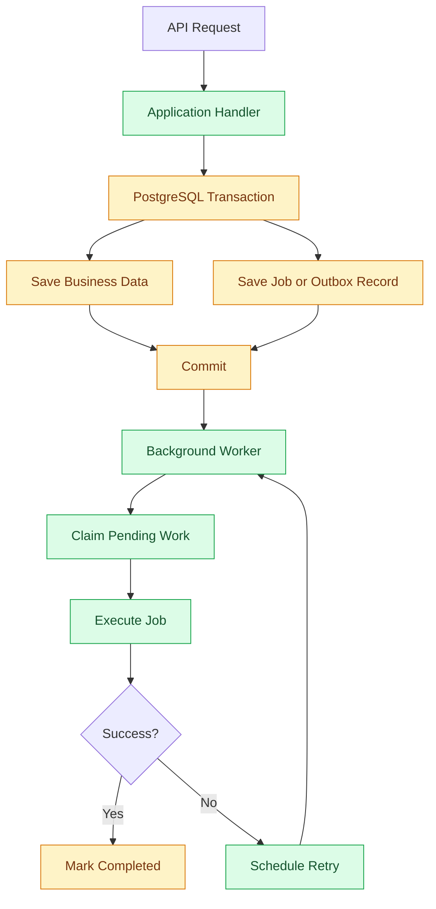

# Background Jobs and Workers

## 1. Purpose

Some operations should not run while a customer is waiting for an API response.

For example:
- Sending order confirmation emails.
- Processing outbox messages.
- Sending payment notifications.
- Cleaning up expired records.
- Generating reports.
- Synchronizing external data.

These operations can run in the background.

A background job allows the application to accept a request, save the required information, and process the remaining work separately.

The goal is to improve API responsiveness and keep long-running operations away from request handling.

## 2. What Is a Background Job?

A background job is a unit of work that runs outside the normal API request lifecycle.

For example:

```text
Customer Places Order
        |
        v
Save Order
        |
        v
Create Background Job
        |
        v
Return API Response
        |
        v
Background Worker
        |
        v
Send Confirmation Email
```

The customer does not need to wait for the email to be sent.

## 3. Background Jobs vs Domain Events vs Integration Events

These concepts have different responsibilities.

| Concept | Responsibility | Example |
|---|---|---|
| Domain Event | Describes a business change | OrderPlaced |
| Integration Event | Communicates with another system | OrderPlacedIntegrationEvent |
| Background Job | Represents work to execute later | SendOrderConfirmationEmail |

A domain event does not automatically need a background job.

Use a background job when work needs to be deferred, retried, or processed independently.

## 4. Architecture

For the initial version, workers run as Rust background tasks and use PostgreSQL for durable job storage.



The worker does not need to know how the original API request was handled.

It only needs a job definition and its required dependencies.

## 5. Worker Responsibilities

A background worker is responsible for:

1. Finding pending jobs.
2. Claiming jobs safely.
3. Executing the required operation.
4. Recording successful execution.
5. Handling failures.
6. Scheduling retries.
7. Recovering jobs abandoned by crashed workers.
8. Logging execution details.

Workers should not contain unrelated business logic.

Each job should have a clear responsibility.

## 6. Job Storage

For the first version, use PostgreSQL to store durable background jobs.

Example schema:

```sql
CREATE TABLE background_jobs (
    id UUID PRIMARY KEY,

    job_type VARCHAR(255) NOT NULL,
    payload JSONB NOT NULL,

    status VARCHAR(30) NOT NULL DEFAULT 'pending',

    attempts INTEGER NOT NULL DEFAULT 0,
    max_attempts INTEGER NOT NULL DEFAULT 5,

    created_at TIMESTAMPTZ NOT NULL DEFAULT NOW(),
    scheduled_at TIMESTAMPTZ NOT NULL DEFAULT NOW(),

    started_at TIMESTAMPTZ,
    completed_at TIMESTAMPTZ,

    locked_until TIMESTAMPTZ,
    worker_id VARCHAR(255),

    last_error TEXT
);

CREATE INDEX idx_background_jobs_pending
ON background_jobs (scheduled_at, created_at)
WHERE status = 'pending';
```

Possible statuses:

| Status | Meaning |
|---|---|
| pending | Waiting to be processed |
| processing | Currently being executed |
| completed | Successfully completed |
| failed | Permanently failed |
| cancelled | Cancelled before execution |

The job record should contain enough information to execute the operation without depending on the original HTTP request.

## 7. Job Definition

A job should contain:

- Unique job ID.
- Job type.
- Required payload.
- Creation timestamp.
- Scheduled execution time.
- Maximum attempts.
- Current status.

Example:

```rust
pub struct SendOrderConfirmationEmail {
    pub order_id: OrderId,
    pub customer_id: CustomerId,
}
```

Avoid putting unnecessary customer or payment information inside job payloads.

Prefer storing stable identifiers and loading the latest required information when the job executes.

## 8. Job Handler

Each job type has a dedicated handler.

Example:

```rust
#[async_trait]
pub trait JobHandler: Send + Sync {
    async fn execute(
        &self,
        payload: serde_json::Value,
    ) -> Result<(), JobError>;
}
```

A concrete handler can implement the business operation.

For example:

```rust
pub struct SendOrderConfirmationHandler {
    email_service: Arc<dyn EmailService>,
}

impl SendOrderConfirmationHandler {
    pub async fn execute(
        &self,
        job: SendOrderConfirmationEmail,
    ) -> Result<(), JobError> {
        // Load required order information.
        // Prepare the email.
        // Send the email.
        Ok(())
    }
}
```

The final implementation should use typed payload deserialization and typed handler registration rather than passing arbitrary JSON throughout the application.

## 9. Worker Execution

Workers continuously look for available jobs.

Conceptual execution:

```rust
loop {
    let jobs = job_repository
        .claim_pending_jobs(10)
        .await?;

    if jobs.is_empty() {
        tokio::time::sleep(Duration::from_secs(2)).await;
        continue;
    }

    for job in jobs {
        process_job(job).await;
    }
}
```

The worker should:
- Process jobs in controlled batches.
- Limit concurrent execution.
- Respect cancellation and shutdown signals.
- Avoid busy polling.
- Handle database errors without crashing permanently.

The polling interval should be configurable.

## 10. Safe Job Claiming

Two workers must not execute the same job simultaneously.

PostgreSQL provides `FOR UPDATE SKIP LOCKED` for this purpose.

Example:

```sql
WITH selected AS (
    SELECT id
    FROM background_jobs
    WHERE status = 'pending'
      AND scheduled_at <= NOW()
    ORDER BY scheduled_at, created_at
    LIMIT 10
    FOR UPDATE SKIP LOCKED
)
UPDATE background_jobs AS job
SET status = 'processing',
    attempts = attempts + 1,
    started_at = NOW(),
    locked_until = NOW() + INTERVAL '5 minutes',
    worker_id = $1
FROM selected
WHERE job.id = selected.id
RETURNING job.*;
```

The claim operation should run in a short database transaction.

Do not keep database locks while the job performs external operations.

The worker should renew its lease for long-running jobs when necessary.

## 11. Retry Strategy

Temporary failures should not immediately mark a job as permanently failed.

Examples:
- External API unavailable.
- Network timeout.
- HTTP 429 response.
- Temporary database connection failure.

Use bounded exponential backoff.

Example:

| Attempt | Retry delay |
|---|---|
| 1 | 5 seconds |
| 2 | 30 seconds |
| 3 | 2 minutes |
| 4 | 10 minutes |
| 5 | 30 minutes |

Add random jitter to avoid synchronized retries.

When the maximum attempts are reached, mark the job as failed.

Permanent failures, such as invalid payloads, should not be retried indefinitely.

## 12. Idempotency

A background job may execute more than once.

For example:

1. Worker sends an email.
2. Worker crashes before marking the job completed.
3. The lease expires.
4. Another worker processes the job again.

The email may be sent twice.

Therefore, handlers must be designed with idempotency in mind.

Possible techniques:
- Unique job identifiers.
- Idempotency keys for external APIs.
- Database uniqueness constraints.
- Processed-operation records.
- Conditional state transitions.

Important: A database lease prevents simultaneous ownership, but it cannot guarantee exactly-once execution of external operations.

## 13. Scheduling Jobs

Jobs can execute immediately or at a future time.

Examples:

| Job | Scheduling |
|---|---|
| Send confirmation email | Immediately |
| Expire abandoned checkout | Scheduled |
| Clean up old records | Daily |
| Generate sales report | Scheduled |
| Retry external notification | Based on retry policy |

Use `scheduled_at` to control when a job becomes eligible for execution.

Avoid introducing a separate scheduling platform for simple recurring tasks.

## 14. Worker Deployment

For the first version, we can support two execution modes.

### Mode A: Worker inside the API process

```text
bio-com API
    |
    +---- HTTP Server
    |
    +---- Background Worker
    |
    +---- PostgreSQL
```

Advantages:
- Simple deployment.
- Fewer moving parts.
- Easy local development.

Disadvantages:
- API and worker share resources.
- Restarting the API also restarts workers.
- Independent scaling is limited.

### Mode B: Separate worker process

```text
bio-com API
    |
    +---- PostgreSQL
              |
              |
         bio-com Worker
```

Advantages:
- Independent resource allocation.
- Independent scaling.
- Worker restarts do not require API restarts.

Disadvantages:
- Additional deployment configuration.
- More operational responsibilities.

**Recommendation:** Start with a worker process that can run in-process during development and as a separate process in production when needed.

Both modes should reuse the same application handlers.

## 15. Integration With Transactional Outbox

The transactional outbox and background jobs are related but should not automatically be the same thing.

The outbox is responsible for reliable integration-event delivery.

Background jobs handle deferred application work.

For example:

```text
OrderPlaced
     |
     v
PostgreSQL Transaction
     |
     +---- Save Order
     |
     +---- Save Outbox Event
     |
     +---- Save Background Job
                |
                v
          Background Worker
                |
                +---- Process Outbox
                |
                +---- Send Email
```

Do not duplicate the same work in both tables.

Use the outbox for reliable outgoing integration events. Use the job table for independent application tasks that need scheduling and execution management.

## 16. Error Handling and Observability

Record:

- Job ID.
- Job type.
- Worker ID.
- Execution start and finish.
- Execution duration.
- Attempt count.
- Success or failure.
- Error category.

Monitor:

| Metric | Purpose |
|---|---|
| Pending jobs | Work waiting for processing |
| Failed jobs | Jobs requiring investigation |
| Processing jobs | Currently executing jobs |
| Oldest pending job | Queue delay |
| Retry count | Failure frequency |
| Execution duration | Worker performance |

Never log passwords, authentication tokens, or sensitive customer data.

## 17. Graceful Shutdown

Workers must stop safely when the application shuts down.

Recommended behavior:

1. Stop claiming new jobs.
2. Allow active jobs to finish within a configured grace period.
3. Persist completed job states.
4. Stop processing when the deadline is reached.
5. Allow unfinished jobs to be recovered through lease expiration.

Do not assume that every job will finish before a process stops.

## 18. Testing Strategy

### Unit tests

Test:
- Job handler behavior.
- Payload validation.
- Retry calculation.
- Idempotency behavior.
- Error classification.

### Integration tests

Test:
- Job creation.
- Job claiming.
- Concurrent workers.
- Lease expiration.
- Retry scheduling.
- Job completion.
- Failed job handling.

### End-to-end tests

Test a complete workflow:

```text
Place Order
    |
    v
Create Job
    |
    v
Worker Claims Job
    |
    v
Execute Handler
    |
    v
Verify Expected Result
```

Use PostgreSQL integration tests rather than relying exclusively on mocks.

## 19. What We Will Not Implement Now

The initial version does not require:

- Redis.
- Kafka.
- RabbitMQ.
- Kubernetes.
- Distributed job orchestration.
- External workflow engines.
- Complex scheduling platforms.
- Exactly-once execution guarantees.

PostgreSQL is sufficient for the initial workload.

## 20. Future Improvements

When requirements grow, we can introduce:

- Dedicated worker deployment.
- Priority queues.
- Job cancellation.
- Dead-letter management.
- Advanced scheduling.
- Worker autoscaling.
- Distributed messaging.
- More advanced monitoring.

Introduce these capabilities only when justified by actual workload and business requirements.

## 21. Summary

For `bio-com`, background processing follows these principles:

- Rust asynchronous workers.
- PostgreSQL-backed durable job storage.
- Explicit job handlers.
- Safe job claiming with `SKIP LOCKED`.
- Lease expiration and recovery.
- Bounded retries with exponential backoff.
- Idempotent processing.
- Graceful shutdown.
- Structured logging and monitoring.
- No Redis or external message broker initially.

The result is a lightweight background-processing architecture that fits the modular monolith.
