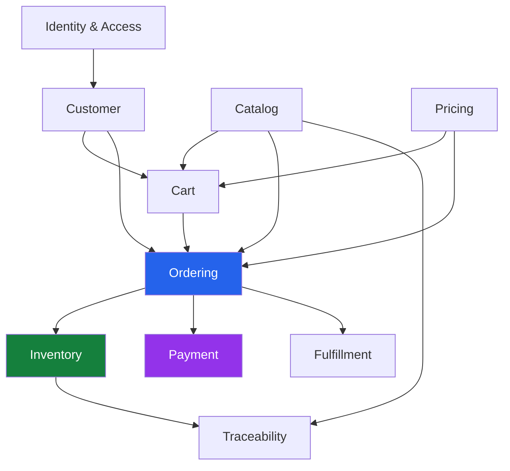

# bio-com — Bounded Contexts

## 1. Purpose

This document defines the bounded contexts of bio-com.

A bounded context is a boundary within which a business model has a clear meaning and responsibility.

For example, a product in the Catalog context describes what we sell.

A product in the Inventory context represents something we keep in stock.

They may refer to the same real-world product, but they serve different business purposes.

Each bounded context owns its business rules, data, and application operations.

Our goal is to avoid mixing responsibilities and creating dependencies that become difficult to maintain.

## 2. Bounded Context Overview

We will start with the following bounded contexts.

| Bounded Context | Main Responsibility | Type |
|---|---|---|
| Identity & Access | Users, authentication, authorization | Core |
| Customer | Customer profiles and addresses | Supporting |
| Catalog | Products, categories, variants | Core |
| Pricing | Prices and promotions | Core |
| Cart | Shopping cart management | Core |
| Inventory | Stock and reservations | Core |
| Ordering | Customer orders | Core |
| Payment | Payments and refunds | Core |
| Fulfillment | Order preparation and delivery | Core |
| Traceability | Product batches and origins | Supporting |

Each context will be implemented as a separate Rust module.

## 3. Context Definitions

### 3.1 Identity & Access Context

**Responsibility:** Manage authentication and authorization.

Owns:

- User accounts.
- Password credentials.
- Roles.
- Permissions.
- Account status.
- Authentication sessions or tokens.

Main operations:

- Register user.
- Authenticate user.
- Change password.
- Assign roles.
- Check permissions.
- Activate or deactivate accounts.

Does not own:

- Customer addresses.
- Customer business profiles.
- Orders.
- Product information.

Other contexts rely on this context when they need to verify access rights.

### 3.2 Customer Context

**Responsibility:** Manage customer business information.

Owns:

- Customer profiles.
- Contact information.
- Delivery addresses.
- Customer preferences.

Main operations:

- Create customer profile.
- Update customer information.
- Add delivery address.
- Update address.
- Retrieve customer information.

Does not own:

- Passwords.
- Authentication credentials.
- Roles and permissions.
- Orders.

Identity & Access manages who can log in. Customer manages the information needed to serve that customer.

### 3.3 Catalog Context

**Responsibility:** Manage the products offered by the business.

Owns:

- Products.
- Categories.
- Product variants.
- Product descriptions.
- Product images.
- Product attributes.
- Publication status.

Main operations:

- Create product.
- Update product.
- Create product variant.
- Publish product.
- Unpublish product.
- Browse catalog.

Does not own:

- Product prices.
- Stock quantities.
- Shopping carts.
- Customer orders.

Example:

The Catalog context knows that olive oil is available in 250 ml, 500 ml, and 1 litre variants.

It does not know how many bottles are currently available in the warehouse.

### 3.4 Pricing Context

**Responsibility:** Calculate the prices customers must pay.

Owns:

- Price lists.
- Variant prices.
- Promotions.
- Discount rules.
- Pricing policies.

Main operations:

- Define price.
- Update price.
- Create promotion.
- Validate promotion.
- Calculate product price.
- Calculate order discounts.

Does not own:

- Product descriptions.
- Inventory quantities.
- Customer orders.
- Payment transactions.

Example:

A 500 ml olive oil bottle has a regular price of $15.

A promotion may reduce the price to $13.50.

The Pricing context determines the applicable amount.

### 3.5 Cart Context

**Responsibility:** Manage items selected by customers before checkout.

Owns:

- Shopping carts.
- Cart items.
- Selected quantities.
- Cart status.

Main operations:

- Create cart.
- Add item.
- Remove item.
- Change quantity.
- View cart.
- Validate cart before checkout.

Does not own:

- Product definitions.
- Final order records.
- Stock quantities.
- Payment transactions.

The Cart context can request product and price information from other contexts.

A cart is temporary shopping information, not a confirmed purchase.

### 3.6 Inventory Context

**Responsibility:** Manage physical stock and product availability.

Owns:

- Stock records.
- Stock locations.
- Stock reservations.
- Inventory movements.
- Stock adjustments.

Main operations:

- Receive stock.
- Check availability.
- Reserve stock.
- Release reservation.
- Confirm stock deduction.
- Record inventory movement.

Does not own:

- Product descriptions.
- Customer orders.
- Payments.
- Shipment information.

Example:

The warehouse has 50 bottles of olive oil.

A reservation is created for 3 bottles.

The available quantity becomes 47, while the physical quantity remains 50 until stock is deducted.

### 3.7 Ordering Context

**Responsibility:** Manage customer purchases.

Owns:

- Orders.
- Order items.
- Order status.
- Order totals.
- Order history.
- Order cancellation information.

Main operations:

- Create order.
- Validate order.
- Confirm order.
- Cancel order.
- View order.
- Track order status.

Does not own:

- Product catalog.
- Price lists.
- Stock records.
- Payment provider credentials.
- Shipment execution details.

Important rule:

An order must preserve the product description, variant, quantity, and agreed price at the time of purchase.

Historical orders must not change when the catalog or pricing is updated.

### 3.8 Payment Context

**Responsibility:** Manage payments and refunds.

Owns:

- Payment records.
- Payment attempts.
- Payment status.
- Refund records.
- External payment references.

Main operations:

- Initiate payment.
- Confirm payment.
- Handle payment failure.
- Process refund.
- Track payment status.

Does not own:

- Order lifecycle.
- Product pricing.
- Customer shopping carts.
- Inventory.

Payment information must be protected.

Raw card information must never be stored by bio-com.

### 3.9 Fulfillment Context

**Responsibility:** Manage the preparation and delivery of orders.

Owns:

- Fulfillment records.
- Picking operations.
- Packing operations.
- Shipment information.
- Delivery status.

Main operations:

- Start fulfillment.
- Prepare order.
- Mark order as packed.
- Create shipment.
- Update delivery status.
- Record delivery problems.

Does not own:

- Customer payment records.
- Product prices.
- Order financial information.
- Inventory ownership.

Fulfillment works with Ordering and Inventory through their public interfaces.

### 3.10 Traceability Context

**Responsibility:** Track product origin and production batches.

Owns:

- Product batches.
- Batch references.
- Origin information.
- Production dates.
- Expiration dates.
- Supplier references.

Main operations:

- Register batch.
- Update batch information.
- Record origin.
- Track batch quantities.
- Retrieve batch history.

Does not own:

- Product catalog definitions.
- Customer orders.
- Payment records.

Example:

An olive oil batch has:

- Batch number: OLIVE-2026-001.
- Origin: A specific production region.
- Production date.
- Expiration date.
- Associated product variant.

Inventory can reference batches when receiving or managing stock.

## 4. Context Relationships

The following diagram illustrates the main interactions.

These arrows represent business interactions, not permission to access another context's database tables directly.

## 5. Communication Rules

Since bio-com uses a modular monolith, contexts can communicate through ordinary Rust interfaces.

We do not need network calls between modules.

We will follow these rules:

1. Each context owns its data.
2. Other contexts must not directly modify its data.
3. Use public application interfaces to request operations.
4. Share simple identifiers and data contracts when needed.
5. Avoid sharing internal domain entities.
6. Keep business rules inside their owning contexts.
7. Use explicit transactions for operations that require atomicity.
8. Handle failures when a business operation involves multiple contexts.

Example:

Ordering must not directly update an inventory database table.

Instead, Ordering requests a stock reservation through the Inventory application interface.

Inventory validates the request and performs the reservation using its own rules.

## 6. Important Business Boundaries

Some concepts look similar but must remain separate.

### Product vs Inventory Item

- Catalog describes the product.
- Inventory tracks its physical stock.

### Product Price vs Order Price

- Pricing determines the current applicable price.
- Ordering stores the agreed price at purchase time.

### User vs Customer

- Identity & Access manages authentication.
- Customer manages customer business information.

### Order vs Payment

- Ordering manages the purchase.
- Payment manages financial transactions.

### Order vs Fulfillment

- Ordering manages the order lifecycle.
- Fulfillment manages preparation and delivery.

These boundaries prevent business logic from becoming mixed between modules.

## 7. Initial Context Implementation Strategy

We will implement the contexts inside one Rust application.

Each context will have its own:

- Domain layer.
- Application layer.
- Infrastructure layer.
- Public interfaces.

The exact folder structure will be defined in the architecture documentation.

PostgreSQL will be shared at the infrastructure level, but database ownership will remain separated by context.

Where useful, we will use separate database schemas to make ownership visible.

We will start with direct function calls between contexts.

For workflows that involve multiple contexts, we will explicitly manage transaction boundaries and failure recovery.

We will not introduce microservices, Kafka, Redis, or distributed transactions in the initial version.

## 8. Future Changes

Bounded contexts are not permanent technical boxes.

As we learn more about the business, we may:

- Split a context when it becomes too large.
- Combine contexts when their responsibilities are too closely related.
- Introduce new contexts for new business capabilities.
- Improve communication contracts.
- Extract a context into a separate service if there is a real operational reason.

Any change should be based on business needs rather than technology trends.

## 9. Summary

The initial bio-com design contains ten bounded contexts.

Each context has a clear responsibility and owns its business rules and information.

This gives us a foundation for designing:

- Aggregates.
- Entities.
- Value Objects.
- Domain Services.
- Repository interfaces.
- Application use cases.
- Database schemas.

**Next step:** Design the domain model and identify the aggregates, entities, and value objects within each bounded context.

---

**Project:** bio-com  
**Language:** Rust  
**Architecture:** DDD + Clean Architecture  
**Application Style:** Modular Monolith  
**Database:** PostgreSQL
