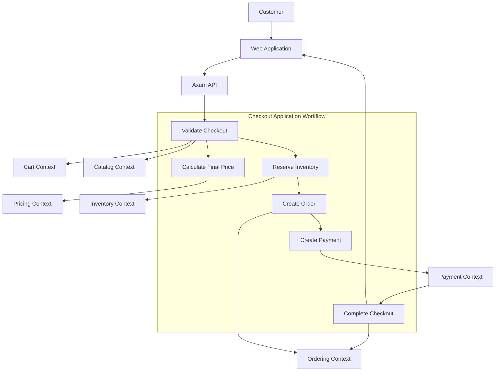

# Checkout Workflow

## 1. Purpose

Checkout is the process that turns a customer's shopping cart into a confirmed order.

It connects several business contexts:

- Cart: provides the customer's selected products.
- Catalog: provides product information.
- Pricing: calculates the final prices.
- Inventory: checks and reserves available stock.
- Ordering: creates and manages the order.
- Payment: processes the customer's payment.

The checkout workflow coordinates these contexts while keeping their responsibilities separate.

## 2. Checkout Principles

The checkout process must follow these rules:

1. Never trust prices submitted by the frontend.
2. Always validate product availability.
3. Reserve inventory before accepting payment.
4. Preserve product and price information in the order.
5. Never charge the customer twice for the same checkout.
6. Do not confirm an order before successful payment.
7. Handle timeouts and failures without losing track of the operation.
8. Keep each business context responsible for its own data.

## 3. High-Level Workflow

The customer follows this process:

1. Add products to the cart.
2. Open the checkout page.
3. Provide delivery information.
4. Review the order summary.
5. Confirm checkout.
6. Complete payment.
7. Receive an order confirmation.

The backend performs the necessary validations and coordinates the business contexts.

## 4. Checkout Architecture



The checkout workflow belongs to the application layer.

It coordinates the contexts through their application interfaces. It does not directly access their database tables.

## 5. Step-by-Step Checkout

### Step 1: Validate the Cart

The customer starts checkout.

The application retrieves the cart and checks:

- The cart exists.
- The cart belongs to the authenticated customer.
- The cart is not empty.
- Every product is still available for sale.
- Every requested quantity is valid.
- Every product variant still exists.

The frontend must not decide whether a product is available or whether its price is valid.

The backend performs these checks again.

### Step 2: Calculate the Final Price

The Pricing context calculates the order total.

It considers:

- Product prices.
- Product quantities.
- Active promotions.
- Discounts.
- Applicable taxes.
- Delivery charges, when supported.

The calculation must use exact monetary values, never floating-point numbers.

The application creates a checkout price snapshot so the amount presented to the customer can be compared with the amount used when creating the order.

If the price changes before the customer confirms checkout, the customer should see the updated amount and confirm it again.

### Step 3: Validate Delivery Information

The application validates the delivery information.

For example:

- Customer name.
- Delivery address.
- Contact information.
- Delivery method, if available.

The address should be copied into the order as a snapshot.

Changing the customer's saved address later must not modify an existing order.

### Step 4: Reserve Inventory

Before creating a payment, the application asks Inventory to reserve the required quantities.

Example:

```text
Product: Organic Olive Oil
Requested quantity: 2

Physical stock: 20
Reserved stock: 5
Available stock: 15

Reservation result: Successful
```

Inventory must perform this operation safely under concurrent requests.

Two customers must not reserve the same remaining stock.

A reservation has an expiration time.

For example:

```text
Reservation duration: 15 minutes
```

The actual duration should be configurable.

If checkout fails or expires, the reservation must be released.

### Step 5: Create the Order

After inventory reservation succeeds, Ordering creates the order.

The order contains:

- Customer ID.
- Product and variant information.
- Product names and prices at checkout time.
- Quantities.
- Discounts.
- Taxes.
- Delivery information.
- Final total.
- Inventory reservation reference.

The order starts with:

```text
Pending
```

It then moves to:

```text
AwaitingPayment
```

The order must preserve its own product and price snapshots.

It must not depend on future Catalog or Pricing changes.

### Step 6: Create the Payment

The Payment context creates a payment for the order.

The payment amount and currency must match the order's payable amount and currency.

The provider creates a hosted checkout session or payment intent.

The application returns the required checkout information to the frontend.

The customer completes the payment through the provider.

### Step 7: Confirm the Payment

The application receives the payment result through a verified webhook or a provider status check.

If payment succeeds:

1. Payment records the successful result.
2. Ordering moves the order to Confirmed.
3. Inventory confirms the reservation and deducts the reserved stock according to its inventory rules.
4. The checkout is marked as completed.
5. The customer can view the confirmed order.

These operations must be idempotent.

If the application fails between steps, retrying must not create a second charge or deduct stock twice.

### Step 8: Clear the Cart

After successful checkout, the application clears the purchased cart items.

The cart should not be cleared before the order has been successfully created.

If checkout fails, the customer should be able to review and retry the cart.

## 6. Checkout State Management

Checkout needs its own state to track the overall process.

| Status | Meaning |
|---|---|
| Started | Customer started checkout |
| Validating | Cart and order information are being checked |
| ReservingInventory | Stock reservation is in progress |
| AwaitingPayment | Order and payment are waiting for completion |
| PaymentProcessing | Provider is processing the payment |
| Completed | Order is confirmed |
| Failed | Checkout failed |
| Expired | Checkout reservation or session expired |
| CancellationPending | A cancellation or recovery operation is in progress |

Checkout status is an application workflow concept.

It does not replace the status owned by Ordering, Payment, or Inventory.

Each context remains responsible for its own lifecycle.

## 7. Failure Scenarios

A reliable checkout process must handle failures at every step.

### Scenario A: Product is unavailable

```text
Customer starts checkout
        |
Validate cart
        |
Product unavailable
        |
Checkout rejected
```

No order or payment should be created.

The customer receives a clear message and can update the cart.

### Scenario B: Inventory reservation fails

```text
Validate cart
        |
Calculate price
        |
Reserve inventory
        |
Reservation rejected
        |
Checkout failed
```

No payment should be initiated.

The customer can review the unavailable quantities.

### Scenario C: Order creation fails

```text
Inventory reserved
        |
Order creation fails
        |
Release inventory reservation
        |
Checkout failed
```

The reservation must be released.

If the release operation also fails, the application must retain enough information to retry it safely.

### Scenario D: Payment fails

```text
Order created
        |
Payment initiated
        |
Payment fails
        |
Order remains unpaid
        |
Release inventory reservation
```

The order should move to an appropriate failed or payment-failed state according to the Ordering lifecycle.

The customer can retry payment if the business rules allow it.

### Scenario E: Payment times out

A timeout does not mean that the payment failed.

For example:

1. The provider successfully charges the customer.
2. The response never reaches the application.
3. The application sees a timeout.

The system must not immediately create another payment charge.

Instead:

- Keep the payment unresolved or processing.
- Query the provider when possible.
- Wait for a verified webhook.
- Reconcile the result.
- Confirm the order if payment is successful.

### Scenario F: Payment succeeds but order confirmation fails

This is an important recovery case.

```text
Payment succeeds
        |
Order confirmation fails
        |
Payment remains successful
        |
Recovery retries order confirmation
        |
Order becomes confirmed
```

The application must retry the confirmation operation using the same identifiers.

It must not charge the customer again.

If automatic recovery cannot resolve the issue, the operation should be visible for staff investigation.

## 8. Transaction Boundaries

The checkout workflow touches multiple business contexts.

It should not use one large database transaction covering every operation.

Instead, each context manages its own transaction.

| Operation | Transaction owner |
|---|---|
| Reserve inventory | Inventory |
| Create order | Ordering |
| Create payment record | Payment |
| Record payment result | Payment |
| Confirm order | Ordering |
| Confirm inventory reservation | Inventory |

The application coordinates the operations.

This keeps database responsibilities clear and avoids long-running transactions involving external APIs.

## 9. Preventing Duplicate Checkout

A customer may click the checkout button more than once.

The system must prevent duplicate orders and payments.

Use an idempotency key for each checkout request.

Example:

```text
checkout_id: chk_123
customer_id: customer_456
idempotency_key: unique-request-key
```

When the same request is submitted again:

- Return the existing checkout result when possible.
- Do not create another order.
- Do not reserve stock twice.
- Do not create another charge.

The database should enforce the necessary uniqueness constraints.

The key should be scoped to the authenticated customer and the relevant operation.

## 10. Checkout Application Structure

The checkout workflow can live in a dedicated application module.

Example:

```text
src/
├── application/
│   └── checkout/
│       ├── commands/
│       │   ├── start_checkout.rs
│       │   └── complete_checkout.rs
│       ├── services/
│       │   └── checkout_service.rs
│       ├── workflows/
│       │   └── checkout_workflow.rs
│       └── ports/
│           ├── cart_service.rs
│           ├── catalog_service.rs
│           ├── pricing_service.rs
│           ├── inventory_service.rs
│           ├── ordering_service.rs
│           └── payment_service.rs
```

The checkout application coordinates the business contexts.

Each context exposes the operations needed by the application through well-defined interfaces.

The application should not import infrastructure implementations directly.

## 11. Example Application Interface

A simplified Rust interface could look like this:

```rust
pub struct StartCheckoutCommand {
    pub customer_id: CustomerId,
    pub cart_id: CartId,
    pub idempotency_key: String,
}

pub struct CheckoutResult {
    pub checkout_id: CheckoutId,
    pub order_id: OrderId,
    pub payment_id: PaymentId,
    pub checkout_url: Option<String>,
}

pub trait CheckoutService {
    async fn start_checkout(
        &self,
        command: StartCheckoutCommand,
    ) -> Result<CheckoutResult, CheckoutError>;
}
```

The implementation coordinates the individual contexts.

The domain models remain independent of Axum, SQLx, and external payment provider types.

## 12. Testing Strategy

Checkout must be tested as a complete business workflow.

### Unit tests

- Reject an empty cart.
- Reject invalid quantities.
- Reject unavailable products.
- Detect price changes.
- Calculate the correct order total.
- Reject an invalid checkout transition.

### Integration tests

- Complete a successful checkout.
- Reject checkout when stock is insufficient.
- Release stock when order creation fails.
- Handle payment failure.
- Handle payment timeout.
- Recover after payment succeeds but order confirmation fails.
- Prevent duplicate checkout requests.
- Prevent duplicate inventory deductions.

### Important end-to-end test

```text
Given:
- A customer has a valid cart.
- Products are available.
- Prices are valid.
- Delivery information is valid.

When:
- The customer completes checkout.
- The payment provider confirms success.

Then:
- An order exists.
- The order is confirmed.
- The payment is successful.
- Inventory has been updated.
- The cart is cleared.
```

## 13. Initial Release Scope

The first version should support:

- Cart validation.
- Server-side price calculation.
- Delivery information validation.
- Inventory reservation.
- Order creation.
- Payment initiation.
- Payment confirmation.
- Inventory confirmation.
- Cart clearing.
- Idempotency.
- Basic failure recovery.

Do not introduce Kafka, Redis, or a workflow orchestration platform.

A modular monolith with explicit application workflows is sufficient for the initial release.

## 14. Future Improvements

Possible future improvements include:

- Multiple delivery methods.
- Shipping cost calculation.
- Discount codes.
- Advanced checkout expiration handling.
- Automated recovery jobs.
- Customer order notifications.
- Advanced checkout monitoring.

Introduce these features when the business requires them.

---

## Final Design Decision

Checkout is an application-level workflow that coordinates the business contexts.

It does not own product, pricing, inventory, order, or payment rules.

Each context remains responsible for its own data and transactions.

The workflow uses explicit state tracking, inventory reservations, idempotency, and recovery procedures to provide a reliable checkout experience.

This approach keeps `bio-com` simple while providing a foundation that can evolve into a production-ready e-commerce platform.
