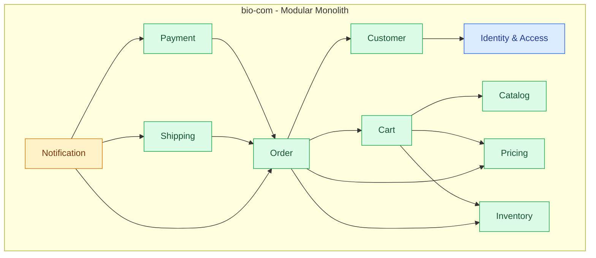
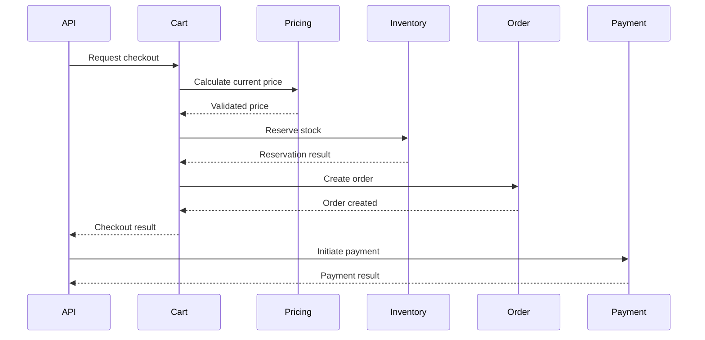

# Domain Boundaries

## 1. Purpose

This document defines the business boundaries of bio-com.

It explains:

- Which business modules exist.
- What each module is responsible for.
- Which data each module owns.
- How modules communicate.
- Which dependencies are allowed.
- How we protect module boundaries.

The goal is to keep the application organized as one modular monolith without turning it into one large, tightly coupled codebase.

## 2. Domain Overview

bio-com is an e-commerce platform.

Its main business capabilities are:

1. Identity and Access.
2. Customer.
3. Catalog.
4. Cart.
5. Pricing.
6. Inventory.
7. Order.
8. Payment.
9. Shipping.
10. Notification.

Each module has a specific responsibility.

A module should own its business rules and data. Other modules should use its public application interfaces rather than accessing its internal implementation.

## 3. High-Level Domain Structure



This diagram shows logical relationships, not permission to access another module's database tables.

## 4. Module Responsibilities

### 4.1 Identity and Access

**Purpose:** Manage user authentication and authorization.

Responsibilities:

- Register users.
- Authenticate users.
- Manage passwords.
- Create and revoke sessions.
- Manage roles and permissions.
- Verify access to protected operations.

Owns:

- User identity credentials.
- Roles.
- Permissions.
- User-role assignments.
- Sessions.

It does not own customer profile details such as delivery addresses or phone preferences.

### 4.2 Customer

**Purpose:** Manage customer information.

Responsibilities:

- Customer profiles.
- Contact information.
- Delivery addresses.
- Customer preferences.
- Customer account status.

Owns:

- Customer profiles.
- Customer addresses.
- Customer-specific preferences.

A customer profile references the corresponding identity user through a stable user identifier.

It does not manage passwords or authentication sessions.

### 4.3 Catalog

**Purpose:** Manage what the platform sells.

Responsibilities:

- Products.
- Product descriptions.
- Categories.
- Product attributes.
- Product publication status.
- Product images and media references.

Owns:

- Products.
- Categories.
- Product attributes.
- Product media metadata.

The catalog describes products. It does not decide how much stock is available.

### 4.4 Pricing

**Purpose:** Manage product prices and pricing rules.

Responsibilities:

- Base prices.
- Currency.
- Price validity.
- Discounts.
- Promotional pricing.
- Price calculation.

Owns:

- Price records.
- Pricing rules.
- Promotions.

The pricing module calculates prices. It does not manage payment transactions.

### 4.5 Cart

**Purpose:** Manage a customer's shopping cart.

Responsibilities:

- Add products.
- Remove products.
- Change quantities.
- View cart contents.
- Calculate cart totals.
- Validate cart contents before checkout.

Owns:

- Shopping carts.
- Cart items.

A cart is not an order.

A customer can modify a cart until checkout creates an order.

### 4.6 Inventory

**Purpose:** Track product stock and availability.

Responsibilities:

- Track stock quantities.
- Check availability.
- Reserve stock.
- Release reservations.
- Confirm stock consumption.
- Record inventory adjustments.

Owns:

- Inventory items.
- Stock quantities.
- Reservations.
- Inventory movements.

The catalog owns product information. Inventory owns stock information.

### 4.7 Order

**Purpose:** Manage customer purchases.

Responsibilities:

- Create orders.
- Maintain order items.
- Calculate order totals using validated pricing information.
- Manage order status.
- Track order history.
- Coordinate checkout.
- Manage order cancellation rules.

Owns:

- Orders.
- Order items.
- Order status history.
- Order-level snapshots of purchased product and price information.

An order should preserve the product descriptions, quantities, and prices agreed at purchase time.

It must not depend on the current catalog price to display historical orders.

### 4.8 Payment

**Purpose:** Manage financial transactions.

Responsibilities:

- Initiate payments.
- Confirm payment results.
- Handle payment failures.
- Process refunds.
- Record provider references.
- Reconcile payment status.

Owns:

- Payment records.
- Refund records.
- Payment status history.
- Provider transaction references.

The payment module integrates with an external payment provider.

It does not store raw card numbers or security codes.

### 4.9 Shipping

**Purpose:** Manage delivery and fulfillment information.

Responsibilities:

- Create shipments.
- Manage shipping addresses used for fulfillment.
- Track shipment status.
- Store tracking numbers.
- Integrate with shipping providers.
- Handle delivery updates.

Owns:

- Shipments.
- Shipment items.
- Tracking information.
- Shipping status history.

Shipping does not own order information or inventory quantities.

### 4.10 Notification

**Purpose:** Send business notifications.

Responsibilities:

- Send order confirmations.
- Send payment notifications.
- Send shipping updates.
- Send refund notifications.
- Manage notification delivery status.

Owns:

- Notification records.
- Delivery attempts.
- Notification templates.

Notification does not decide whether an order or payment is valid.

It receives information from the responsible module and sends the corresponding message.

## 5. Data Ownership

Every business module must have clear ownership of its data.

| Module | Main Data Owned |
|---|---|
| Identity & Access | Users, roles, permissions, sessions |
| Customer | Customer profiles, addresses |
| Catalog | Products, categories, attributes |
| Pricing | Prices, discounts, promotions |
| Cart | Carts, cart items |
| Inventory | Stock, reservations, movements |
| Order | Orders, order items, status history |
| Payment | Payments, refunds, payment history |
| Shipping | Shipments, tracking, delivery status |
| Notification | Notifications, delivery attempts |

### Ownership Rules

1. A module creates and updates its own business data.
2. Other modules cannot directly modify its tables.
3. Database foreign keys can be used where appropriate, but they do not replace module-level ownership.
4. Cross-module references should use stable identifiers.
5. Historical business records should preserve the information needed to explain past transactions.
6. A module exposes only the information other modules need.

## 6. Module Communication

Modules run in the same application.

They do not need HTTP calls to communicate internally.

Use application interfaces.

Example:

```text
Order Module
    |
    v
Inventory Application Interface
    |
    v
Inventory Use Case
    |
    v
Inventory Repository
    |
    v
PostgreSQL
```

The order module does not directly query inventory tables.

### Communication Rules

- Use public application interfaces for cross-module operations.
- Keep domain models private to their owning module unless explicitly designed as shared contracts.
- Do not expose database models as public module interfaces.
- Avoid circular dependencies.
- Keep communication synchronous initially.
- Use domain events for important business facts when useful.

## 7. Domain Events

A domain event represents something important that happened in a module.

Examples:

| Event | Owner |
|---|---|
| UserRegistered | Identity & Access |
| CustomerProfileCreated | Customer |
| ProductPublished | Catalog |
| CartCheckedOut | Cart |
| StockReserved | Inventory |
| OrderPlaced | Order |
| PaymentAuthorized | Payment |
| PaymentFailed | Payment |
| RefundProcessed | Payment |
| ShipmentCreated | Shipping |
| OrderDelivered | Shipping |

Events describe facts. They should not become a way for modules to access each other's internal data.

### Initial Approach

Use in-process communication where appropriate.

For example, after an order is placed, the order workflow can invoke the notification module to request an order confirmation.

For workflows that must survive process crashes, use a transactional outbox or another durable mechanism rather than relying only on in-memory event delivery.

A message broker is not required for the initial implementation.

## 8. Cross-Module Workflows

Some business operations involve multiple modules.

### Example: Checkout



This is a conceptual workflow. The actual checkout use case should define the transaction boundaries, failure handling, and compensation behavior.

Important rules:

- Validate cart contents.
- Recalculate prices.
- Reserve stock safely.
- Create an order with price snapshots.
- Initiate payment using an idempotency key.
- Handle payment failures.
- Release reservations when appropriate.
- Avoid creating duplicate orders or payments.

A PostgreSQL transaction can protect operations within the same database transaction, but external payment provider calls cannot participate in that transaction.

Use explicit workflow states and recovery handling for operations that cross external system boundaries.

## 9. Dependency Rules

The following rules protect the architecture.

### Allowed

- API calls application use cases.
- Application uses domain models.
- Infrastructure implements repository interfaces.
- One module calls another module's public application interface.
- Modules exchange explicit request and result types.

### Not Allowed

- One module directly accesses another module's repository.
- One module modifies another module's tables.
- Domain code depends on Axum or SQLx.
- API handlers contain business rules.
- Circular module dependencies.
- Shared mutable global business state.

### Example

Good:

```rust
let result = inventory_service
    .reserve_stock(command)
    .await?;
```

Bad:

```rust
let stock = sqlx::query_as::<_, InventoryRow>(
    "SELECT * FROM inventory WHERE product_id = $1"
)
.fetch_one(&pool)
.await?;
```

The second example is problematic when used by another module because it bypasses inventory's business rules and data ownership.

## 10. Shared Types

Avoid creating a large shared domain model.

Shared types should be limited to concepts that genuinely have the same meaning across modules.

Possible examples:

- UserId.
- CustomerId.
- ProductId.
- OrderId.
- Money.
- Currency.
- Timestamp.

Even when two modules use the same identifier, they should remain responsible for validating their own business rules.

Do not expose internal database structs as shared types.

## 11. Suggested Rust Module Structure

```text
bio-com/
└── src/
    ├── main.rs
    ├── lib.rs
    ├── shared/
    │   ├── error.rs
    │   ├── ids.rs
    │   └── money.rs
    │
    ├── modules/
    │   ├── identity/
    │   ├── customer/
    │   ├── catalog/
    │   ├── pricing/
    │   ├── cart/
    │   ├── inventory/
    │   ├── order/
    │   ├── payment/
    │   ├── shipping/
    │   └── notification/
    │
    ├── infrastructure/
    │   ├── database/
    │   └── external/
    │
    └── api/
        ├── routes.rs
        └── middleware/
```

Each module should organize its own domain, application, and infrastructure concerns.

For example:

```text
modules/
└── order/
    ├── mod.rs
    ├── domain/
    │   ├── entities/
    │   ├── value_objects/
    │   ├── events/
    │   └── repositories/
    ├── application/
    │   ├── commands/
    │   ├── queries/
    │   └── services/
    └── infrastructure/
        └── persistence/
```

The exact structure can evolve as implementation begins.

## 12. When to Split a Module

A module should be reconsidered when:

- It contains unrelated business responsibilities.
- Its domain model becomes difficult to understand.
- It has different business rules from neighboring functionality.
- Its data ownership is unclear.
- It needs independent scaling or deployment.
- It becomes a major source of coupling.

Do not split modules simply because they contain many files.

The important question is whether the business responsibilities belong together.

## 13. Key Design Decisions

1. bio-com uses a modular monolith.
2. Each business capability has a clear module boundary.
3. Each module owns its business data.
4. Modules communicate through public application interfaces.
5. Internal communication uses direct calls initially.
6. Domain events represent important business facts.
7. Cross-module workflows explicitly handle failures.
8. External provider calls are not treated as part of PostgreSQL transactions.
9. Shared types remain small and stable.
10. Modules can be extracted later if there is a real business or operational reason.

---

**Main principle:** A module owns its business rules and data. Other modules request its capabilities through explicit interfaces instead of reaching into its implementation.
