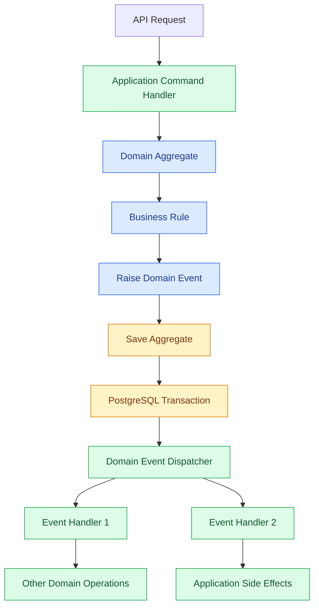

# Domain Events

## 1. Purpose

Domain events represent important things that happen in the business.

They help different parts of the application react to business changes without being tightly connected to each other.

For example:
- A customer account is created.
- A product is published.
- An order is placed.
- A payment is completed.
- An order is cancelled.
- A refund is approved.

Instead of directly calling several modules whenever something happens, a module can raise a domain event. Other modules can react to it.

This keeps the business logic easier to understand, maintain, and extend.

## 2. What Is a Domain Event?

A domain event describes something that has already happened.

Domain events:
- Represent a meaningful business action.
- Are written in the past tense.
- Are immutable.
- Belong to the domain model.
- Are independent of databases, frameworks, and messaging infrastructure.

Example:

```rust
pub struct OrderPlaced {
    pub order_id: OrderId,
    pub customer_id: CustomerId,
}
```

The event means that an order has successfully been placed.

It does not mean that someone wants to place an order.

That distinction is important:

| Concept | Meaning | Example |
|---|---|---|
| Command | Something we want to do | PlaceOrder |
| Domain Event | Something that happened | OrderPlaced |
| Query | Something we want to read | GetOrderDetails |

## 3. Domain Events vs Integration Events

These two concepts are related but serve different purposes.

### Domain Events

Domain events communicate business changes inside the application.

For example:

- OrderPlaced
- ProductPublished
- CustomerRegistered
- PaymentCompleted

They are handled inside the modular monolith.

### Integration Events

Integration events communicate business changes to external systems or other applications.

For example:

- OrderPlacedIntegrationEvent
- PaymentCompletedIntegrationEvent

They are published after the database transaction commits.

| Domain Events | Integration Events |
|---|---|
| Internal communication | External communication |
| Within the application | Across application boundaries |
| In-process dispatching | Asynchronous messaging |
| Domain-oriented | Contract-oriented |

**Important:** A domain event does not automatically become an integration event.

An application-level handler decides whether an external notification is necessary.

## 4. Architecture

For the first version, domain events use simple in-process dispatching.

We do not need Kafka, RabbitMQ, or Redis.



The responsibilities are separated:

- Domain: creates events when business changes happen.
- Application: dispatches events and executes handlers.
- Infrastructure: persists data and manages transactions.

## 5. Where Domain Events Belong

Domain events belong to the domain layer.

Handlers belong to the application layer because they coordinate business operations and interact with repositories or other application services.

Suggested structure:

```text
src/
└── modules/
    ├── ordering/
    │   ├── domain/
    │   │   ├── aggregates/
    │   │   ├── events/
    │   │   └── value_objects/
    │   │
    │   ├── application/
    │   │   ├── commands/
    │   │   ├── handlers/
    │   │   └── event_handlers/
    │   │
    │   └── infrastructure/
    │       └── persistence/
    │
    └── shared/
        ├── domain/
        │   └── domain_event.rs
        │
        └── application/
            └── event_dispatcher.rs
```

Each module owns its business events.

The shared domain layer only contains common abstractions. It should not contain business-specific events such as `OrderPlaced`.

## 6. Raising Domain Events

An aggregate raises an event when an important business operation succeeds.

For example, an Order aggregate can raise `OrderPlaced` after validating and changing its state.

Conceptual Rust example:

```rust
pub struct Order {
    id: OrderId,
    customer_id: CustomerId,
    status: OrderStatus,
    events: Vec<DomainEvent>,
}

impl Order {
    pub fn place(&mut self) -> Result<(), DomainError> {
        if self.status != OrderStatus::Draft {
            return Err(DomainError::InvalidOrderStatus);
        }

        self.status = OrderStatus::Placed;

        self.events.push(
            DomainEvent::OrderPlaced(
                OrderPlaced {
                    order_id: self.id.clone(),
                    customer_id: self.customer_id.clone(),
                }
            )
        );

        Ok(())
    }
}
```

This is an illustrative example. The final implementation will use the project's agreed domain event abstraction and error types.

The aggregate does not:
- Call event handlers.
- Access the database.
- Send emails.
- Call external APIs.
- Know about infrastructure.

It only records what happened.

## 7. Event Dispatching

The application layer is responsible for dispatching domain events.

The dispatcher:
1. Collects events raised by aggregates.
2. Finds the registered handlers.
3. Executes the handlers.
4. Reports failures.
5. Clears events only after successful processing according to the transaction strategy.

A dispatcher should not contain business rules. Its responsibility is event delivery.

For the initial implementation, handlers execute in-process.

## 8. Transaction Management

Domain events must be handled carefully around database transactions.

For `bio-com`, we will use a simple transaction strategy initially.

### Recommended flow

1. Receive the application command.
2. Load the aggregate.
3. Execute the business operation.
4. Collect raised domain events.
5. Begin or continue the database transaction.
6. Persist the aggregate changes.
7. Dispatch the relevant internal handlers.
8. Persist handler changes within the same transaction when they must be atomic.
9. Commit the transaction.
10. Clear processed events.

If any operation that belongs to the transaction fails, roll back the transaction.

**Important:** Handlers must not perform irreversible external actions before the transaction commits.

For example, do not send an email before knowing that the order transaction has committed.

External notifications can be handled later through an integration-event mechanism.

## 9. Example: Order Placement

Consider a customer placing an order.

The ordering module handles the command.

```text
PlaceOrder
    |
    v
Order Aggregate
    |
    v
Validate Order
    |
    v
Change Status to Placed
    |
    v
Raise OrderPlaced
    |
    v
Persist Order
    |
    v
Dispatch Domain Event
    |
    +---- Update Customer Order Information
    |
    +---- Record Business Activity
    |
    +---- Prepare External Notification
```

Each handler has one responsibility.

Adding a new handler should not require modifying the Order aggregate.

## 10. Event Naming and Design Rules

Follow these conventions:

1. Use past-tense names.
2. Name events after business actions.
3. Keep events immutable.
4. Include only the information required by consumers.
5. Avoid database-specific information.
6. Do not expose internal implementation details.
7. Do not use events to replace ordinary method calls.
8. Do not create events for every database update.

Examples:

| Good | Avoid |
|---|---|
| OrderPlaced | OrderPlacement |
| PaymentCompleted | UpdatePayment |
| ProductPublished | ProductUpdated |
| CustomerRegistered | CreateCustomer |
| OrderCancelled | ChangeOrderStatus |

A database record being updated is not necessarily a domain event. The change must have business meaning.

## 11. Error Handling

Event handlers must have clear failure behavior.

Examples:

- A validation handler rejects an invalid operation.
- A persistence handler reports a database error.
- An optional notification preparation handler records its failure.

Do not silently ignore failures.

For events handled inside the same transaction, a handler failure should cause the transaction to roll back when its operation is required for consistency.

For non-critical side effects, use a separate mechanism with retries.

## 12. Reliability and Future Evolution

The initial implementation deliberately avoids distributed messaging infrastructure.

However, the design should allow future improvements:

- Integration event publishing.
- Transactional outbox.
- Background processing.
- Retry policies.
- Idempotent event handlers.
- Event monitoring.

If external event publishing becomes necessary, the transactional outbox pattern can ensure that business changes and outgoing messages are recorded atomically.

We should introduce these mechanisms only when the business requirements justify them.

## 13. What We Will Not Implement Now

To keep the first version simple, we will not introduce:

- Kafka.
- RabbitMQ.
- Redis Pub/Sub.
- Distributed event buses.
- Event sourcing.
- Complex event orchestration frameworks.

Domain events are not event sourcing.

We will continue using PostgreSQL as the source of truth for current business state.

## 14. Implementation Principles

The implementation must follow these principles:

- Aggregates raise events.
- Domain events belong to the domain layer.
- Event handlers belong to the application layer.
- Infrastructure remains outside the domain.
- Event dispatching is explicit.
- Transaction boundaries are clear.
- External side effects happen after successful commits.
- Each module owns its business events.
- No unnecessary infrastructure.

## 15. Summary

Domain events provide a clean way for different parts of `bio-com` to react to business changes.

We will start with a lightweight, in-process implementation using Rust and PostgreSQL.

The architecture will remain simple while leaving room for integration events, an outbox, and asynchronous processing when needed.
