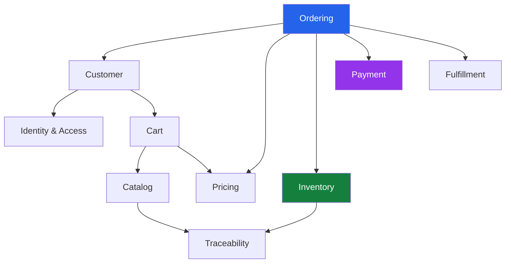

# bio-com — Domain Overview

## 1. Purpose

This document describes the main business areas of bio-com.

Each business area is responsible for a specific part of the e-commerce platform.

We use Domain-Driven Design (DDD) to organize the application around business responsibilities rather than technical layers.

Our initial architecture will be a modular monolith:

- One Rust application.
- One PostgreSQL database.
- Clearly separated business modules.
- Each module owns its business logic.
- Modules communicate through well-defined interfaces.

We want strong boundaries without introducing unnecessary infrastructure.

## 2. Business Domains

The platform is divided into the following business domains.

| Domain | Responsibility | Priority |
|---|---|---|
| Identity & Access | Authentication, users, roles, permissions | Core |
| Catalog | Products, categories, variants, descriptions | Core |
| Pricing | Prices, discounts, promotions | Core |
| Cart | Customer shopping carts | Core |
| Inventory | Stock, reservations, movements | Core |
| Ordering | Customer orders and order lifecycle | Core |
| Payment | Payment processing and refunds | Core |
| Fulfillment | Preparing and shipping orders | Core |
| Traceability | Product batches, origin, expiration | Supporting |
| Customer | Customer profiles and addresses | Supporting |

## 3. Core Domains

Core domains represent the main business activities required to operate the platform.

### 3.1 Identity & Access

**Purpose:** Control who can access the platform and what they are allowed to do.

Responsibilities:

- User registration.
- Login and logout.
- Password management.
- Account activation and deactivation.
- Role management.
- Permission management.
- Authorization checks.

Examples:

- A customer can place orders.
- A warehouse employee can update stock.
- An administrator can manage products and users.

This domain protects the platform and its business operations.

### 3.2 Catalog

**Purpose:** Manage the products available in the store.

Responsibilities:

- Product creation and updates.
- Product categories.
- Product descriptions and images.
- Product variants.
- Product characteristics.
- Product publication status.

Example:

An olive oil product may have several variants:

- 250 ml bottle.
- 500 ml bottle.
- 1 litre bottle.

The catalog describes what the business sells.

It does not decide how much stock is available.

### 3.3 Pricing

**Purpose:** Determine how much customers must pay.

Responsibilities:

- Product prices.
- Variant prices.
- Discounts.
- Promotional rules.
- Price calculations.
- Order price breakdowns.

Example:

A 500 ml olive oil bottle costs $15.

A promotion offers a 10% discount.

The pricing domain calculates the applicable price.

Pricing must be kept separate from the catalog because product information and commercial pricing have different business rules.

### 3.4 Cart

**Purpose:** Manage products selected by a customer before checkout.

Responsibilities:

- Create and update carts.
- Add and remove items.
- Change quantities.
- Calculate cart summaries.
- Validate cart contents before checkout.

Example:

A customer adds:

- Two bottles of olive oil.
- One jar of honey.

The cart keeps these selections until the customer proceeds to checkout.

The cart is not an order. An order is created only after the checkout process succeeds according to the business rules.

### 3.5 Inventory

**Purpose:** Know how much stock is available and prevent overselling.

Responsibilities:

- Receive stock.
- Track available quantities.
- Reserve stock.
- Release reservations.
- Record stock movements.
- Adjust inventory.
- Check product availability.

Example:

The warehouse has 20 bottles of olive oil.

A customer places an order for 3 bottles.

The inventory domain reserves the required quantity.

Other customers should not be able to purchase stock that is already reserved.

### 3.6 Ordering

**Purpose:** Manage customer orders from creation to completion.

Responsibilities:

- Create orders.
- Validate order information.
- Maintain order items.
- Record order totals.
- Track order status.
- Handle cancellations.
- Coordinate payment and fulfillment.

Example order lifecycle:

`Pending → Confirmed → Processing → Shipped → Delivered`

An order must keep a record of the price and product details agreed at the time of purchase.

Later catalog or pricing changes must not modify historical orders.

### 3.7 Payment

**Purpose:** Manage money-related operations for customer orders.

Responsibilities:

- Initiate payments.
- Confirm payments.
- Handle payment failures.
- Track payment status.
- Process refunds.
- Record payment transactions.

Example:

A customer places an order for $45.

The payment domain communicates with the external payment provider and records the result.

Payment status must be tracked independently from order status.

A successful payment does not automatically mean that an order has been delivered.

### 3.8 Fulfillment

**Purpose:** Prepare and deliver confirmed customer orders.

Responsibilities:

- Receive orders ready for fulfillment.
- Prepare order items.
- Pick and pack products.
- Record shipment details.
- Update delivery status.
- Handle delivery problems.

Example:

After an order is confirmed and ready for processing, warehouse staff prepare the products and arrange shipment.

## 4. Supporting Domains

Supporting domains provide additional business capabilities.

### 4.1 Customer

Manages customer information.

Responsibilities:

- Customer profiles.
- Contact information.
- Delivery addresses.
- Customer preferences.
- Customer account information.

Customer identity and authentication are handled by Identity & Access.

Customer business information belongs to the Customer domain.

### 4.2 Traceability

Manages information about product origin and production batches.

Responsibilities:

- Batch registration.
- Production information.
- Supplier references.
- Origin information.
- Expiration dates.
- Batch-level stock tracking.

Example:

A bottle of olive oil belongs to batch `OLIVE-2026-001`.

The business can identify its origin, production information, and associated inventory.

Traceability is particularly important for natural and agricultural products.

## 5. How Domains Work Together

Consider a customer purchasing two bottles of olive oil.

1. Identity & Access verifies the customer.
2. Catalog provides product information.
3. Pricing calculates the current price.
4. Cart stores the selected products.
5. Customer provides delivery information.
6. Inventory checks availability.
7. Ordering creates the order.
8. Payment processes the payment.
9. Inventory confirms the stock reservation.
10. Fulfillment prepares the shipment.
11. Ordering tracks the order lifecycle.
12. The customer can view the order status.

Each domain handles its own business rules.

No domain should directly modify another domain's internal data.

## 6. Domain Interaction Overview

The following diagram shows the main business relationships.

This diagram represents business relationships, not direct database dependencies.

## 7. Domain Ownership Rules

To keep the architecture maintainable, each domain owns its information and business rules.

| Information | Owner |
|---|---|
| Users, roles, permissions | Identity & Access |
| Products and categories | Catalog |
| Prices and promotions | Pricing |
| Shopping carts | Cart |
| Stock and reservations | Inventory |
| Orders and order items | Ordering |
| Payments and refunds | Payment |
| Shipments and delivery | Fulfillment |
| Customer profiles and addresses | Customer |
| Product batches and origin | Traceability |

Other domains must use the owner's public interfaces to access or request changes to its information.

## 8. Initial Architecture Boundaries

We will start with a modular monolith.

Each domain will have its own application and domain logic.

For example:

- Ordering decides whether an order can be confirmed.
- Inventory decides whether stock can be reserved.
- Payment decides whether a payment is successful.
- Fulfillment decides whether an order is ready to ship.

The modules can share the same PostgreSQL database, but they must not share ownership of business data.

We will initially use direct application-level communication and database transactions where appropriate.

For workflows involving multiple business operations, we will design explicit failure handling and compensation rules.

We do not need Kafka, Redis, or a distributed messaging platform for the first version.

## 9. Future Evolution

As the business grows, some domains may require additional capabilities.

Possible future improvements:

- Advanced promotions.
- Supplier management.
- Loyalty programs.
- Advanced traceability.
- Multiple warehouses.
- Multi-currency support.
- Advanced reporting.
- External logistics integrations.

We will introduce these capabilities when business requirements justify them.

## 10. Summary

The bio-com platform starts with ten business domains.

Our main focus is to keep each domain responsible for its own business rules and information.

This gives us a clear foundation for:

- Defining bounded contexts.
- Designing domain models.
- Identifying aggregates.
- Organizing Rust modules.
- Designing PostgreSQL schemas.
- Building application use cases.

**Next step:** Define the bounded contexts and establish their boundaries and relationships.
