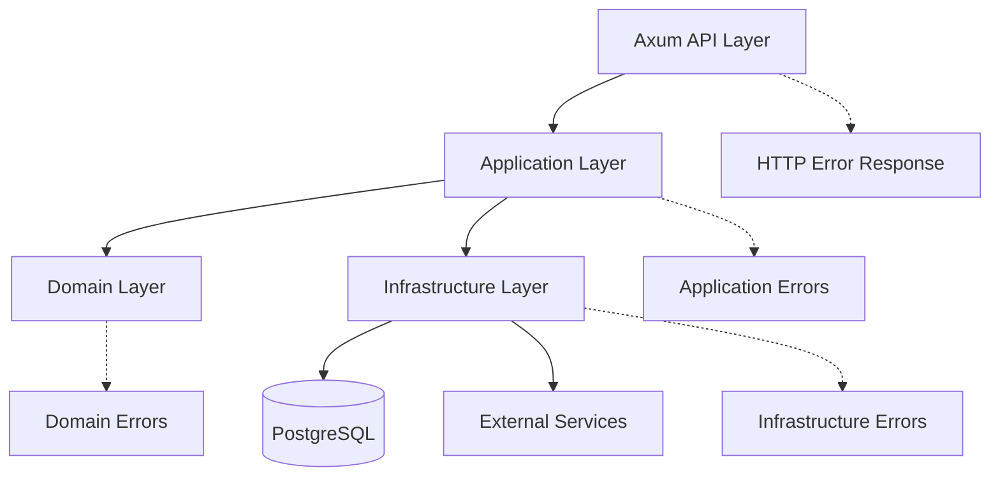

# Error Handling and Resilience

## 1. Purpose

Errors are part of every application.

The goal is not to prevent every error. The goal is to handle errors safely, consistently, and predictably.

This document defines how bio-com handles:

- Invalid requests.
- Business rule violations.
- Authentication and authorization failures.
- Database errors.
- External service failures.
- Timeouts.
- Transaction failures.
- Unexpected application errors.

The initial implementation uses Rust, Axum, PostgreSQL, and a modular monolith.

We keep the infrastructure lightweight. No Kafka, Redis, or distributed messaging system is required.

## 2. Error Handling Principles

The platform follows these principles.

### Fail Fast

Reject invalid input as early as possible.

Do not execute unnecessary operations when the request is already invalid.

### Handle Errors at the Right Layer

Each layer handles errors according to its responsibility.

- Domain: business rule violations.
- Application: use case and workflow failures.
- Infrastructure: database and external service failures.
- API: HTTP error responses.

### Never Hide Errors

Errors must not be silently ignored.

If an operation fails, the application must either handle the failure explicitly or propagate it.

### Do Not Expose Internal Details

API consumers should receive useful error messages without seeing SQL statements, stack traces, or infrastructure details.

### Preserve Data Consistency

A failed business operation must not leave the database in an invalid state.

### Recover When Safe

Retry temporary failures only when doing so cannot create duplicate operations or inconsistent business results.

## 3. Error Handling Architecture



Each layer defines errors meaningful to its responsibility.

Infrastructure errors should be translated before they reach the API.

## 4. Error Categories

We distinguish four main categories.

### 4.1 Domain Errors

Domain errors represent violations of business rules.

Examples:

- Product price cannot be negative.
- Order cannot be cancelled.
- Insufficient inventory.
- Refund amount exceeds the refundable balance.
- Payment cannot be captured in its current state.

These errors belong to the domain layer.

Example:

```rust
pub enum OrderError {
    OrderNotFound,
    InvalidOrderState,
    CancellationNotAllowed,
    EmptyOrder,
}
```

### 4.2 Application Errors

Application errors represent failures while executing a use case.

Examples:

- User is not authorized.
- Required resource does not exist.
- Duplicate operation.
- Required dependency is unavailable.
- Application workflow cannot continue.

Example:

```rust
pub enum ApplicationError {
    NotFound,
    Unauthorized,
    Forbidden,
    Conflict,
    Validation,
    DependencyUnavailable,
}
```

### 4.3 Infrastructure Errors

Infrastructure errors come from external technical dependencies.

Examples:

- Database connection failure.
- SQL execution failure.
- Transaction failure.
- Payment provider timeout.
- Email provider unavailable.

These errors must be translated into application-level errors when appropriate.

Do not expose SQLx or provider-specific errors to the domain layer.

### 4.4 Unexpected Errors

Unexpected errors include programming bugs and failures that were not anticipated.

Examples:

- Unexpected null values.
- Serialization failures.
- Internal invariant violations.
- Unhandled exceptions or panics.

These should be logged with diagnostic information and returned as generic internal errors.

## 5. Error Ownership by Layer

| Layer | Responsibility |
|---|---|
| Domain | Define business errors |
| Application | Coordinate use case errors |
| Infrastructure | Translate technical failures |
| API | Map errors to HTTP responses |

The same error should not be redefined independently in every layer.

Keep error types close to the responsibility that owns them.

## 6. HTTP Error Mapping

The API layer converts application errors into HTTP status codes.

| Application Error | HTTP Status |
|---|---|
| Validation | 400 |
| Unauthenticated | 401 |
| Forbidden | 403 |
| NotFound | 404 |
| Conflict | 409 |
| BusinessRuleViolation | 422 |
| RateLimited | 429 |
| DependencyUnavailable | 503 |
| Timeout | 504 |
| Internal | 500 |

The API must return a consistent response format.

Example:

```json
{
  "error": {
    "code": "ORDER_CANNOT_BE_CANCELLED",
    "message": "This order cannot be cancelled.",
    "details": [],
    "correlation_id": "request-123"
  }
}
```

Error codes should be stable and machine-readable.

Messages should be understandable to API consumers.

## 7. Database Error Handling

PostgreSQL is the primary data store.

Database failures must be handled carefully because they can affect business consistency.

### Common Failures

| Failure | Handling |
|---|---|
| Connection failure | Return service unavailable |
| Connection pool exhausted | Apply bounded waiting and timeout |
| Unique constraint violation | Return conflict |
| Foreign key violation | Return an appropriate domain or conflict error |
| Query timeout | Cancel or stop waiting for the operation |
| Transaction failure | Roll back |
| Database unavailable | Fail safely |

### Important Rule

Never return a successful response when the database operation has failed.

Do not silently ignore failed database writes.

### Connection Pool

Use a bounded SQLx connection pool.

Configure:

- Maximum connections.
- Connection acquisition timeout.
- Idle connection limits.
- Connection lifetime where appropriate.

Do not create a new database connection for every request.

## 8. Database Transactions

Transactions protect business consistency.

For example, placing an order may involve:

1. Creating the order.
2. Creating order items.
3. Recording the initial order state.
4. Recording the audit event.

These operations should be committed together when they belong to the same consistency boundary.

Example:

```rust
let mut tx = pool.begin().await?;

create_order(&mut tx, &order).await?;
create_order_items(&mut tx, &items).await?;
record_audit_event(&mut tx, &event).await?;

tx.commit().await?;
```

If an operation fails before commit, roll back the transaction.

### Transaction Rules

- Keep transactions short.
- Do not perform slow external HTTP calls inside database transactions.
- Avoid holding locks longer than necessary.
- Use database constraints as a final integrity safeguard.
- Use optimistic concurrency where appropriate.

## 9. Timeouts

Every external dependency must have a timeout.

An operation should not wait indefinitely.

Examples:

| Operation | Timeout Strategy |
|---|---|
| Database connection acquisition | Bounded |
| Database query | Configurable |
| Payment provider request | Bounded |
| Email provider request | Bounded |
| Internal application operation | Bounded where necessary |

Timeout values should be configurable according to the operation.

A timeout does not always mean the operation failed.

For example, a payment provider might have processed a payment but the response may have been lost.

In such cases, verify the payment status before attempting another operation.

## 10. Retry Strategy

Retries can help recover from temporary failures.

However, retries must be used carefully.

### Retryable Failures

Examples:

- Temporary network errors.
- Temporary database connection failures.
- Provider rate limits.
- Temporary external service unavailability.

### Non-Retryable Failures

Examples:

- Invalid request.
- Invalid credentials.
- Insufficient inventory.
- Business rule violation.
- Invalid payment information.

### Retry Rules

- Use a limited number of attempts.
- Apply exponential backoff.
- Add jitter to avoid synchronized retries.
- Respect provider retry instructions such as `Retry-After`.
- Set an overall operation deadline.
- Never retry non-idempotent operations without duplicate protection.

Example retry schedule:

| Attempt | Delay |
|---|---|
| 1 | Immediate |
| 2 | 200 ms |
| 3 | 500 ms |
| 4 | 1 second |

These values are illustrative and must be configured per dependency.

Do not retry indefinitely.

## 11. Idempotency and Duplicate Operations

Some operations must not execute more than once.

Examples:

- Creating an order.
- Initiating a payment.
- Processing a refund.
- Capturing a payment.

Use idempotency keys for supported API operations.

Store the following information:

- Idempotency key.
- Actor ID.
- Operation type.
- Request fingerprint.
- Processing status.
- Result reference.
- Creation timestamp.

Enforce uniqueness in PostgreSQL.

When the same request is received again, return the previously stored result.

If the same key is reused with a different payload, return a conflict.

Idempotency must be designed together with transaction boundaries.

## 12. External Service Failures

bio-com may communicate with external providers.

Examples:

- Payment providers.
- Email providers.
- Shipping providers.

External failures must not corrupt internal business state.

### Payment Example

A customer submits a payment.

The provider processes the payment, but the application times out before receiving the response.

The application must not immediately assume that the payment failed.

Instead:

1. Mark the payment outcome as unknown or pending verification.
2. Use the provider transaction reference or idempotency key to query the payment.
3. Reconcile the provider result.
4. Update the payment state.
5. Record the final result.

This avoids duplicate charges.

### Email Example

If an email fails to send, the order should not necessarily fail.

Email delivery is usually a secondary operation.

The system should record the failure and retry safely where appropriate.

A lightweight PostgreSQL-backed background job mechanism can be introduced if reliable asynchronous delivery becomes necessary.

## 13. Concurrency and Data Consistency

Multiple requests may attempt to update the same resource.

Examples:

- Two customers purchasing the last available product.
- Two requests cancelling the same order.
- Two administrators updating the same product.

The application must protect against conflicting operations.

Possible techniques:

- Database transactions.
- Unique constraints.
- Foreign keys.
- Optimistic locking.
- Row-level locking.
- Conditional updates.

### Example: Inventory

When reserving inventory, use an atomic database operation or an appropriate locking strategy.

Do not rely on:

1. Reading available quantity.
2. Checking quantity in application memory.
3. Updating quantity later without concurrency protection.

Two concurrent requests could otherwise oversell the same stock.

## 14. Circuit Breaker Considerations

A circuit breaker prevents repeated requests to an unhealthy external dependency.

For the initial version, we do not need a distributed circuit-breaker platform.

A lightweight in-process implementation may be introduced for dependencies where repeated failures are a real concern.

Possible states:

- CLOSED: Requests are allowed.
- OPEN: Requests are rejected temporarily.
- HALF_OPEN: A limited number of test requests are allowed.

Circuit breakers are especially useful for payment, shipping, and other external providers.

Do not add them to every internal function.

## 15. Correlation IDs

Every incoming request should receive a correlation ID.

The ID should be propagated through:

- API handlers.
- Application use cases.
- Infrastructure operations.
- Application logs.
- Audit events.
- External calls when supported.

Example:

```text
X-Correlation-ID: request-123
```

If a trusted client supplies an ID, validate its format and length before accepting it. Otherwise generate a new one.

Do not use correlation IDs as authentication tokens.

They are for tracing operations only.

## 16. Logging

Logs should help developers diagnose failures.

Use structured logging.

Recommended fields:

- Timestamp.
- Log level.
- Correlation ID.
- Module.
- Operation.
- Error code.
- Relevant resource ID.

Example:

```json
{
  "level": "ERROR",
  "module": "orders",
  "operation": "create_order",
  "error_code": "DATABASE_UNAVAILABLE",
  "correlation_id": "request-123"
}
```

Never log:

- Passwords.
- Session tokens.
- Payment card details.
- API secrets.
- Sensitive customer information.

Use appropriate log levels:

| Level | Usage |
|---|---|
| TRACE | Detailed development diagnostics |
| DEBUG | Debugging information |
| INFO | Normal application events |
| WARN | Recoverable or suspicious conditions |
| ERROR | Failed operations |

## 17. Graceful Shutdown

The application must shut down safely.

When receiving a termination signal:

1. Stop accepting new requests.
2. Allow in-flight requests a bounded period to finish.
3. Stop accepting new background jobs.
4. Finish or safely release active work.
5. Close database connections.
6. Exit cleanly.

Do not terminate the process while critical business operations are left in an unknown state.

## 18. Health Checks

Expose health endpoints for deployment and monitoring.

### Liveness

```text
GET /health/live
```

Indicates whether the application process is running.

It should not fail simply because PostgreSQL is temporarily unavailable.

### Readiness

```text
GET /health/ready
```

Indicates whether the application is ready to receive traffic.

It should verify critical dependencies, including database availability.

Health endpoints must not expose credentials, internal configuration, or detailed infrastructure information.

## 19. Testing Strategy

### Unit Tests

- Domain error handling.
- Business rule violations.
- Retry decision logic.
- State transitions.
- Idempotency behavior.

### Integration Tests

- Database connection failures.
- Transaction rollback.
- Constraint violations.
- Concurrent updates.
- Session persistence.

### Failure Scenario Tests

- Payment provider timeout.
- Email provider unavailable.
- Database unavailable.
- Duplicate payment request.
- Application shutdown during a request.

### Concurrency Tests

Test simultaneous operations against the same resource.

For example, attempt to purchase the last available product using multiple concurrent requests.

The final inventory must never become negative.

## 20. Initial Technology Decisions

| Responsibility | Technology |
|---|---|
| Language | Rust |
| HTTP | Axum |
| Async runtime | Tokio |
| Database | PostgreSQL |
| Database access | SQLx |
| Error types | thiserror |
| Error propagation | Result |
| Logging and tracing | tracing |
| Serialization | Serde |
| Retry | Lightweight application implementation |
| Idempotency | PostgreSQL |
| Background processing | Tokio initially |
| Distributed messaging | Not required |

## 21. Key Design Decisions

1. Errors are defined according to layer responsibility.
2. Domain errors represent business rule violations.
3. Infrastructure errors must not leak into the domain.
4. API errors follow a consistent response format.
5. Database transactions protect business consistency.
6. External calls must have bounded timeouts.
7. Retries are limited and use backoff with jitter.
8. Non-idempotent operations must not be retried blindly.
9. PostgreSQL provides the initial persistence mechanism for idempotency.
10. Concurrency is protected using database transactions and constraints.
11. Correlation IDs connect logs and audit events.
12. Graceful shutdown protects in-flight operations.
13. Health checks distinguish liveness from readiness.
14. No distributed infrastructure is required initially.

---

**Main principle:** Fail safely, preserve business consistency, and recover only when it is safe to do so.
