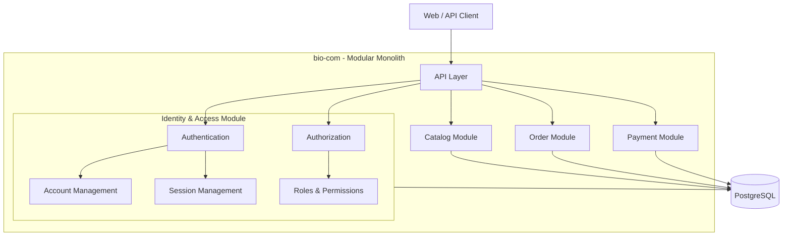
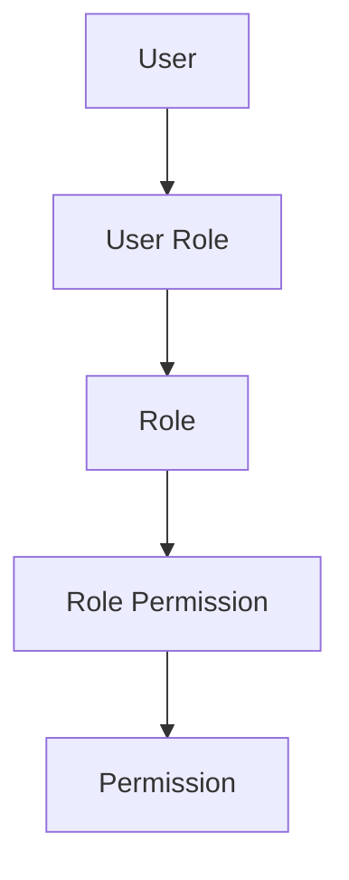

# Identity and Access

## 1. Purpose

The Identity and Access module is responsible for managing user identities and controlling access to the bio-com platform.

It answers two important questions:

- **Authentication (AuthN):** Who are you?
- **Authorization (AuthZ):** What are you allowed to do?

For example:

A customer can log in, view their orders, and manage their profile.

An administrator can manage products, categories, and customer accounts.

Both users access the same platform, but they have different permissions.

## 2. Design Goals

The Identity and Access module must:

- Support customer registration and login.
- Manage user accounts.
- Securely store passwords.
- Manage roles and permissions.
- Authenticate users for protected operations.
- Control access to application resources.
- Support logout and session revocation.
- Keep security rules separate from other business modules.

The design should remain simple initially while allowing future improvements.

## 3. Architecture

Identity and Access is a dedicated module inside the bio-com modular monolith.

It is not a separate microservice for now.

It owns its business logic, application use cases, and persistence.

Other modules must not directly access Identity's internal implementation.

They should use its exposed application interfaces to obtain the authenticated user's identity and perform authorization checks where required.

## 4. Authentication (AuthN)

Authentication verifies the identity of a user.

### 4.1 Registration

A new customer can create an account using:

- Email address.
- Password.
- First name.
- Last name.

Registration flow:

1. Receive registration information.
2. Validate the input.
3. Check whether the email is already registered.
4. Hash the password using Argon2id.
5. Create the user account.
6. Persist the account in PostgreSQL.
7. Return the registration result.

Passwords must never be stored as plain text.

### 4.2 Login

Users authenticate using their email and password.

Login flow:

1. Receive email and password.
2. Find the account.
3. Check that the account is active.
4. Verify the password hash.
5. Create a new session.
6. Generate a cryptographically secure random session token.
7. Store only the hash of the session token.
8. Return the session cookie.

The session cookie must use:

- HttpOnly.
- Secure.
- SameSite.
- An appropriate expiration time.

### 4.3 Logout

When a user logs out:

1. Identify the current session.
2. Revoke the session.
3. Remove or invalidate the session cookie.

A revoked session must no longer grant access.

### 4.4 Password Security

Password management must follow these rules:

- Use Argon2id for password hashing.
- Never store plain-text passwords.
- Never log passwords or session tokens.
- Use generic login error messages.
- Apply login rate limiting.
- Support password changes.
- Revoke existing sessions when required by security policy.

## 5. Authorization (AuthZ)

Authorization determines whether an authenticated user can perform an operation.

For example:

- A customer can view their own orders.
- An administrator can manage products.
- A support agent can access customer support information.
- Only authorized users can perform administrative operations.

### 5.1 Role-Based Access Control (RBAC)

The initial authorization model uses Role-Based Access Control.

A user receives one or more roles.

Each role contains a set of permissions.

Permissions determine which operations the user can perform.

### 5.2 Initial Roles

| Role | Responsibilities |
|---|---|
| CUSTOMER | Manage profile and personal orders |
| ADMIN | Manage platform operations |
| SUPPORT | Access customer support operations |

These are initial roles. More roles can be introduced when business requirements justify them.

### 5.3 Initial Permissions

Permissions should describe business actions rather than technical endpoints.

Examples:

| Permission | Description |
|---|---|
| profile:read | View profile |
| profile:update | Update profile |
| order:create | Create an order |
| order:read_own | View own orders |
| order:read_all | View all orders |
| product:read | View products |
| product:create | Create products |
| product:update | Update products |
| product:delete | Delete products |
| user:read | View user accounts |
| user:update | Update user accounts |
| role:manage | Manage roles and permissions |

A role receives only the permissions required for its responsibilities.

## 6. Resource Ownership

Having a valid role does not automatically mean a user can access every resource.

The application must also verify resource ownership.

For example:

A customer requests:

`GET /orders/123`

The system must verify:

1. The user is authenticated.
2. The user has permission to read an order.
3. The requested order belongs to that user.

An administrator with the appropriate permission may access orders belonging to other customers.

This prevents users from accessing another customer's information by changing an ID in the request.

## 7. Session Management

The initial implementation uses database-backed sessions.

We do not need Redis or an external identity provider.

### Session lifecycle

- Create a session after successful login.
- Associate the session with a user.
- Set an expiration time.
- Validate the session on protected requests.
- Revoke the session during logout.
- Revoke sessions when required by account security policies.

### Session storage

Each session contains:

- Session ID.
- User ID.
- Token hash.
- Created timestamp.
- Expiration timestamp.
- Revocation timestamp.

The raw session token is returned to the client only once and is never stored in the database.

PostgreSQL is the source of truth for session validity.

## 8. Data Model

The Identity module owns the following tables.

### users

Stores user account information.

| Field | Description |
|---|---|
| id | Unique user ID |
| email | Unique email address |
| password_hash | Argon2id password hash |
| first_name | First name |
| last_name | Last name |
| status | Account status |
| email_verified_at | Email verification timestamp |
| created_at | Creation timestamp |
| updated_at | Last update timestamp |

### roles

Stores available roles.

| Field | Description |
|---|---|
| id | Unique role ID |
| name | Role name |
| description | Role description |
| created_at | Creation timestamp |

### permissions

Stores available permissions.

| Field | Description |
|---|---|
| id | Unique permission ID |
| code | Unique permission code |
| description | Permission description |

### user_roles

Connects users to roles.

| Field | Description |
|---|---|
| user_id | User ID |
| role_id | Role ID |

### role_permissions

Connects roles to permissions.

| Field | Description |
|---|---|
| role_id | Role ID |
| permission_id | Permission ID |

### sessions

Stores active and revoked sessions.

| Field | Description |
|---|---|
| id | Unique session ID |
| user_id | Associated user |
| token_hash | Hashed session token |
| created_at | Creation timestamp |
| expires_at | Expiration timestamp |
| revoked_at | Revocation timestamp |

Use foreign keys, unique constraints, and indexes to protect data integrity and support efficient lookups.

## 9. Clean Architecture

Identity follows the same Clean Architecture principles as the rest of bio-com.

The business rules must not depend on PostgreSQL, Axum, or external libraries.

### Domain Layer

Contains:

- User.
- Role.
- Permission.
- Session.
- Domain rules.
- Domain errors.

The domain layer does not know about HTTP, SQLx, or cookies.

### Application Layer

Contains use cases:

- RegisterUser.
- LoginUser.
- LogoutUser.
- ChangePassword.
- GetCurrentUser.
- AssignRole.
- RevokeSession.
- CheckPermission.

It defines the ports required by the application.

Examples:

- UserRepository.
- SessionRepository.
- PasswordHasher.
- SessionTokenGenerator.
- Clock.

### Infrastructure Layer

Implements the application ports.

Examples:

- PostgreSQL repositories using SQLx.
- Argon2id password hashing.
- Cryptographically secure token generation.
- Session persistence.

### API Layer

Uses Axum to expose HTTP endpoints.

Responsibilities:

- Request validation.
- Cookie handling.
- Authentication middleware.
- Calling application use cases.
- Mapping application errors to HTTP responses.

## 10. API Endpoints

Initial HTTP endpoints:

| Method | Endpoint | Description |
|---|---|---|
| POST | /api/v1/auth/register | Register account |
| POST | /api/v1/auth/login | Authenticate user |
| POST | /api/v1/auth/logout | Revoke current session |
| GET | /api/v1/auth/me | Get current user |
| POST | /api/v1/auth/change-password | Change password |
| GET | /api/v1/users/{id} | Get user information |
| PATCH | /api/v1/users/{id} | Update user information |
| GET | /api/v1/admin/roles | List roles |
| POST | /api/v1/admin/roles | Create role |
| PUT | /api/v1/admin/roles/{id}/permissions | Update role permissions |

Administrative endpoints must require appropriate permissions.

## 11. Security Requirements

The initial implementation must include:

| Area | Requirement |
|---|---|
| Passwords | Argon2id hashing |
| Sessions | Cryptographically secure random tokens |
| Token storage | Store token hashes only |
| Cookies | HttpOnly, Secure, SameSite |
| CSRF | Protection for cookie-authenticated state-changing requests |
| Authorization | RBAC and permission checks |
| Ownership | Verify access to individual resources |
| Login | Rate limiting and generic error messages |
| Account status | Reject disabled accounts |
| Database | Parameterized queries and least-privilege access |
| Logging | Never expose passwords, tokens, or sensitive credentials |

Rate limiting can initially be implemented inside the application with PostgreSQL-backed persistence where needed. It does not require Redis.

## 12. Error Handling

Use consistent application errors.

Examples:

| Error | Meaning |
|---|---|
| InvalidCredentials | Email or password is incorrect |
| AccountDisabled | Account is disabled |
| EmailAlreadyExists | Email is already registered |
| SessionExpired | Session has expired |
| SessionRevoked | Session has been revoked |
| Unauthenticated | User is not authenticated |
| PermissionDenied | User lacks the required permission |
| ResourceNotOwned | User does not own the resource |

Map these errors to appropriate HTTP status codes without exposing internal implementation details.

## 13. Testing Strategy

Identity and Access requires several levels of testing.

### Unit Tests

Test business rules:

- User registration validation.
- Password verification.
- Account status checks.
- Role assignment.
- Permission evaluation.
- Session expiration.
- Session revocation.

### Integration Tests

Test infrastructure:

- User persistence.
- Session persistence.
- Password hashing.
- Repository behavior.
- Database constraints.

### API Tests

Test complete authentication and authorization flows:

- Register and log in.
- Access protected endpoints.
- Access endpoints without authentication.
- Access resources belonging to another customer.
- Attempt administrative operations without permission.
- Log out and reuse a revoked session.

## 14. Infrastructure Decisions

Keep the first implementation lightweight.

| Component | Decision |
|---|---|
| Language | Rust |
| HTTP | Axum |
| Async runtime | Tokio |
| Database | PostgreSQL |
| Database access | SQLx |
| Password hashing | Argon2id |
| Authentication | Database-backed sessions |
| Authorization | RBAC |
| Token storage | Hashed random tokens |
| Cache | Not required initially |
| Message broker | Not required |
| Identity provider | Not required initially |

The module should run as part of the bio-com application.

## 15. Future Improvements

The design should allow future improvements without changing the core business rules.

Possible additions:

- Email verification.
- Password reset.
- Multi-factor authentication (MFA).
- Account lockout policies.
- Audit logs.
- Fine-grained resource permissions.
- OAuth2 / OpenID Connect integration.
- External identity providers.
- Session management across multiple devices.

These features should be introduced when there is a real business requirement.

## 16. Key Design Decisions

1. Identity and Access is a dedicated module inside the modular monolith.
2. Authentication and authorization are handled by the same module but remain separate responsibilities.
3. Passwords are hashed using Argon2id.
4. Sessions are persisted in PostgreSQL.
5. Session tokens are random and only their hashes are stored.
6. Authorization initially uses RBAC.
7. Resource ownership is checked separately from role permissions.
8. Other modules use exposed application interfaces rather than accessing Identity's internal implementation.
9. Clean Architecture keeps business rules independent of infrastructure.
10. No external identity provider or heavy infrastructure is required initially.

---

**Main principle:** Authentication establishes who the user is. Authorization determines what the user can do. Resource ownership determines which specific data the user can access.
