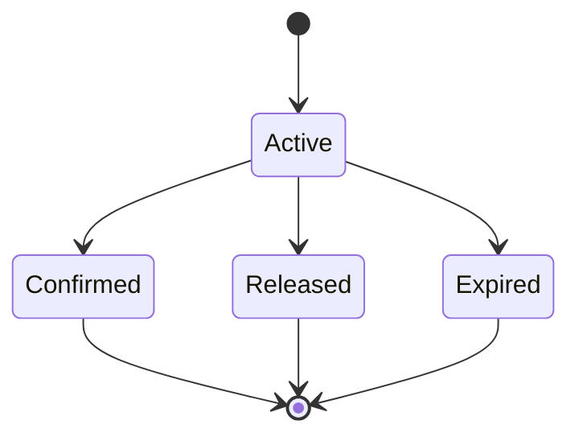
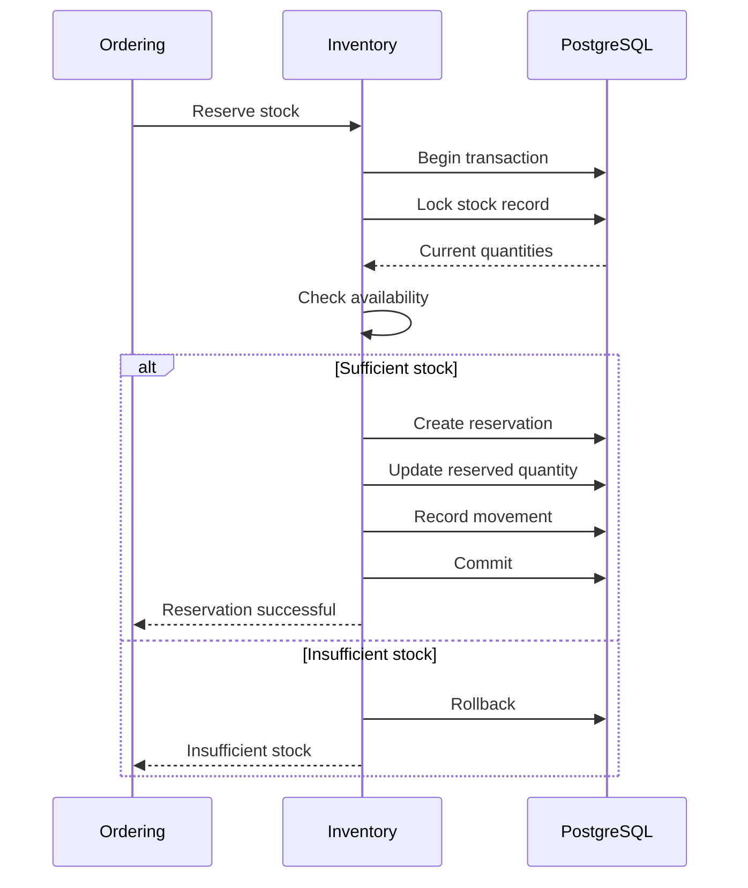

# bio-com — Inventory Management

## 1. Purpose

The Inventory context manages the products physically available for sale.

It answers important business questions:

- How many products do we have?
- How many are available for sale?
- How many are reserved for customer orders?
- Where is the stock located?
- Which products belong to a specific production batch?
- What happened to the stock over time?

The main goal is to keep inventory accurate and prevent customers from purchasing products that are no longer available.

## 2. Main Concepts

We need to distinguish between several inventory quantities.

### 2.1 Physical Stock

The actual quantity available in the warehouse.

Example:

We physically have 100 bottles of olive oil.

### 2.2 Reserved Stock

The quantity temporarily allocated to customer orders.

Example:

Customers have reserved 20 bottles.

### 2.3 Available Stock

The quantity that can still be sold.

Formula:

`Available Stock = Physical Stock - Reserved Stock`

Example:

| Quantity | Amount |
|---|---:|
| Physical stock | 100 |
| Reserved stock | 20 |
| Available stock | 80 |

The platform must never allow available stock to become negative.

### 2.4 Damaged Stock

Products that cannot be sold because they are damaged or unsuitable.

We will track damaged quantities separately.

The business must define whether damaged stock is included in physical stock or recorded as a separate inventory status. Our initial model will treat it as a separate stock category, excluded from sellable availability.

## 3. Inventory Domain Model

The Inventory context will contain the following main aggregates.

| Aggregate | Responsibility |
|---|---|
| StockItem | Manage quantities for a product variant at a location |
| StockReservation | Reserve stock for an order |
| InventoryMovement | Record stock changes |
| Warehouse | Manage stock locations |

ProductBatch belongs to the Traceability context.

Inventory references its BatchId when stock must be tracked by production batch.

## 4. StockItem Aggregate

### 4.1 Responsibility

StockItem represents the inventory of one product variant at one warehouse or stock location.

Example:

Product: Organic Olive Oil

Variant: 500 ml

Warehouse: Main Warehouse

Physical quantity: 100

Reserved quantity: 20

Available quantity: 80

### 4.2 Main Attributes

- StockItemId
- VariantId
- WarehouseId
- PhysicalQuantity
- ReservedQuantity
- DamagedQuantity
- Version

The Version field supports optimistic concurrency if we choose that approach for specific operations.

### 4.3 Business Rules

- Physical quantity cannot be negative.
- Reserved quantity cannot exceed sellable physical quantity.
- Available quantity cannot be negative.
- Damaged products cannot be reserved.
- Stock adjustments must be recorded.
- Stock quantities must remain consistent.

### 4.4 Stock Operations

StockItem supports:

- Receive stock.
- Reserve stock.
- Release reserved stock.
- Deduct confirmed stock.
- Record damaged stock.
- Correct stock discrepancies.

## 5. Stock Reservation

### 5.1 Why Reservations Are Needed

Imagine we have only one bottle of olive oil.

Two customers try to buy it at almost the same time.

Without reservations, both customers might see one bottle available and both complete checkout.

This creates an overselling problem.

A reservation temporarily allocates stock to one order.

### 5.2 Reservation Information

A reservation contains:

- ReservationId
- OrderId
- VariantId
- WarehouseId
- Quantity
- Status
- CreatedAt
- ExpiresAt

### 5.3 Reservation Lifecycle



### 5.4 Reservation Rules

- Quantity must be greater than zero.
- Available stock must be sufficient.
- A reservation must reference an order.
- A reservation cannot be confirmed twice.
- Released reservations cannot be confirmed.
- Expired reservations cannot be confirmed.
- Repeated requests must not create duplicate reservations.

### 5.5 Reservation Expiration

Reservations should not remain active forever.

Example:

A customer starts checkout but never completes payment.

The reservation expires after the configured period.

The reserved quantity is released and becomes available again.

The expiration duration will be configurable.

## 6. Stock Movements

Every important stock change must be recorded.

We need an inventory movement history to understand how quantities changed.

### 6.1 Movement Types

| Movement | Description |
|---|---|
| StockReceived | New products arrive |
| StockReserved | Products allocated to an order |
| ReservationReleased | Reserved quantity becomes available |
| StockDeducted | Products leave physical inventory |
| StockReturned | Products are returned |
| StockDamaged | Products become unsellable |
| StockAdjusted | Inventory correction |

### 6.2 Movement Information

Each movement should contain:

- MovementId
- VariantId
- WarehouseId
- BatchId, when applicable
- MovementType
- Quantity
- ReferenceId
- Reason
- CreatedAt

### 6.3 Example

Initial stock: 100 bottles.

| Operation | Change | Physical | Reserved |
|---|---:|---:|---:|
| Receive stock | +100 | 100 | 0 |
| Reserve order A | Reserve 10 | 100 | 10 |
| Reserve order B | Reserve 5 | 100 | 15 |
| Confirm order A | Deduct 10 | 90 | 5 |
| Release order B | Release 5 | 90 | 0 |

Available stock after the last operation: 90.

The movement history must allow us to understand these changes.

## 7. Warehouse Management

A warehouse represents a physical or logical location where products are stored.

Initial capabilities:

- Create warehouse.
- Update warehouse information.
- Activate or deactivate warehouse.
- Track stock by warehouse.
- Receive stock.
- Transfer stock between warehouses.

Each StockItem belongs to a specific warehouse and product variant.

For the first release, we can operate with one warehouse while keeping the model ready for multiple locations.

## 8. Batch-Level Inventory

Some products require batch tracking.

Examples:

- Olive oil.
- Honey.
- Herbal products.

A batch provides information about product origin and production.

Example:

| Field | Value |
|---|---|
| Batch number | OLIVE-2026-001 |
| Product | Organic Olive Oil |
| Variant | 500 ml |
| Origin | Production Region A |
| Production date | 2026-08-15 |
| Expiration date | 2028-08-15 |

Inventory records should identify the batch associated with received stock.

This allows the business to:

- Track product origin.
- Identify affected batches.
- Apply expiration policies.
- Support product recalls.
- Use FIFO or FEFO stock allocation where appropriate.

**FIFO:** First In, First Out.

**FEFO:** First Expired, First Out.

For products with expiration dates, FEFO is generally the preferred allocation strategy.

## 9. Preventing Overselling

This is one of the most important technical requirements.

Checking available stock in Rust and then updating it later is not sufficient.

Two requests could read the same quantity before either writes an update.

PostgreSQL must protect the operation.

### 9.1 PostgreSQL Row-Level Locking

We can use a transaction with `SELECT ... FOR UPDATE`.

Conceptual example:

```sql
BEGIN;

SELECT physical_quantity, reserved_quantity
FROM inventory.stock_items
WHERE variant_id = $1
  AND warehouse_id = $2
FOR UPDATE;

-- Validate available quantity.

UPDATE inventory.stock_items
SET reserved_quantity = reserved_quantity + $3
WHERE variant_id = $1
  AND warehouse_id = $2;

COMMIT;
```

The row lock prevents another transaction from modifying the same stock record concurrently.

Production implementation must also validate the reservation request and record its reservation and movement atomically.

### 9.2 Atomic Conditional Update

Another option is an atomic conditional update:

```sql
UPDATE inventory.stock_items
SET reserved_quantity = reserved_quantity + $3
WHERE variant_id = $1
  AND warehouse_id = $2
  AND physical_quantity - reserved_quantity >= $3
RETURNING *;
```

If no row is returned, there is insufficient stock.

This is a useful approach because PostgreSQL performs the availability check and update atomically.

We will choose the final implementation based on the reservation and batch-allocation requirements.

### 9.3 Database Constraints

We should also use database constraints to protect important invariants.

Examples:

- Physical quantity must be non-negative.
- Reserved quantity must be non-negative.
- Reserved quantity cannot exceed physical quantity.

Database constraints provide an additional layer of protection.

## 10. Stock Reservation Workflow



All reservation-related changes must succeed together or be rolled back.

## 11. Stock Reconciliation

Inventory quantities may differ from actual warehouse quantities.

For example:

- Damaged products were not recorded.
- A stock movement was missed.
- A counting mistake occurred.
- Returned products were not registered.

We need a reconciliation process.

Responsibilities:

- Compare recorded stock with physical stock.
- Identify discrepancies.
- Record adjustments.
- Require an authorized user to approve sensitive adjustments.
- Preserve the adjustment history.

Stock must never be silently changed.

## 12. Returns and Restocking

When a customer returns a product, it should not automatically become available for sale.

The returned product must be inspected.

Possible outcomes:

| Condition | Inventory Action |
|---|---|
| Good condition | Restock |
| Damaged | Move to damaged stock |
| Expired | Exclude from sellable stock |
| Requires inspection | Keep unavailable pending inspection |

Inventory should be updated only after the return inspection process determines the correct outcome.

## 13. PostgreSQL Schema Direction

We will use a dedicated PostgreSQL schema for Inventory.

Initial tables:

| Table | Purpose |
|---|---|
| inventory.warehouses | Warehouse information |
| inventory.stock_items | Stock by variant and location |
| inventory.stock_reservations | Reservation records |
| inventory.inventory_movements | Stock movement history |

Traceability tables will belong to the Traceability context.

Foreign references to other contexts should use identifiers rather than direct database ownership.

Example:

`inventory.stock_items.variant_id` references the Catalog identifier logically, without allowing Inventory to own Catalog data.

## 14. Rust Implementation Direction

The domain layer should contain plain Rust types.

Example:

```rust
pub struct StockItem {
    id: StockItemId,
    variant_id: VariantId,
    warehouse_id: WarehouseId,
    physical_quantity: Quantity,
    reserved_quantity: Quantity,
}

impl StockItem {
    pub fn available_quantity(&self) -> Quantity {
        self.physical_quantity
            .subtract(self.reserved_quantity)
    }

    pub fn reserve(
        &mut self,
        quantity: Quantity,
    ) -> Result<(), InventoryError> {
        if quantity.is_zero() {
            return Err(InventoryError::InvalidQuantity);
        }

        if self.available_quantity() < quantity {
            return Err(InventoryError::InsufficientStock);
        }

        self.reserved_quantity =
            self.reserved_quantity.add(quantity);

        Ok(())
    }
}
```

This is an illustrative domain example. The production implementation must also protect the database operation against concurrent requests.

The domain layer must not depend on SQLx or Axum.

## 15. Testing Strategy

Inventory requires strong automated tests.

### Unit Tests

- Reserve available stock.
- Reject insufficient stock.
- Reject zero quantity.
- Release reservation.
- Prevent double confirmation.
- Prevent negative stock.
- Handle expired reservations.

### Integration Tests

- Reserve stock using PostgreSQL.
- Roll back failed reservations.
- Record stock movements.
- Confirm stock deduction.
- Release stock correctly.
- Verify database constraints.

### Concurrency Tests

Simulate multiple customers trying to reserve the same limited stock.

Expected result:

Only requests that fit within the available quantity should succeed.

Example:

Available stock: 10.

Concurrent requests:

- Customer A: 7.
- Customer B: 5.
- Customer C: 3.

The system must never reserve more than 10 units.

## 16. Initial Design Decisions

| Area | Decision |
|---|---|
| Inventory ownership | Inventory context |
| Stock tracking | Variant and warehouse |
| Physical stock | Tracked separately from reservations |
| Reservations | Separate lifecycle |
| Stock movements | Recorded |
| Concurrency | PostgreSQL transactions |
| Overselling protection | Atomic updates or row locks |
| Batch tracking | Traceability context |
| Expiration | FEFO support |
| Multiple warehouses | Supported by model |
| Reconciliation | Auditable adjustments |
| Infrastructure | PostgreSQL only initially |

## 17. Summary

Inventory management must provide accurate stock information and protect the business against overselling.

The most important concepts are:

- Physical stock.
- Reserved stock.
- Available stock.
- Stock movements.
- Reservations.
- Warehouse locations.
- Product batches.
- Concurrency protection.
- Reconciliation.

PostgreSQL will provide the transactional guarantees needed for the initial implementation.

We will keep the design simple while ensuring that the important business rules are protected.

---

**Project:** bio-com  
**Context:** Inventory  
**Language:** Rust  
**Architecture:** DDD + Clean Architecture  
**Database:** PostgreSQL
