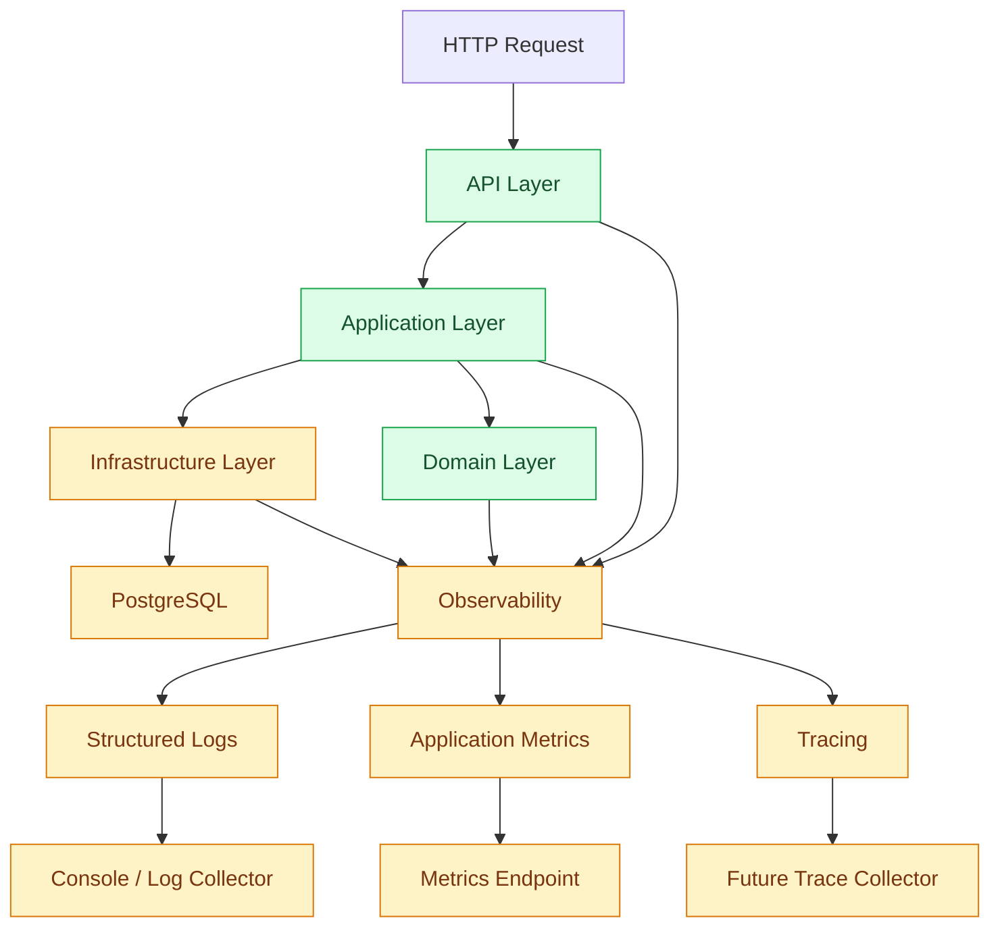

# Observability and Logging

## 1. Purpose

Observability helps us understand what is happening inside an application.

When something goes wrong, we need to answer questions such as:

- Which request failed?
- Which module caused the problem?
- How long did the operation take?
- Did the database respond correctly?
- Did an external API fail?
- How many background jobs are waiting?
- Is the application healthy?

For `bio-com`, observability should be built into the application from the beginning.

We want to detect problems, understand their causes, and troubleshoot them without adding unnecessary infrastructure.

## 2. What Is Observability?

Observability is the ability to understand an application's internal behavior through the information it produces.

It has three main pillars.

| Pillar | Purpose | Example |
|---|---|---|
| Logs | Explain what happened | Order creation failed |
| Metrics | Measure system behavior | Request latency |
| Traces | Follow an operation through components | API → Application → Database |

These three pillars complement each other.

### Logs

Logs describe individual events.

Example:

```text
ERROR order creation failed
order_id=123
reason=inventory_unavailable
```

### Metrics

Metrics show numerical information about application behavior.

Example:

```text
http_requests_total = 1500
http_request_duration = 120ms
```

### Traces

Traces show how an operation moves through the application.

Example:

```text
Place Order
    |
    +---- Load Customer
    |
    +---- Validate Order
    |
    +---- Check Inventory
    |
    +---- Save Order
```

## 3. Architecture

For the initial version, observability runs inside the application.



Observability should not contain business logic.

It collects information about application execution without changing business behavior.

## 4. Technology Choices

Use the following Rust ecosystem.

| Technology | Responsibility | Priority |
|---|---|---|
| `tracing` | Structured application instrumentation | Initial |
| `tracing-subscriber` | Collect and format logs | Initial |
| `tracing-appender` | Optional file-based logging | When needed |
| `metrics` | Application metrics | Initial foundation |
| `metrics-exporter-prometheus` | Expose metrics for Prometheus | When needed |
| `tracing-opentelemetry` | OpenTelemetry integration | Future |
| `opentelemetry-otlp` | Export traces through OTLP | Future |

We do not need to deploy Prometheus, Grafana, Jaeger, or an OpenTelemetry Collector immediately.

## 5. Structured Logging

Structured logging records information in a consistent format.

Instead of writing:

```rust
println!("Order creation failed");
```

Use:

```rust
tracing::error!(
    order_id = %order_id,
    error = %error,
    "Order creation failed"
);
```

This makes logs easier to search and analyze.

### Log levels

Use consistent log levels.

| Level | Purpose | Example |
|---|---|---|
| ERROR | Operation failed | Database transaction failed |
| WARN | Unexpected but recoverable condition | Retry scheduled |
| INFO | Important application event | Order placed |
| DEBUG | Detailed troubleshooting | Repository operation |
| TRACE | Very detailed execution information | Internal processing steps |

Avoid logging every operation at INFO level.

Production logging should normally use INFO as the default, with DEBUG and TRACE enabled only when troubleshooting requires them.

## 6. Log Format

Use structured JSON logs in production.

Example:

```json
{
  "timestamp": "2026-11-05T14:00:00Z",
  "level": "INFO",
  "target": "bio_com::ordering",
  "message": "Order placed",
  "order_id": "order-123",
  "customer_id": "customer-456",
  "correlation_id": "request-789"
}
```

JSON makes logs easier to process with future log collection systems.

For local development, human-readable console output is also useful.

## 7. Correlation IDs

A correlation ID connects related operations.

Consider a customer placing an order.

The request may trigger:

- An API handler.
- An application command.
- Several repository operations.
- Domain event handling.
- Background jobs.

All these operations should be traceable through a shared correlation ID where appropriate.

Example:

```text
Request: request-123
    |
    +---- API Handler
    |
    +---- Order Command
    |
    +---- Order Repository
    |
    +---- Domain Event Handler
    |
    +---- Background Job
```

Every related log should include the appropriate correlation information.

### Important distinction

A correlation ID is not the same as a trace ID.

- Correlation ID connects related business operations.
- Trace ID identifies a distributed trace.
- Span ID identifies an individual operation within a trace.

Use separate fields when both concepts are needed.

For asynchronous processing, persist the correlation ID with the job or outbox message so that later processing can be linked to the original operation.

## 8. Request Logging

Every HTTP request should produce useful information.

Recommended fields:

- HTTP method.
- Request path.
- HTTP status code.
- Request duration.
- Correlation ID.
- Trace ID when available.
- Client information when appropriate.

Example:

```text
INFO http_request_completed
method=POST
path=/api/v1/orders
status=201
duration_ms=85
correlation_id=request-123
```

Do not log:
- Passwords.
- Authentication tokens.
- Session cookies.
- Payment card information.
- Sensitive personal information.
- Complete request bodies by default.

## 9. Application Instrumentation

Use `tracing` spans to understand application execution.

Example:

```rust
#[tracing::instrument(
    skip(self),
    fields(order_id = %order_id)
)]
pub async fn place_order(
    &self,
    order_id: OrderId,
) -> Result<(), ApplicationError> {
    tracing::info!("Processing order placement");

    // Application workflow.

    Ok(())
}
```

A span represents an operation and can contain nested spans.

Recommended instrumentation locations:

- API request handlers.
- Application command handlers.
- Query handlers.
- Repository operations.
- External API calls.
- Event dispatching.
- Background job execution.

Avoid excessive instrumentation of trivial functions.

## 10. Error Logging

Errors should provide enough information to understand what happened.

Example:

```rust
match order_repository.save(&order).await {
    Ok(()) => {
        tracing::info!(
            order_id = %order.id(),
            "Order saved"
        );
    }
    Err(error) => {
        tracing::error!(
            order_id = %order.id(),
            error = %error,
            "Failed to save order"
        );

        return Err(error.into());
    }
}
```

Follow these rules:

1. Log errors at the appropriate application boundary.
2. Preserve the original error context.
3. Avoid logging the same error repeatedly at every layer.
4. Do not expose internal database errors to API consumers.
5. Return safe, meaningful error responses.
6. Include correlation information for troubleshooting.

Use typed application errors rather than relying entirely on string messages.

## 11. Application Metrics

Metrics help identify performance and reliability problems.

For `bio-com`, start with a small set of useful metrics.

### HTTP metrics

| Metric | Description |
|---|---|
| http_requests_total | Total HTTP requests |
| http_request_duration_seconds | Request duration |
| http_requests_in_flight | Active HTTP requests |

### Database metrics

| Metric | Description |
|---|---|
| db_pool_connections | Database connections |
| db_pool_idle_connections | Idle connections |
| db_query_duration_seconds | Query duration |
| db_errors_total | Database errors |

### Background job metrics

| Metric | Description |
|---|---|
| jobs_pending_total | Pending jobs |
| jobs_processing_total | Processing jobs |
| jobs_failed_total | Failed jobs |
| jobs_retried_total | Retried jobs |
| job_execution_duration_seconds | Execution duration |

### Business metrics

Examples:

- Orders placed.
- Orders cancelled.
- Payments completed.
- Refunds processed.

Business metrics should not expose sensitive customer information.

## 12. Metric Cardinality

Metric labels must have controlled values.

Good example:

```text
http_requests_total{
    method="POST",
    route="/api/v1/orders",
    status="201"
}
```

Bad example:

```text
http_requests_total{
    customer_id="123456",
    order_id="987654"
}
```

Why?

Every unique label combination creates another time series.

Using customer IDs, order IDs, or arbitrary request IDs as metric labels can create extremely high cardinality.

Use logs and traces for individual identifiers.

Use metrics for aggregated measurements.

## 13. Health Checks

The application should expose health endpoints.

We need two main checks.

### Liveness

```http
GET /health/live
```

Answers:

Is the application process running?

This endpoint should not depend on PostgreSQL availability.

### Readiness

```http
GET /health/ready
```

Answers:

Can the application accept requests?

The readiness check can verify:
- Application initialization completed.
- PostgreSQL connectivity is available.
- Required dependencies are ready.

Do not make readiness checks perform expensive database queries.

### Example responses

Liveness:

```json
{
  "status": "healthy"
}
```

Readiness:

```json
{
  "status": "ready",
  "dependencies": {
    "postgresql": "healthy"
  }
}
```

Return an appropriate non-success HTTP status when the application cannot accept traffic.

Avoid exposing database credentials, connection strings, or internal infrastructure details.

## 14. Database Observability

Database operations are an important part of application performance.

Monitor:

- Connection pool usage.
- Query execution time.
- Slow queries.
- Database errors.
- Connection acquisition time.
- Transaction duration.

Avoid logging complete SQL statements with sensitive parameter values.

Use PostgreSQL's own monitoring capabilities when necessary.

Do not introduce a separate database monitoring platform in the first version.

## 15. Background Worker Observability

Background workers need their own observability.

Every job execution should include:

- Job ID.
- Job type.
- Attempt number.
- Worker ID.
- Correlation ID.
- Execution duration.
- Success or failure.

Example:

```text
INFO job_completed
job_id=job-123
job_type=send_order_confirmation
attempt=2
duration_ms=350
correlation_id=request-789
```

Monitor:

- Pending job count.
- Failed job count.
- Expired leases.
- Retry frequency.
- Oldest pending job.
- Worker execution duration.

The same principles apply to the transactional outbox worker.

## 16. Security and Privacy

Observability data can contain sensitive information.

Apply the following rules:

- Never log passwords or access tokens.
- Never log authentication secrets.
- Avoid logging payment details.
- Minimize personal information.
- Sanitize untrusted values.
- Restrict access to log files.
- Define log retention policies.
- Avoid exposing internal errors through health endpoints.
- Protect operational metrics endpoints.

Logs should support troubleshooting without becoming a source of sensitive data exposure.

## 17. Configuration

Observability settings should be configurable through environment variables.

Example:

```env
RUST_LOG=info
LOG_FORMAT=json
LOG_LEVEL=info
METRICS_ENABLED=true
```

Do not hardcode production logging levels.

Use different configurations for local development, testing, and production.

For example:

| Environment | Logging |
|---|---|
| Development | Human-readable logs, DEBUG |
| Testing | Controlled logs, WARN |
| Production | Structured JSON, INFO |

The exact configuration should be centralized in application startup.

## 18. Suggested Rust Project Structure

Keep observability configuration in shared infrastructure.

```text
src/
├── shared/
│   ├── application/
│   │
│   └── infrastructure/
│       └── observability/
│           ├── mod.rs
│           ├── logging.rs
│           ├── tracing.rs
│           ├── metrics.rs
│           └── health.rs
│
├── modules/
│   ├── ordering/
│   ├── catalog/
│   ├── identity/
│   └── customer/
│
└── main.rs
```

The observability module provides shared technical capabilities.

Individual business modules should use these capabilities without owning their configuration.

## 19. Testing Strategy

Observability should also be tested.

### Logging tests

Verify:
- Important operations generate logs.
- Error context is preserved.
- Sensitive information is not logged.

### Metrics tests

Verify:
- Request counters increase.
- Execution duration is recorded.
- Failed operations update the appropriate metrics.

### Health check tests

Verify:
- Liveness works independently of PostgreSQL.
- Readiness reports database availability correctly.
- Dependency failures produce the expected response.

### Tracing tests

Verify:
- Important operations create spans.
- Correlation information is propagated.
- Errors preserve useful context.

## 20. What We Will Not Implement Now

To keep infrastructure lightweight, we will not initially deploy:

- Elasticsearch.
- Logstash.
- Kibana.
- Jaeger.
- Grafana.
- Prometheus.
- OpenTelemetry Collector.

The application will produce structured logs and expose useful metrics.

These outputs can be connected to monitoring platforms later.

## 21. Future Improvements

When the application grows, we can introduce:

- Centralized log collection.
- Prometheus.
- Grafana dashboards.
- OpenTelemetry.
- Distributed tracing.
- Alert management.
- Error tracking.
- Performance profiling.
- Advanced database monitoring.

These improvements should follow operational requirements rather than being introduced prematurely.

## 22. Summary

For `bio-com`, observability follows these principles:

- Structured logging with `tracing`.
- Centralized tracing configuration.
- Correlation IDs across application workflows.
- Request and database instrumentation.
- Application and background job metrics.
- Liveness and readiness endpoints.
- Sensitive data protection.
- Environment-based configuration.
- No heavy monitoring infrastructure initially.

The objective is to make the application easy to understand, troubleshoot, and operate as it grows.
