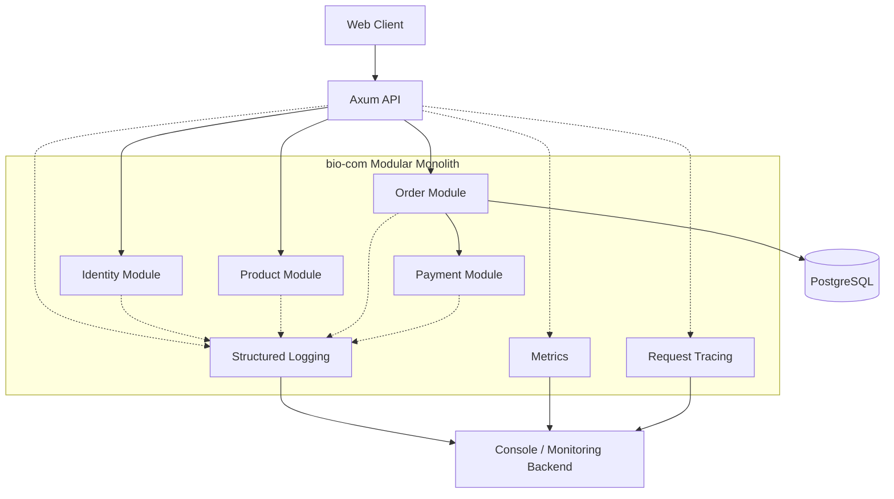
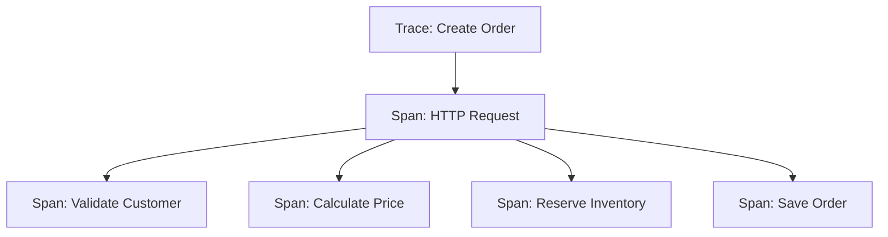

# Observability

## 1. Purpose

Observability helps us understand the internal behavior of bio-com by looking at its outputs.

It helps answer questions such as:
- Is the application running correctly?
- Which API endpoints are slow?
- Why did an order creation fail?
- How many payments are failing?
- Is PostgreSQL responding normally?
- Which module is consuming the most time?
- Are customers experiencing errors?

Observability is not only about collecting logs. It combines three main areas:

1. Logging.
2. Metrics.
3. Tracing.

The initial implementation must remain lightweight and suitable for a Rust modular monolith.

## 2. Observability Principles

The platform follows these principles:

- Every important operation should be observable.
- Logs must be structured and searchable.
- Metrics must help identify operational problems.
- Requests must be traceable across application layers.
- Sensitive information must never appear in telemetry.
- Monitoring must have low overhead.
- Observability must not change business behavior.
- Each module must follow common instrumentation conventions.

## 3. The Three Pillars

### 3.1 Logging

Logs describe events that happen inside the application.

Example:

```json
{
  "level": "INFO",
  "module": "orders",
  "operation": "create_order",
  "order_id": "order-123",
  "correlation_id": "request-456",
  "message": "Order created successfully"
}
```

Logs help investigate individual events and failures.

### 3.2 Metrics

Metrics are numerical measurements collected over time.

Examples:
- Number of HTTP requests.
- Request latency.
- Error rate.
- Database connection usage.
- Number of orders created.
- Payment failure rate.

Metrics help identify trends and performance problems.

### 3.3 Tracing

Tracing follows an operation through different application components.

For example, creating an order may involve:
1. API handler.
2. Order application service.
3. Inventory module.
4. Pricing module.
5. PostgreSQL.

Tracing helps identify where time is spent and where an operation fails.

## 4. Observability Architecture



Each module uses the same observability conventions.

## 5. Structured Logging

Use structured logs instead of relying only on plain text messages.

### Recommended Fields

| Field | Description |
|---|---|
| timestamp | Event timestamp |
| level | Log severity |
| module | Application module |
| operation | Operation name |
| correlation_id | Request correlation identifier |
| trace_id | Trace identifier when available |
| error_code | Application error code |
| message | Human-readable description |

### Log Levels

| Level | Usage | Example |
|---|---|---|
| TRACE | Very detailed execution information | Development diagnostics |
| DEBUG | Development and debugging information | Repository operation |
| INFO | Important normal application events | Order placed |
| WARN | Unexpected but recoverable situations | Retry scheduled |
| ERROR | Failed operations | Database transaction failed |

Avoid logging every operation at INFO level.

Production logging should normally use INFO as the default, with DEBUG and TRACE enabled only when troubleshooting requires them.

### Rust Example

```rust
use tracing::{error, info, instrument};

#[instrument(skip(pool), fields(module = "orders"))]
pub async fn create_order(
    pool: &sqlx::PgPool,
) -> Result<(), String> {
    info!("Starting order creation");

    // Execute application operation.

    info!("Order created successfully");

    Ok(())
}
```

In production, use structured fields for important identifiers and outcomes.

## 6. Correlation IDs

Every incoming HTTP request should have a correlation ID.

The same ID must be available throughout the request lifecycle.

Example:

```text
X-Correlation-ID: req-123
```

The correlation ID helps connect:
- API logs.
- Application logs.
- Database operation logs.
- Audit events.
- External provider requests.

If a client supplies a correlation ID, validate it before accepting it.

Generate a new identifier when it is missing or invalid.

Correlation IDs are not authentication credentials.

## 7. Distributed Tracing Concepts

Even though bio-com is a modular monolith, tracing is still useful.

A trace represents an entire operation.

A span represents one part of that operation.

Example:



Each span should provide:
- Operation name.
- Start and end time.
- Relevant identifiers.
- Outcome.
- Error information when applicable.

Use tracing to investigate slow operations and failures.

Do not add spans to every trivial function.

## 8. Metrics

Metrics provide numerical information about application behavior.

The initial implementation should focus on useful metrics.

### 8.1 HTTP Metrics

| Metric | Description |
|---|---|
| http_requests_total | Total HTTP requests |
| http_request_duration_seconds | Request duration |
| http_requests_failed_total | Failed requests |
| http_requests_in_flight | Currently processing requests |

Collect metrics by:
- HTTP method.
- Route template.
- Status code.

Avoid using raw URLs containing customer IDs as metric labels.

### 8.2 Database Metrics

| Metric | Description |
|---|---|
| db_pool_connections_total | Total pool connections |
| db_pool_connections_idle | Idle connections |
| db_pool_connections_active | Active connections |
| db_connection_acquire_duration | Connection acquisition time |
| db_query_duration | Query execution duration |

Monitor connection pool saturation and slow queries.

### 8.3 Business Metrics

Business metrics help understand platform activity.

| Metric | Description |
|---|---|
| orders_created_total | Number of created orders |
| orders_cancelled_total | Number of cancelled orders |
| payments_succeeded_total | Successful payments |
| payments_failed_total | Failed payments |
| refunds_created_total | Number of refunds |
| inventory_reservations_failed_total | Failed inventory reservations |

Business metrics must not contain personal customer information.

### 8.4 Metric Naming

Use consistent names.

Recommended conventions:
- Lowercase.
- Underscore separators.
- Descriptive units.
- `_total` for counters.
- `_seconds` for duration measurements.

## 9. Performance Monitoring

Monitor application performance continuously.

Important measurements include:
- API response time.
- Database query time.
- Connection acquisition time.
- External provider latency.
- Error rate.
- CPU and memory usage.

For HTTP endpoints, examine latency percentiles:
- p50: typical response time.
- p95: response time below which 95% of requests complete.
- p99: response time below which 99% of requests complete.

Do not rely only on average response time. Averages can hide slow requests.

## 10. Error Monitoring

Every unexpected application failure should produce a structured error log.

Example:

```json
{
  "level": "ERROR",
  "module": "payments",
  "operation": "process_payment",
  "error_code": "PAYMENT_PROVIDER_TIMEOUT",
  "correlation_id": "req-123",
  "message": "Payment provider request timed out"
}
```

Errors should be classified into:
- Business errors.
- Validation errors.
- Authentication errors.
- Authorization errors.
- Infrastructure errors.
- Unexpected application errors.

Expected business errors should not generate noisy ERROR logs.

## 11. Health Checks

The application exposes two main health endpoints.

### Liveness

```text
GET /health/live
```

Checks whether the application process is running.

It should not depend on PostgreSQL availability.

### Readiness

```text
GET /health/ready
```

Checks whether the application can safely receive requests.

It should verify critical dependencies, especially PostgreSQL.

Health responses must not expose internal infrastructure details.

## 12. Alerting

Alerts notify operators when the application requires attention.

Initially, define operational thresholds and monitor them through the available deployment environment.

Examples:

| Alert | Condition |
|---|---|
| High API latency | p95 exceeds the agreed threshold |
| High error rate | 5xx responses increase significantly |
| Database unavailable | Database health check fails |
| Connection pool saturation | Pool remains near capacity |
| Payment failures | Failure rate exceeds normal levels |
| Application unavailable | Liveness check fails |

Thresholds should be based on actual workload and business requirements.

Avoid generating alerts for every isolated error.

## 13. Sensitive Data Protection

Observability must follow the security policies defined in `security-and-audit.md`.

Never include:
- Passwords.
- Session tokens.
- Authorization headers.
- API keys.
- Payment card numbers.
- CVV values.
- Sensitive customer information.

Avoid logging complete request or response bodies by default.

Use identifiers that help investigation without exposing personal information.

## 14. Rust Implementation

The initial Rust observability stack uses lightweight libraries.

| Responsibility | Technology |
|---|---|
| Structured logging | tracing |
| Subscriber configuration | tracing-subscriber |
| HTTP instrumentation | tower-http |
| Async runtime | Tokio |
| Metrics | metrics ecosystem |
| Metric export | Prometheus-compatible exporter |
| Distributed tracing | OpenTelemetry, when required |
| HTTP server | Axum |

### Initial Dependencies

```toml
[dependencies]
tracing = "0.1"
tracing-subscriber = { version = "0.3", features = ["env-filter", "json"] }
tower-http = { version = "0.6", features = ["trace"] }
metrics = "0.24"
metrics-exporter-prometheus = "0.16"
```

Use compatible versions when adding dependencies to the actual project.

### Initial Setup

Configure the tracing subscriber once during application startup.

Use environment-based log filtering.

Example:

```bash
RUST_LOG=info,bio_com=debug
```

Production should normally use INFO or WARN as the default level.

### Metrics Endpoint

Expose an internal metrics endpoint if a metrics exporter is enabled.

```text
GET /metrics
```

Restrict access to this endpoint.

Do not expose operational metrics publicly without an explicit security decision.

## 15. Monitoring Without Heavy Infrastructure

The first version does not require a full monitoring platform.

Start with:
1. Structured JSON logs.
2. Request correlation IDs.
3. HTTP request metrics.
4. Database connection pool metrics.
5. Business operation metrics.
6. Liveness and readiness endpoints.

The application can initially write logs to stdout.

The deployment environment can collect and retain them.

Prometheus-compatible metrics can be scraped by a monitoring system when one is introduced.

OpenTelemetry can be added when there is a concrete need for trace export and centralized analysis.

## 16. Testing Strategy

### Logging Tests

- Important operations produce structured logs.
- Errors contain useful diagnostic context.
- Sensitive values are never logged.

### Metrics Tests

- HTTP requests increment counters.
- Request duration is recorded.
- Failed operations update the appropriate metrics.
- Metric labels remain bounded.

### Tracing Tests

- Important operations create spans.
- Correlation IDs are propagated.
- Errors preserve useful context.

### Health Check Tests

- Liveness works independently of PostgreSQL.
- Readiness fails when a critical dependency is unavailable.

## 17. Key Design Decisions

1. Use structured logging throughout the application.
2. Use Rust's tracing ecosystem.
3. Generate correlation IDs for incoming requests.
4. Instrument important operations with spans.
5. Collect HTTP, database, and business metrics.
6. Monitor latency percentiles rather than averages alone.
7. Provide liveness and readiness endpoints.
8. Keep metric labels bounded and avoid personal information.
9. Protect logs and metrics from sensitive data exposure.
10. Start with stdout logging and lightweight metrics.
11. Introduce centralized monitoring and OpenTelemetry when justified.
12. Do not require Kafka, Redis, or Elasticsearch for observability.

---

*This document merges and consolidates content from the original `observability.md` and `observability-and-logging.md` documentation sources, removing overlapping sections and preserving the core principles from both documents.*