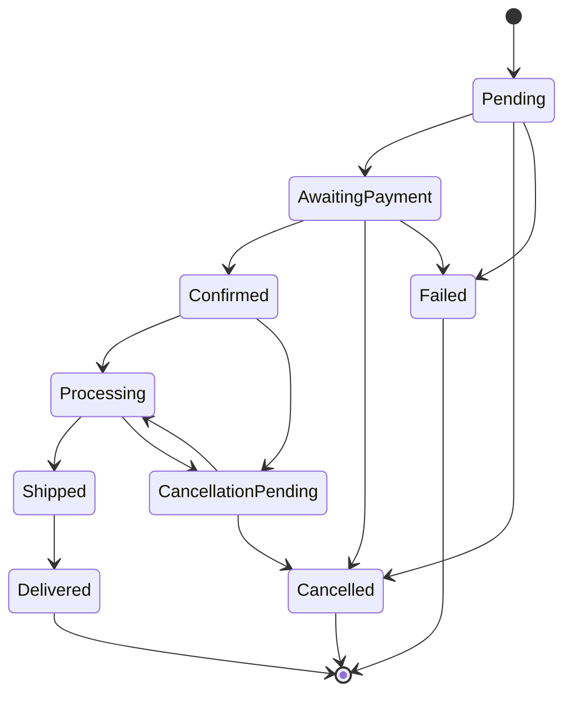
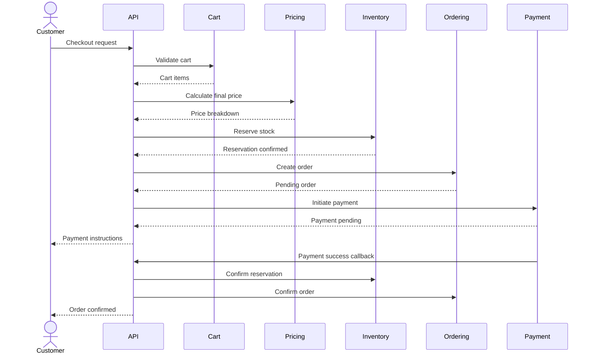
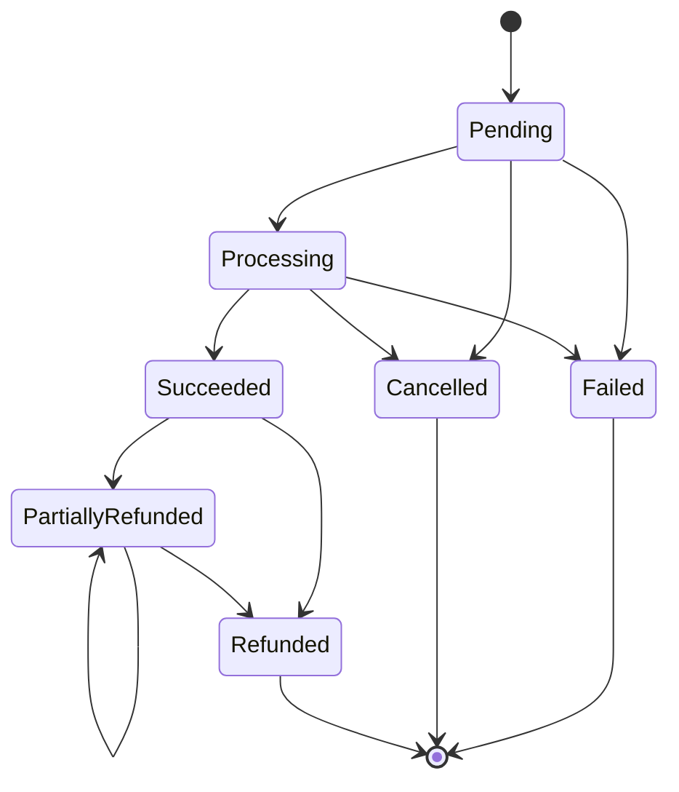

# bio-com — Order Lifecycle

## 1. Purpose

This document describes the complete order lifecycle in bio-com.

It defines:

- How an order is created.
- How checkout works.
- How stock is reserved.
- How payment is processed.
- When an order is confirmed.
- How fulfillment starts.
- How cancellations and refunds work.
- How failures are handled.

The goal is to make order processing reliable, predictable, and easy to maintain.

## 2. Main Principles

We will follow these principles:

1. An order must contain at least one item.
2. Product prices must be validated during checkout.
3. Stock must be reserved before an order is confirmed.
4. Payment must be successful before normal fulfillment starts.
5. An order must preserve the prices agreed upon at purchase time.
6. Payment and order status must be managed separately.
7. Repeated requests must not create duplicate orders or payments.
8. Failed operations must have a recovery path.
9. Every important state transition must be recorded.

We will use application-level orchestration to coordinate the different business contexts.

## 3. Order States

An order can have the following statuses.

| Status | Meaning |
|---|---|
| Pending | Order has been created but not confirmed |
| AwaitingPayment | Waiting for payment completion |
| Confirmed | Payment and required checks succeeded |
| Processing | Order preparation has started |
| Shipped | Order has been handed to the carrier |
| Delivered | Customer received the order |
| CancellationPending | Cancellation is being processed |
| Cancelled | Order was successfully cancelled |
| Failed | Order could not be completed |

These statuses represent the initial order lifecycle. We may refine them as business requirements become clearer.

## 4. Order State Machine



Important rules:

- Delivered orders cannot return to Processing.
- Cancelled orders cannot be confirmed again.
- Failed orders cannot continue through normal fulfillment.
- Cancellation after shipment requires a separate return workflow.
- Invalid transitions must be rejected by the domain model.

## 5. Checkout Workflow

Checkout starts when a customer decides to purchase the items in their cart.

### Step 1 — Validate Customer

The system verifies:

- Customer account exists.
- Account is active.
- Customer has valid delivery information.

### Step 2 — Validate Cart

The system checks:

- Cart is not empty.
- Product variants still exist.
- Products are available for sale.
- Quantities are valid.

### Step 3 — Recalculate Prices

The Pricing context calculates:

- Current product prices.
- Applicable discounts.
- Promotional rules.
- Order subtotal.
- Taxes, where applicable.
- Delivery charges, where applicable.
- Final order total.

The customer must agree to the final amount before payment.

### Step 4 — Reserve Inventory

The Inventory context attempts to reserve the required quantities.

If stock is insufficient, checkout must stop.

No payment should be initiated for an order that cannot reserve the required stock.

### Step 5 — Create Order

The Ordering context creates the order.

The order stores:

- Customer reference.
- Product and variant information.
- SKU.
- Quantity.
- Unit price.
- Discounts.
- Tax details.
- Delivery address snapshot.
- Final total.

Initial status:

`Pending`

### Step 6 — Initiate Payment

The Payment context creates a payment record and communicates with the payment provider.

Order status becomes:

`AwaitingPayment`

### Step 7 — Handle Payment Result

If payment succeeds:

- Record the successful payment.
- Confirm the stock reservation.
- Confirm the order.
- Make the order available for fulfillment.

Order status:

`Confirmed`

If payment fails:

- Record the payment failure.
- Release the stock reservation.
- Mark the order as Failed or Cancelled according to the failure policy.

## 6. Checkout Sequence Diagram



This is the logical workflow. The implementation must also handle asynchronous payment callbacks, timeouts, retries, and recovery.

## 7. Inventory Reservation Rules

Inventory must be protected against overselling.

Example:

Available stock: 10 bottles.

Customer A requests 7 bottles.

Customer B requests 5 bottles.

Customer A reserves 7 bottles.

Only 3 bottles remain available.

Customer B's reservation must fail.

### Reservation lifecycle

`Active → Confirmed`

`Active → Released`

`Active → Expired`

A reservation should have:

- Reservation ID.
- Order ID.
- Product variant ID.
- Reserved quantity.
- Creation time.
- Expiration time.
- Status.

Reservation operations must be idempotent.

The same reservation must never deduct stock twice.

## 8. Payment Lifecycle

Payment has its own lifecycle, independent of the order.

Initial payment statuses:

| Status | Meaning |
|---|---|
| Pending | Payment has been created |
| Processing | Provider is processing payment |
| Succeeded | Payment succeeded |
| Failed | Payment failed |
| Cancelled | Payment was cancelled |
| PartiallyRefunded | Part of the payment was refunded |
| Refunded | Full refundable amount was refunded |

Payment state machine:



A successful payment must never be treated as failed simply because the application did not receive the provider callback.

Payment status must be reconciled with the provider when necessary.

## 9. Order Cancellation

Cancellation depends on the current order status.

### Before payment

If the order is Pending or AwaitingPayment:

- Cancel the order.
- Cancel the payment attempt where possible.
- Release the inventory reservation.

### After payment but before shipment

If the order is Confirmed or Processing:

- Check cancellation eligibility.
- Stop fulfillment if possible.
- Request a refund.
- Release or restore inventory according to the actual stock state.
- Confirm cancellation only after the required operations succeed.

### After shipment

A shipped order cannot simply be cancelled.

The customer must follow the return process.

The platform should track the return and refund separately.

## 10. Failure Handling

Distributed business operations can fail even inside a modular monolith.

For example:

- Inventory reservation succeeds.
- Order creation succeeds.
- Payment provider times out.

The application must not assume that a timeout means payment failed.

### Failure scenarios

| Scenario | Expected action |
|---|---|
| Invalid cart | Reject checkout |
| Product unavailable | Stop checkout |
| Price changed | Request customer confirmation |
| Stock reservation failed | Stop checkout |
| Order creation failed | Release reservation |
| Payment declined | Release reservation |
| Payment timeout | Reconcile payment status |
| Payment succeeded but callback was delayed | Confirm through reconciliation |
| Stock confirmation failed | Keep workflow recoverable |
| Refund provider unavailable | Retry safely and retain refund status |

We must preserve enough information to recover from interrupted operations.

## 11. Idempotency

Idempotency prevents the same business operation from being performed multiple times.

Example:

A customer clicks the checkout button twice because the first request takes too long.

The platform must not create two orders or charge the customer twice.

We will use idempotency keys for operations such as:

- Checkout requests.
- Payment initiation.
- Payment callbacks.
- Stock reservation.
- Refund requests.

The same idempotency key must return the result of the original operation rather than execute it again.

The key must be scoped to the relevant business operation and customer or payment context.

## 12. Transaction Management

We will use PostgreSQL transactions for operations that require atomicity inside one context.

Examples:

- Creating an order and its order items.
- Updating stock and recording its movement.
- Recording a payment result.
- Creating a reservation.

We will not keep database transactions open while calling external services.

For workflows spanning multiple contexts, the application layer coordinates operations and records their progress.

A transactional outbox can be introduced when reliable asynchronous event delivery becomes necessary.

## 13. Order History

The platform must maintain a history of important order changes.

Examples:

- Order created.
- Payment initiated.
- Payment succeeded.
- Order confirmed.
- Processing started.
- Order shipped.
- Order delivered.
- Cancellation requested.
- Refund processed.

Each record should contain:

- Event or action type.
- Order ID.
- Timestamp.
- Relevant actor or system.
- Additional context.

This history helps customer support and administrators understand what happened to an order.

## 14. Initial Business Policies

The following policies will guide the first implementation.

| Policy | Initial Decision |
|---|---|
| Empty order | Not allowed |
| Stock validation | Required before confirmation |
| Inventory reservation | Required |
| Payment | Required before normal fulfillment |
| Order price | Snapshot at purchase time |
| Duplicate checkout | Prevented with idempotency |
| Duplicate payment | Prevented with idempotency |
| Cancellation before payment | Allowed |
| Cancellation after payment | Requires cancellation checks and refund |
| Cancellation after shipment | Use return workflow |
| Payment timeout | Reconciliation required |
| Order history | Important transitions recorded |

Specific reservation durations, tax rules, delivery fees, and refund timing will be configured as business policies.

## 15. Rust Implementation Direction

The Ordering domain will expose operations such as:

```rust
pub trait OrderRepository {
    async fn save(&self, order: &Order) -> Result<(), OrderError>;

    async fn find_by_id(
        &self,
        id: &OrderId,
    ) -> Result<Option<Order>, OrderError>;
}
```

The application layer will coordinate checkout:

```rust
pub struct CheckoutUseCase {
    // Cart, pricing, inventory, ordering,
    // and payment application interfaces.
}
```

The domain layer will enforce order invariants.

The application layer will coordinate business workflows.

The infrastructure layer will handle PostgreSQL, payment provider communication, and external integrations.

## 16. Summary

The order lifecycle defines how bio-com processes customer purchases reliably.

The most important rules are:

- Validate before confirming.
- Reserve stock before completing checkout.
- Preserve historical prices.
- Keep payment and order states separate.
- Prevent duplicate operations.
- Recover safely from failures.
- Record important business transitions.

The implementation must prioritize correctness over convenience.

**Next step:** Design the detailed inventory lifecycle, including stock movements, reservations, concurrency, and batch tracking.

---

**Project:** bio-com  
**Language:** Rust  
**Architecture:** DDD + Clean Architecture  
**Application Style:** Modular Monolith  
**Database:** PostgreSQL
