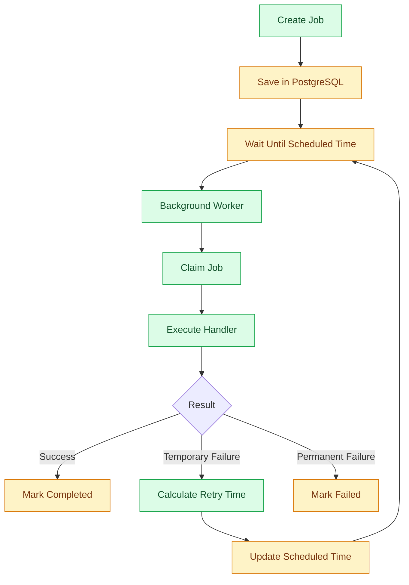

# Scheduling and Retries

## 1. Purpose

Background jobs do not always succeed on their first attempt.

An external API might be unavailable, a network request might time out, or a database connection might temporarily fail.

Instead of immediately giving up, the application needs a reliable way to retry failed operations.

It also needs to schedule work for a specific time.

For example:

- Retry a failed email notification.
- Process a payment notification later.
- Expire an abandoned checkout.
- Run a daily cleanup task.
- Retry an external integration.

This document defines how scheduling and retries work in `bio-com`.

## 2. Scheduling vs Retries

These concepts are related but have different purposes.

### Scheduling

Scheduling determines when a job should execute.

Example:

```text
Expire abandoned checkout
        |
        v
Scheduled for 10:00 AM
        |
        v
Worker executes at 10:00 AM
```

### Retries

Retries determine when a failed job should execute again.

Example:

```text
Send confirmation email
        |
        v
Attempt 1: Failed
        |
        v
Wait 5 seconds
        |
        v
Attempt 2: Failed
        |
        v
Wait 30 seconds
        |
        v
Attempt 3: Successful
```

Both mechanisms use PostgreSQL to store execution information.

## 3. Architecture



## 4. Job Scheduling Model

Every job has a scheduled execution time.

The worker only processes jobs whose scheduled time has arrived.

Example database fields:

| Field | Purpose |
|---|---|
| id | Unique job identifier |
| job_type | Type of work |
| payload | Required job data |
| status | Current state |
| scheduled_at | Next execution time |
| attempts | Number of attempts |
| max_attempts | Maximum attempts |
| created_at | Creation timestamp |
| started_at | Last execution start |
| completed_at | Successful completion |
| locked_until | Worker lease expiration |
| last_error | Last failure information |

The `scheduled_at` field is used for both initial scheduling and retry scheduling.

## 5. Job States

A job can move through the following states:

```text
Pending
   |
   v
Processing
   |
   +---- Success ------> Completed
   |
   +---- Temporary ----> Pending
   |       Failure        (Retry Scheduled)
   |
   +---- Permanent ----> Failed
   |
   +---- Cancellation --> Cancelled
```

Allowed transitions must be enforced by the job repository.

For example, a completed job must not return to pending through an ordinary retry operation.

## 6. Retry Policy

A retry policy defines how many times a failed job can be attempted and how long the worker waits between attempts.

For the initial version, use:

- Maximum attempts: 5.
- Exponential backoff.
- Random jitter.
- Configurable maximum delay.
- Failure classification.

These values are defaults and should be configurable.

## 7. Exponential Backoff

Exponential backoff increases the waiting time after each failure.

A simple formula is:

\[
D_n = \min(D_{max}, D_{base} \times 2^{n-1})
\]

Where:

- \(D_n\): Delay for the next retry.
- \(D_{base}\): Initial delay.
- \(D_{max}\): Maximum delay.
- \(n\): Attempt number.

Example:

| Attempt | Delay |
|---|---:|
| 1 | 5 seconds |
| 2 | 10 seconds |
| 3 | 20 seconds |
| 4 | 40 seconds |
| 5 | 80 seconds |

This prevents the application from continuously retrying an unavailable service.

## 8. Jitter

When many jobs fail at the same time, they might all retry simultaneously.

This can overload an external service when it becomes available again.

Jitter introduces a random variation into retry delays.

Example:

\[
D_{retry} = Random(0.5D_n, D_n)
\]

If the calculated delay is 20 seconds, the actual delay will be between 10 and 20 seconds.

For production, the random generator should be injectable so retry behavior can be tested reliably.

## 9. Failure Classification

Not every error should trigger a retry.

The application should distinguish between temporary and permanent failures.

### Temporary failures

Examples:

- Network timeout.
- HTTP 500.
- HTTP 502.
- HTTP 503.
- HTTP 504.
- HTTP 429.
- Temporary database connectivity failure.

These failures may be retried.

### Permanent failures

Examples:

- Invalid job payload.
- Unsupported job type.
- Missing required business information.
- Invalid external request.
- Business operation no longer allowed.

These failures should normally be marked as failed.

Example Rust model:

```rust
pub enum JobFailure {
    Transient(String),
    Permanent(String),
}
```

The handler or infrastructure adapter should classify errors appropriately.

Do not classify every unknown error as temporary.

## 10. HTTP Retry Handling

When calling external APIs, the worker must respect HTTP response behavior.

| HTTP status | Suggested behavior |
|---|---|
| 200–299 | Success |
| 400 | Usually permanent |
| 401 | Usually permanent until credentials are corrected |
| 403 | Usually permanent |
| 404 | Depends on the operation |
| 408 | Retry |
| 409 | Depends on the operation |
| 429 | Retry |
| 500 | Retry |
| 502 | Retry |
| 503 | Retry |
| 504 | Retry |

For HTTP 429, respect the `Retry-After` header when present.

Do not retry non-idempotent operations without an appropriate idempotency mechanism.

## 11. Job Claiming and Leases

A worker claims a job before executing it.

The job receives a lease represented by `locked_until`.

Example:

```sql
UPDATE background_jobs
SET status = 'processing',
    worker_id = $2,
    locked_until = NOW() + INTERVAL '5 minutes',
    attempts = attempts + 1,
    started_at = NOW()
WHERE id = $1
  AND status = 'pending'
RETURNING *;
```

The worker owns the job until the lease expires or the job is completed.

### Why use leases?

Consider this scenario:

1. Worker A claims a job.
2. Worker A crashes.
3. The job remains in processing.
4. Its lease expires.
5. Another worker can recover it.

A lease prevents abandoned jobs from remaining stuck forever.

### Lease renewal

Long-running jobs may need to renew their lease.

The worker should periodically extend `locked_until` while it still owns the job.

Every update must verify the worker's ownership.

For example, do not allow an old worker to update a job that has already been reclaimed by another worker.

## 12. Recovering Abandoned Jobs

A recovery process identifies expired processing leases.

Example:

```sql
UPDATE background_jobs
SET status = 'pending',
    worker_id = NULL,
    locked_until = NULL,
    scheduled_at = NOW()
WHERE status = 'processing'
  AND locked_until < NOW()
  AND attempts < max_attempts;
```

Jobs that have exhausted their attempts should be moved to failed status instead.

Recovery must be atomic and must not interfere with jobs whose leases are still valid.

## 13. Scheduled Jobs

Some operations need to run at a specific time or repeatedly.

Examples:

| Job | Schedule |
|---|---|
| Expire abandoned checkout | After configured inactivity |
| Clean old records | Daily |
| Generate reports | Daily or weekly |
| Synchronize catalog | Periodically |
| Retry failed notification | Based on retry policy |

For one-time jobs, store the execution time in `scheduled_at`.

For recurring jobs, store a schedule definition separately or generate the next job after a successful execution.

Avoid creating duplicate recurring jobs.

## 14. Recurring Job Protection

A recurring job should not be created repeatedly by multiple application instances.

Use a unique business key or database constraint.

For example:

```sql
CREATE TABLE recurring_job_runs (
    id UUID PRIMARY KEY,
    job_type VARCHAR(255) NOT NULL,
    scheduled_for TIMESTAMPTZ NOT NULL,
    created_at TIMESTAMPTZ NOT NULL DEFAULT NOW(),

    UNIQUE (job_type, scheduled_for)
);
```

This prevents duplicate records for the same scheduled occurrence.

Use an appropriate time zone policy for business schedules.

Store timestamps in UTC and convert to local time only when interpreting business schedules or displaying them.

## 15. Cancellation

Some jobs may no longer be necessary.

For example:

- An abandoned checkout was completed.
- An order was cancelled.
- A scheduled notification became irrelevant.

The application should support cancelling pending jobs.

A worker must verify the current job state before starting execution.

Cancellation of a running job is more complex.

For long-running operations, use cancellation tokens and check them at safe execution points.

Do not assume an already completed external operation can be reversed by cancelling its job.

## 16. Idempotency and Retries

Retries can execute the same operation more than once.

Every retryable handler must consider duplicate execution.

For example, a payment-related operation should use a stable idempotency key when supported by the payment provider.

A notification handler may record its completed delivery using a unique operation identifier.

Important principles:

- Use stable idempotency keys.
- Add database uniqueness constraints where appropriate.
- Avoid repeating irreversible side effects.
- Do not rely only on job status to guarantee exactly-once execution.

The system should assume at-least-once execution.

## 17. Rust Implementation

Use Rust and Tokio for worker execution.

Suggested components:

```text
src/
├── shared/
│   ├── application/
│   │   └── jobs/
│   │       ├── job.rs
│   │       ├── job_handler.rs
│   │       ├── retry_policy.rs
│   │       └── worker.rs
│   │
│   └── infrastructure/
│       └── persistence/
│           └── job_repository.rs
│
└── modules/
    └── ordering/
        └── application/
            └── jobs/
                └── expire_checkout.rs
```

Suggested retry policy:

```rust
pub struct RetryPolicy {
    pub max_attempts: u32,
    pub base_delay: Duration,
    pub max_delay: Duration,
}

impl RetryPolicy {
    pub fn next_delay(&self, attempt: u32) -> Duration {
        let exponent = attempt.saturating_sub(1).min(20);

        self.base_delay
            .saturating_mul(2u32.saturating_pow(exponent))
            .min(self.max_delay)
    }
}
```

This example calculates the exponential delay without jitter. Jitter should be applied separately in the production implementation.

## 18. Observability

The system should expose useful operational information.

Monitor:

| Metric | Description |
|---|---|
| job_pending_total | Number of pending jobs |
| job_processing_total | Number of processing jobs |
| job_failed_total | Number of failed jobs |
| job_retry_total | Number of retries |
| job_execution_duration | Job execution time |
| job_queue_delay | Time spent waiting |
| job_lease_expired_total | Number of expired leases |

Use structured logs with:

- Job ID.
- Job type.
- Attempt number.
- Worker ID.
- Error category.
- Execution duration.

Avoid logging sensitive payload data.

## 19. Testing Strategy

### Unit tests

Test:

- Exponential backoff.
- Maximum retry delay.
- Jitter boundaries.
- Failure classification.
- Maximum attempts.
- Cancellation behavior.

### Integration tests

Test:

- Scheduled job execution.
- Concurrent job claiming.
- Lease expiration.
- Job recovery.
- Retry scheduling.
- Duplicate job prevention.
- Worker shutdown.

### Failure simulation

Simulate:

- External API unavailable.
- Worker crash.
- Database connection failure.
- HTTP 429 response.
- Repeated permanent failure.

Verify that the job reaches the correct final state.

## 20. What We Will Not Implement Now

The initial version does not require:

- Redis.
- Kafka.
- RabbitMQ.
- External schedulers.
- Distributed workflow engines.
- Complex priority queues.
- Exactly-once processing guarantees.

PostgreSQL and Tokio are sufficient for the initial requirements.

## 21. Summary

For `bio-com`, scheduling and retries follow these principles:

- PostgreSQL-backed scheduling.
- Rust asynchronous workers.
- Configurable retry policies.
- Exponential backoff with jitter.
- Temporary and permanent failure classification.
- Job leases and recovery.
- Idempotent processing.
- Controlled recurring execution.
- Graceful cancellation.
- Structured monitoring.

The objective is to make background processing reliable without making the architecture unnecessarily complex.
