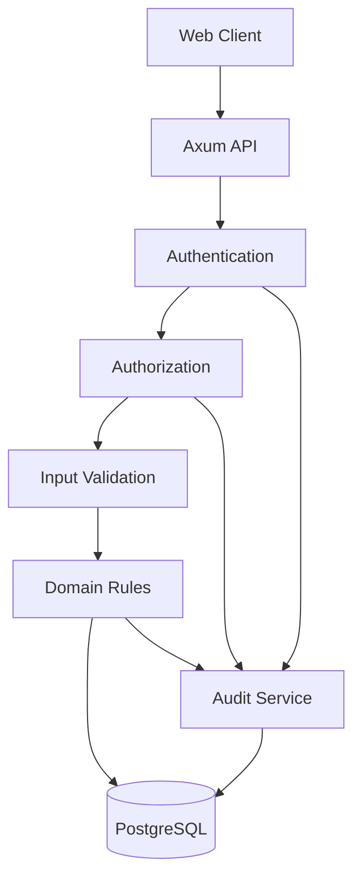

# Security and Audit

## 1. Purpose

Security is a responsibility shared across the entire bio-com platform.

This document defines how we protect:

- User accounts.
- Customer information.
- Orders and payments.
- Administrative operations.
- Application data.
- Internal business operations.

It also defines how important actions are recorded so that we can investigate problems and understand who did what.

The initial design uses Rust, PostgreSQL, and the existing modular monolith.

We do not introduce Kafka, Redis, Elasticsearch, or external security platforms at this stage.

## 2. Security Principles

The platform follows these principles:

### Least Privilege

Every user and application component receives only the permissions it needs.

### Defense in Depth

Security must exist at multiple levels:

- API validation.
- Authentication.
- Authorization.
- Business rules.
- Database constraints.
- Infrastructure configuration.

### Secure by Default

New users must not receive administrative permissions automatically.

Sensitive operations must require explicit authorization.

### Data Minimization

Only collect and store information required by the business.

### Fail Securely

If authentication or authorization cannot be verified, access must be denied.

### Auditability

Important business and security actions must leave an audit record.

## 3. Security Architecture

Security is implemented across the existing application layers.



Each layer has a specific responsibility.

- Authentication verifies the user's identity.
- Authorization checks permissions.
- Validation rejects invalid input.
- Domain rules protect business invariants.
- Audit records important actions.

## 4. Authentication Security

Authentication is implemented by the Identity and Access module.

The following rules apply:

- Passwords must be hashed using Argon2id.
- Passwords must never appear in logs.
- Login errors must not reveal whether an email exists.
- Session tokens must be generated securely.
- Only token hashes are stored in PostgreSQL.
- Sessions must expire.
- Logout must revoke the current session.
- Disabled accounts must not authenticate.

### Session Protection

Session cookies must use:

- HttpOnly.
- Secure.
- SameSite.

Cookie-authenticated state-changing requests must also have CSRF protection.

Session tokens must not be placed in URLs.

## 5. Authorization Security

All protected operations must verify permissions.

For example:

A customer requests an order.

The application checks:

1. Is the user authenticated?
2. Is the user allowed to read orders?
3. Does the requested order belong to the user?

An administrator may access other customers' orders only when explicitly authorized.

Never rely only on hiding buttons in the frontend.

Authorization must be enforced by the backend.

## 6. API Security

All external requests must pass through the API security controls.

### Input Validation

Validate:

- Request parameters.
- Request body.
- Identifiers.
- Email addresses.
- Numeric values.
- Pagination parameters.
- File uploads.

Reject invalid input before executing business operations.

### SQL Injection Protection

Use SQLx parameterized queries.

Never build SQL statements by concatenating untrusted user input.

### HTTP Security

Apply appropriate HTTP security headers.

Examples:

- Content-Security-Policy.
- X-Content-Type-Options.
- Referrer-Policy.
- Strict-Transport-Security when HTTPS is enforced.

Configure CORS using an explicit list of trusted origins.

Do not allow every origin in production.

### Request Limits

Protect the API against oversized requests.

Configure:

- Maximum request body size.
- Request timeouts.
- Upload size limits.
- Pagination limits.

## 7. Rate Limiting

Rate limiting protects the application against excessive requests and brute-force attacks.

Initially, rate limiting can be implemented within the application.

PostgreSQL can persist counters where multiple application instances must share limits.

Important operations to protect:

| Operation | Protection |
|---|---|
| Login | Limit repeated attempts |
| Registration | Limit account creation |
| Password reset | Limit reset requests |
| Product search | Limit excessive requests |
| Checkout | Prevent excessive submissions |
| Payment operations | Prevent repeated requests |

Rate limits should be configurable.

For sensitive operations, consider limits by both account and source IP.

Do not rely exclusively on IP addresses because multiple legitimate users may share one address.

## 8. Sensitive Data Protection

Not all application data has the same sensitivity.

### Data Classification

| Classification | Examples | Protection |
|---|---|---|
| Public | Product names, public prices | Normal access controls |
| Internal | Operational configuration | Restricted access |
| Confidential | Customer addresses, order details | Authorization and encryption |
| Highly sensitive | Password hashes, payment credentials | Strict access and specialized protection |

### Passwords

Store only password hashes generated using Argon2id.

### Payment Information

The application must not store raw card numbers or CVV values.

Use a payment provider to handle sensitive card information.

Store only the payment references and non-sensitive transaction information required by the business.

### Customer Information

Protect:

- Names.
- Email addresses.
- Phone numbers.
- Delivery addresses.
- Order history.

Access must be limited to authorized business operations.

## 9. Encryption

### Data in Transit

Use HTTPS for all production communication.

Internal service communication should also use secure transport when applicable.

### Data at Rest

Use PostgreSQL storage encryption provided by the hosting infrastructure.

For highly sensitive application secrets, use dedicated encryption rather than relying only on database disk encryption.

Encryption keys must not be stored alongside encrypted data.

## 10. Audit Logging

Audit logging records important actions performed by users and system components.

It is different from normal application logging.

Application logs help developers investigate technical problems.

Audit logs help answer:

- Who performed an action?
- What action was performed?
- Which resource was affected?
- When did it happen?
- Was the operation successful?

### Audited Operations

The initial system should audit:

| Area | Events |
|---|---|
| Identity | Login, logout, account creation |
| Accounts | Account activation, suspension, password change |
| Authorization | Role assignment, permission changes |
| Products | Product creation, update, deletion |
| Orders | Order cancellation and administrative changes |
| Payments | Refund creation and refund status changes |
| Administration | Sensitive administrative operations |

Do not create audit records for every ordinary read operation unless there is a business or regulatory requirement.

### Audit Record

An audit record contains:

| Field | Description |
|---|---|
| id | Unique audit event ID |
| actor_id | User or system performing the action |
| actor_type | USER or SYSTEM |
| action | Action performed |
| resource_type | Type of affected resource |
| resource_id | Identifier of affected resource |
| outcome | SUCCESS or FAILURE |
| occurred_at | Event timestamp |
| correlation_id | Request or operation correlation ID |
| metadata | Safe additional information |

Metadata must not contain passwords, tokens, CVV values, or other secrets.

### Example

An administrator updates a product price.

```json
{
  "actor_id": "user-123",
  "actor_type": "USER",
  "action": "PRODUCT_PRICE_UPDATED",
  "resource_type": "PRODUCT",
  "resource_id": "product-456",
  "outcome": "SUCCESS",
  "correlation_id": "request-789",
  "metadata": {
    "field": "price"
  }
}
```

Avoid recording sensitive old and new values unless explicitly required.

## 11. Audit Storage

Audit records are stored in PostgreSQL.

Create a dedicated `audit_logs` table.

Important requirements:

- Audit records should be append-only.
- Normal application users must not update or delete audit records.
- Audit access must be restricted.
- Audit records should be indexed by actor, resource, and timestamp.
- Retention must follow the applicable business and legal requirements.

Audit records must be written reliably.

For critical business operations, write the audit record in the same database transaction as the business change.

This prevents successful changes from being committed without their corresponding audit record.

For failed authentication attempts, record the security event independently because no successful business transaction exists.

## 12. Security Events

Security events are actions that may indicate suspicious activity.

Examples:

- Repeated failed login attempts.
- Login using a disabled account.
- Repeated authorization failures.
- Unexpected administrative activity.
- Session reuse after revocation.
- Repeated password reset requests.

The application should record these events and make them available for investigation.

Avoid logging sensitive authentication information.

## 13. Error Handling

Security errors must not expose internal information.

Examples:

| Situation | HTTP Status |
|---|---|
| Missing authentication | 401 |
| Invalid credentials | 401 |
| Missing permission | 403 |
| Invalid request | 400 |
| Resource not accessible | 404 where appropriate |
| Rate limit exceeded | 429 |
| Unexpected internal error | 500 |

Never return:

- Database connection strings.
- SQL statements.
- Password hashes.
- Session tokens.
- Internal stack traces.
- Secret configuration values.

Detailed technical information belongs in protected internal logs.

## 14. Secrets Management

Secrets include:

- Database passwords.
- Session signing or encryption keys, where applicable.
- Payment provider API keys.
- Email provider credentials.
- Third-party integration credentials.

Initial approach:

- Use environment variables for deployment configuration.
- Use a local `.env` file for development only.
- Add `.env` to `.gitignore`.
- Commit only `.env.example`.
- Never commit real credentials.
- Restrict production secret access.
- Rotate compromised or exposed credentials.

A dedicated secrets manager can be introduced later when deployment requirements justify it.

## 15. Backup and Recovery

Security also includes protecting data against accidental deletion and infrastructure failures.

The platform must support:

- Regular PostgreSQL backups.
- Restricted backup access.
- Encryption of backups.
- Tested restoration procedures.
- Documented recovery objectives.

Backups must not be accessible through public application endpoints.

Define recovery point objective (RPO) and recovery time objective (RTO) before production deployment.

## 16. Testing Strategy

Security must be tested continuously.

### Authentication Tests

- Invalid credentials.
- Disabled accounts.
- Expired sessions.
- Revoked sessions.
- Password verification.

### Authorization Tests

- Customer accessing another customer's order.
- Customer accessing administrative operations.
- Support user attempting unauthorized operations.
- Administrator performing authorized operations.

### API Security Tests

- Invalid request payloads.
- Oversized requests.
- SQL injection attempts.
- CSRF protection.
- CORS configuration.
- Rate limiting.

### Audit Tests

- Successful operations create audit records.
- Failed authentication attempts are recorded.
- Sensitive information is never included.
- Audit records cannot be modified through normal application operations.
- Business changes and their audit records commit atomically.

## 17. Initial Infrastructure Decisions

Keep the first version simple.

| Component | Decision |
|---|---|
| Application | Rust modular monolith |
| HTTP | Axum |
| Database | PostgreSQL |
| Data access | SQLx |
| Password hashing | Argon2id |
| Authentication | Database-backed sessions |
| Authorization | RBAC |
| Audit storage | PostgreSQL |
| Rate limiting | Application-level |
| Encryption in transit | HTTPS |
| Encryption at rest | Infrastructure-level |
| Secrets | Environment variables initially |
| Message broker | Not required |
| Distributed tracing platform | Not required initially |

## 18. Future Improvements

Introduce additional security capabilities when required:

- Multi-factor authentication.
- Advanced fraud detection.
- Centralized security monitoring.
- Dedicated secrets management.
- Automated security alerts.
- Immutable external audit storage.
- Advanced API abuse detection.
- Automated vulnerability scanning.
- Security incident response procedures.

## 19. Key Design Decisions

1. Security is implemented across all application modules.
2. Identity and Access owns authentication and authorization.
3. Every protected operation requires backend authorization.
4. Resource ownership is checked independently.
5. Sensitive information is protected at rest and in transit.
6. Important business and security actions are audited.
7. Audit records are stored in PostgreSQL.
8. Critical business changes and audit records use the same transaction.
9. Secrets are never committed to Git.
10. No heavy infrastructure is required for the initial implementation.

---

**Main principle:** Security must be enforced by the backend, recorded where necessary, and applied consistently across every business module.
