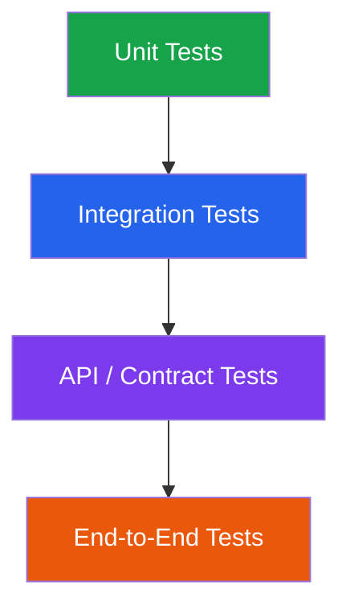
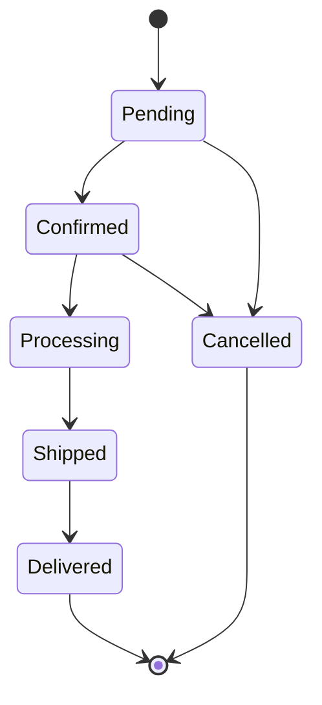

# Testing Strategy

## 1. Purpose

Testing helps us verify that bio-com works correctly and that changes do not break existing functionality.

Our testing strategy covers:

- Domain logic.
- Application use cases.
- Infrastructure implementations.
- REST APIs.
- Database operations.
- Security rules.
- Complete business workflows.
- Performance and concurrency.

The goal is to catch problems early and keep the application reliable as it grows.

## 2. Testing Principles

We follow these principles:

### Test Business Behavior

Tests should verify what the application does, not only how the code is implemented.

### Test at the Right Level

Use unit tests for business rules and integration tests for interactions between components.

### Keep Tests Independent

A test should not depend on another test running first.

### Make Tests Repeatable

The same test should produce the same result under the same conditions.

### Protect Business Invariants

Important rules must be tested explicitly.

Examples:

- An order cannot have a negative total.
- A customer cannot access another customer's order.
- A refund cannot exceed the refundable amount.
- Inventory cannot become negative.

### Test Failure Scenarios

Test not only successful operations but also invalid input, unavailable dependencies, and unexpected failures.

## 3. Testing Pyramid

We organize tests into different levels.



### Unit Tests

Test individual functions and business rules.

These tests should be fast and should not require PostgreSQL or external services.

### Integration Tests

Test interactions between components, such as application services and PostgreSQL repositories.

### API Tests

Test HTTP endpoints, request validation, response formats, authentication, and authorization.

### End-to-End Tests

Test complete business workflows through the application's public interfaces.

The number of tests should be highest at the unit level and lower at the end-to-end level.

## 4. Unit Testing

Unit tests focus on small pieces of business logic.

The domain layer is a major target.

Examples:

| Module | Test |
|---|---|
| Identity | Password policy validation |
| Product | Product price validation |
| Inventory | Available quantity calculation |
| Cart | Cart total calculation |
| Order | Order state transitions |
| Payment | Payment state transitions |
| Refund | Refund amount validation |

### Example: Product Price

```rust
#[cfg(test)]
mod tests {
    use super::*;

    #[test]
    fn should_reject_negative_price() {
        let result = Money::new("-10.00", "CAD");

        assert!(result.is_err());
    }

    #[test]
    fn should_accept_valid_price() {
        let result = Money::new("89.99", "CAD");

        assert!(result.is_ok());
    }
}
```

The example assumes a domain constructor that validates monetary values.

### Unit Test Rules

- Avoid database access.
- Avoid network calls.
- Avoid real payment providers.
- Use deterministic test inputs.
- Test both successful and failed cases.
- Keep tests focused on one behavior.

## 5. Domain Testing

Domain tests protect business invariants.

For example, an order may have the following states:



Tests should verify:

- Valid state transitions.
- Invalid state transitions.
- Cancellation rules.
- Order total calculations.
- Refund eligibility.
- Inventory rules.

Domain behavior must not depend on HTTP status codes or SQL implementation details.

## 6. Application Testing

Application tests verify complete use cases.

Examples:

- Register customer.
- Create product.
- Add item to cart.
- Place order.
- Reserve inventory.
- Initiate payment.
- Cancel order.
- Process refund.

Application tests should verify that the correct dependencies are called and that the expected results are returned.

Use fake implementations of application ports when appropriate.

For example, an order application service can use a fake inventory repository rather than a real database.

Do not mock every internal function. Test meaningful boundaries.

## 7. Infrastructure Testing

Infrastructure tests verify that technical implementations work correctly.

Examples:

- PostgreSQL repositories.
- SQLx queries.
- Database transactions.
- Password hashing.
- Session persistence.
- External provider adapters.

These tests should use real PostgreSQL when database behavior is being tested.

Mocks cannot fully verify SQL queries, database constraints, locking, or transaction behavior.

### Important Database Tests

- Unique constraints.
- Foreign key constraints.
- Transaction rollback.
- Concurrent updates.
- Optimistic locking.
- Migration execution.
- Data persistence.

## 8. API Testing

API tests verify the HTTP contract.

Test:

- HTTP method.
- URL.
- Request body.
- Response body.
- Status code.
- Authentication.
- Authorization.
- Validation errors.

### Example: Product Creation

Request:

```http
POST /api/v1/products
Content-Type: application/json
```

```json
{
  "name": "Wireless Headphones",
  "price": "89.99",
  "currency": "CAD"
}
```

Expected response:

```http
201 Created
```

The test should verify the response structure and that the product was persisted.

### API Error Tests

Examples:

- Missing required fields.
- Invalid price.
- Unknown product.
- Missing authentication.
- Insufficient permissions.
- Duplicate resource.

All errors must follow the common API error format.

## 9. Security Testing

Security tests verify that users cannot perform unauthorized operations.

### Authentication Tests

- Invalid password.
- Expired session.
- Revoked session.
- Disabled account.
- Repeated login attempts.

### Authorization Tests

- Customer accessing another customer's order.
- Customer attempting to create a product.
- Support user attempting administrative operations.
- Unauthorized role assignment.

### Data Protection Tests

- Passwords are never returned in API responses.
- Session tokens are never persisted in plain text.
- Sensitive information is not included in logs.
- Customer data is not exposed to unauthorized users.

Security tests must be part of the regular CI pipeline.

## 10. End-to-End Testing

End-to-end tests verify complete business workflows.

They should use the real application and PostgreSQL, with external providers replaced by controlled test adapters or sandbox environments.

### Workflow 1: Customer Registration

1. Register a customer.
2. Verify account creation.
3. Log in.
4. Access the current user endpoint.
5. Log out.
6. Verify the session is no longer valid.

### Workflow 2: Purchase

1. Customer logs in.
2. Customer views products.
3. Customer adds items to the cart.
4. Customer submits checkout.
5. Inventory is reserved.
6. Order is created.
7. Payment is initiated.
8. Order state is updated.

### Workflow 3: Refund

1. Customer requests a refund.
2. Application checks eligibility.
3. Refund amount is validated.
4. Payment provider adapter processes the refund.
5. Refund status is updated.
6. Audit event is recorded.

These workflows should cover the most important customer journeys.

## 11. Concurrency Testing

Concurrency testing verifies behavior when multiple operations happen at the same time.

This is especially important for e-commerce.

### Example: Last Item in Stock

Available inventory:

```text
Product quantity = 1
```

Two customers attempt to purchase the same product simultaneously.

Expected result:

- One reservation succeeds.
- One reservation fails.
- Inventory never becomes negative.
- No duplicate successful reservation is created.

Other concurrency scenarios:

- Two requests cancelling the same order.
- Multiple refund requests for the same payment.
- Two administrators updating the same product.
- Multiple checkout requests using the same idempotency key.

Use real PostgreSQL for these tests.

## 12. Contract Testing

Contract tests ensure that API consumers and providers agree on request and response formats.

The OpenAPI specification should be consistent with the actual implementation.

Verify:

- Endpoint paths.
- HTTP methods.
- Required fields.
- Data types.
- Response schemas.
- Error schemas.
- Authentication requirements.

Breaking API changes must be identified before release.

## 13. Test Data Management

Tests should use predictable and isolated data.

### Test Data Rules

- Use dedicated test databases.
- Reset or isolate data between tests.
- Avoid production customer information.
- Use deterministic identifiers where useful.
- Create only the data required by each test.
- Clean up test resources.

### Fixtures

Fixtures can provide reusable test data.

Examples:

- Customer fixture.
- Administrator fixture.
- Product fixture.
- Order fixture.
- Payment fixture.

Use fixtures carefully. Large shared fixtures can make tests difficult to understand.

## 14. Database Migration Testing

Database migrations must be tested.

For every migration:

1. Apply the migration to a clean database.
2. Verify that the schema is correct.
3. Verify constraints and indexes.
4. Test the application against the migrated schema.
5. Test upgrade paths from the previous supported version.

Avoid assuming that a migration works simply because it compiles.

## 15. Performance Testing

Performance tests help identify bottlenecks before production.

Important areas:

- Product listing.
- Product search.
- Cart operations.
- Checkout.
- Order retrieval.
- Database queries.
- Concurrent inventory reservations.

Measure:

- Throughput.
- p50 latency.
- p95 latency.
- p99 latency.
- Error rate.
- Database connection usage.

Define performance targets based on expected workload rather than arbitrary numbers.

## 16. Resilience Testing

Test how the application behaves when dependencies fail.

Examples:

| Scenario | Expected Behavior |
|---|---|
| PostgreSQL unavailable | Requests fail safely |
| Payment provider timeout | Payment outcome is handled safely |
| Email provider unavailable | Core order operation remains consistent |
| Duplicate checkout request | No duplicate order |
| Database transaction failure | Changes are rolled back |
| Application shutdown | In-flight operations are handled safely |

The application must preserve business consistency even when technical dependencies fail.

## 17. Rust Testing Tools

Initial testing stack:

| Responsibility | Tool |
|---|---|
| Unit testing | Rust built-in test framework |
| Assertions | assert_eq!, assert! |
| Advanced assertions | pretty_assertions |
| Async testing | Tokio test |
| API testing | Axum Router with Tower utilities |
| Database testing | SQLx + PostgreSQL |
| Test data generation | fake / custom fixtures |
| Property testing | proptest |
| Coverage | cargo-llvm-cov |
| Performance testing | Criterion |
| HTTP load testing | k6 |

Use additional libraries only when they provide real value.

## 18. Test Organization

Suggested structure:

```text
bio-com/
├── crates/
│   ├── domain/
│   │   └── tests/
│   ├── application/
│   │   └── tests/
│   ├── infrastructure/
│   │   └── tests/
│   └── api/
│       └── tests/
│
├── tests/
│   ├── integration/
│   ├── api/
│   ├── e2e/
│   ├── fixtures/
│   └── support/
│
└── docs/
    └── testing-strategy.md
```

Adapt this structure to the actual workspace and module boundaries.

Keep domain unit tests close to the code they test. Use the shared test directory for tests that span multiple crates or modules.

## 19. Continuous Integration Quality Gates

Every pull request must pass the required quality checks.

### Required Checks

1. Formatting.
2. Compilation.
3. Linting.
4. Unit tests.
5. Integration tests.
6. API tests.
7. Database migration tests.
8. Security checks.

Example commands:

```bash
cargo fmt --all -- --check

cargo check --workspace

cargo clippy --workspace --all-targets -- -D warnings

cargo test --workspace
```

Additional CI jobs should run PostgreSQL-backed tests, migration checks, and security scans.

Do not merge code when required checks fail.

## 20. Test Coverage

Code coverage is useful, but it is not the only quality measure.

Focus on:

- Critical business rules.
- Financial calculations.
- Inventory consistency.
- Authentication and authorization.
- Order state transitions.
- Payment and refund workflows.
- Error handling.

A high coverage percentage does not guarantee correct behavior.

Prioritize meaningful tests over tests that only execute lines of code.

## 21. Testing by Development Stage

| Development Stage | Required Tests |
|---|---|
| Domain implementation | Unit tests |
| Application use case | Unit and application tests |
| Repository implementation | PostgreSQL integration tests |
| API endpoint | API and contract tests |
| Security changes | Security tests |
| Business workflow | End-to-end tests |
| Performance-sensitive change | Performance tests |

Testing should be introduced alongside implementation, not postponed until the end.

## 22. Key Design Decisions

1. Use a testing pyramid.
2. Prioritize domain and application unit tests.
3. Use real PostgreSQL for database integration tests.
4. Test API contracts and error responses.
5. Test authentication and authorization explicitly.
6. Protect financial and inventory business invariants.
7. Test concurrent operations.
8. Test complete customer workflows.
9. Validate database migrations.
10. Run quality gates in CI.
11. Use coverage as a supporting measure, not the primary quality target.
12. Keep tests independent and repeatable.

---

**Main principle:** Test business rules at the domain level, technical integrations at their boundaries, and critical customer journeys end to end.
