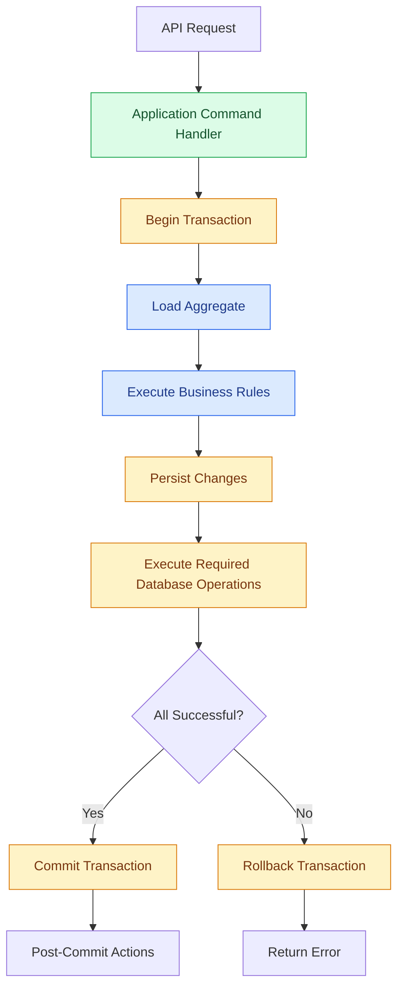

# Transaction Management

## 1. Purpose

A database transaction ensures that a group of database operations succeeds or fails together.

For example, when a customer places an order, the application may need to:

1. Save the order.
2. Save the order items.
3. Update inventory reservations.
4. Record the required business changes.

If one required operation fails, we should not leave the database in an inconsistent state.

Transactions help protect business data and maintain consistency.

## 2. What Is a Transaction?

A transaction is a group of database operations treated as one unit.

A transaction follows four important properties: ACID.

| Property | Meaning |
|---|---|
| Atomicity | All operations succeed or all are rolled back. |
| Consistency | Data remains valid according to database rules. |
| Isolation | Concurrent transactions do not produce invalid results. |
| Durability | Committed changes survive failures according to database guarantees. |

PostgreSQL provides transaction support through these properties.

## 3. Architecture

Transaction management belongs to the infrastructure layer, while the application layer controls when a transaction starts and finishes.



Responsibilities:

- Application: defines the transaction boundary.
- Domain: executes business rules.
- Infrastructure: manages the database transaction.
- PostgreSQL: guarantees database-level transactional behavior.

## 4. Transaction Boundaries

A transaction boundary defines which operations must succeed together.

For `bio-com`, the default rule is:

**One application command should normally use one database transaction.**

Example: placing an order.

```text
PlaceOrder Command
       |
       v
Begin Transaction
       |
       v
Create Order
       |
       v
Save Order Items
       |
       v
Save Required Business Records
       |
       v
Commit Transaction
```

If saving the order items fails, the order creation must also be rolled back.

Avoid transactions that remain open while waiting for external services or user input.

## 5. Unit of Work

The Unit of Work pattern coordinates multiple database operations within one transaction.

It allows repositories to share the same database transaction.

For example:

```rust
pub trait UnitOfWork {
    async fn begin(&self) -> Result<(), TransactionError>;

    async fn commit(&self) -> Result<(), TransactionError>;

    async fn rollback(&self) -> Result<(), TransactionError>;
}
```

This is a conceptual interface.

The actual Rust implementation should use an owned PostgreSQL transaction handle or a transaction-scoped context, rather than a shared mutable global transaction.

### Why use Unit of Work?

Without transaction coordination:

- Each repository might open its own transaction.
- Some operations might commit while others fail.
- Business workflows become difficult to maintain.

With transaction coordination:

- Repositories participate in one transaction.
- The application controls commit and rollback.
- Database consistency is easier to protect.

## 6. Repository and Transaction Coordination

Repositories should not independently decide when to commit a business transaction.

The application layer controls the transaction.

Example:

```text
Application Handler
       |
       v
Unit of Work
       |
       +---- Order Repository
       |
       +---- Inventory Repository
       |
       +---- Payment Repository
       |
       v
PostgreSQL Transaction
```

All repositories participating in this workflow must use the same transaction.

Important: Repository interfaces should remain independent of PostgreSQL-specific implementation details.

## 7. Rust Implementation Approach

For `bio-com`, use:

- Rust.
- SQLx.
- PostgreSQL.
- Explicit transaction management.
- Async database operations.

SQLx provides transaction support through its transaction API.

Conceptual example:

```rust
let mut tx = pool.begin().await?;

let result = async {
    order_repository.save(&mut tx, &order).await?;
    inventory_repository.reserve(&mut tx, &reservation).await?;

    Ok::<(), ApplicationError>(())
}
.await;

match result {
    Ok(()) => {
        tx.commit().await?;
        Ok(())
    }
    Err(error) => {
        tx.rollback().await?;
        Err(error)
    }
}
```

The repository implementations receive the transaction rather than opening independent connections.

The exact types and error conversions should be defined in the infrastructure implementation.

## 8. Commit and Rollback

### Commit

A commit permanently applies the changes in the transaction.

Example:

```rust
tx.commit().await?;
```

Only commit when all required database operations have succeeded.

### Rollback

A rollback cancels the uncommitted changes.

Example:

```rust
tx.rollback().await?;
```

Rollback when:
- A repository operation fails.
- A required database operation fails.
- A persistence constraint is violated.
- A required transactional event handler fails.

Do not ignore transaction errors.

Also remember that PostgreSQL rolls back an open transaction when its connection is closed without a successful commit. Explicit rollback is still preferable for clear control flow.

## 9. Domain Events and Transactions

Domain events must be coordinated with database transactions.

Consider an order placement operation.

```text
1. Customer places an order.
2. Order aggregate validates the request.
3. OrderPlaced event is raised.
4. Order is persisted.
5. Required transactional handlers execute.
6. Database transaction commits.
7. Post-commit operations execute.
```

There are two categories of event handlers.

### Transactional handlers

These execute database operations that must succeed together with the original command.

Their changes participate in the same PostgreSQL transaction.

### Post-commit handlers

These execute after the transaction commits.

Examples:
- Sending an email.
- Calling an external API.
- Publishing an integration event.

Never assume a post-commit operation can roll back an already committed database transaction.

For reliable external processing, introduce a transactional outbox when needed.

## 10. Isolation Levels

PostgreSQL supports several transaction isolation levels.

| Isolation level | Description |
|---|---|
| Read Uncommitted | PostgreSQL treats this as Read Committed. |
| Read Committed | Each statement sees committed data at the start of that statement. |
| Repeatable Read | Maintains a consistent snapshot throughout the transaction. |
| Serializable | Provides the strongest isolation, detecting transactions that cannot be safely serialized. |

For the first version, use PostgreSQL's default:

**Read Committed.**

Use stronger isolation only when a specific business operation requires it.

For example, inventory reservation may require explicit locking or atomic conditional updates to prevent overselling.

## 11. Concurrency Control

Transactions alone do not prevent every concurrency problem.

Consider two customers attempting to purchase the last available product.

Both requests may read:

```text
Available quantity = 1
```

Both may attempt to reserve it.

The application must prevent this race condition.

Possible approaches:

### Optimistic locking

Use a version column.

```text
product_id | quantity | version
-----------|----------|--------
100        | 1        | 5
```

Update only when the version is unchanged.

### Pessimistic locking

Use PostgreSQL row locking, such as:

```sql
SELECT *
FROM inventory
WHERE product_id = $1
FOR UPDATE;
```

The second transaction waits until the first releases the lock.

### Atomic update

For simple inventory reservations:

```sql
UPDATE inventory
SET quantity = quantity - 1
WHERE product_id = $1
  AND quantity > 0
RETURNING quantity;
```

If no row is returned, the reservation cannot be completed.

Choose the simplest approach that correctly protects the business rule.

## 12. Long-Running Operations

Avoid keeping database transactions open during:

- External API calls.
- Email delivery.
- Payment gateway requests.
- Long calculations.
- User confirmation.
- Background processing.

Long transactions can:
- Hold database locks.
- Consume connections.
- Increase contention.
- Reduce application throughput.

For workflows that involve several external operations, use an application-level workflow or saga with separate short transactions.

Do not try to maintain one database transaction across external services.

## 13. Error Handling

Transaction errors should be classified.

| Error | Expected behavior |
|---|---|
| Validation failure | Do not persist changes. |
| Unique constraint violation | Roll back and return a suitable conflict error. |
| Database connection failure | Fail the operation safely. |
| Deadlock | Retry the complete transaction when safe. |
| Serialization failure | Retry the complete transaction when safe. |
| External API failure | Handle outside the committed database transaction. |

Retries must be bounded.

Do not automatically retry every database error.

A retry must repeat the complete transaction, not just the last failed SQL statement.

## 14. Testing Strategy

Transaction behavior needs integration tests with a real PostgreSQL instance.

### Test 1: Successful transaction

Verify that all expected records are committed.

### Test 2: Rollback

Force one required database operation to fail.

Verify that no partial changes remain.

### Test 3: Concurrent updates

Run two operations against the same inventory record.

Verify that the quantity never becomes invalid.

### Test 4: Transaction isolation

Verify the expected behavior when two transactions modify the same data.

### Test 5: Domain event consistency

Verify that failed transactions do not result in committed business changes or premature external notifications.

## 15. What We Will Not Implement Now

To keep the architecture simple:

- No distributed transactions.
- No two-phase commit.
- No distributed locks.
- No event sourcing.
- No unnecessary transaction framework.
- No long-running database transactions.
- No message broker.

PostgreSQL transactions are sufficient for the initial modular monolith.

## 16. Future Improvements

When requirements grow, we can introduce:

- Transactional outbox.
- Background workers.
- Retry policies.
- Optimistic locking where appropriate.
- Database connection pool tuning.
- Transaction monitoring.
- Saga orchestration for long-running business workflows.

These improvements should be introduced based on actual business needs.

## 17. Summary

For `bio-com`, transaction management follows these principles:

- One application command normally owns one transaction.
- Repositories share the same transaction.
- The application layer controls transaction boundaries.
- PostgreSQL provides ACID guarantees.
- Read Committed is the initial isolation level.
- Concurrency-sensitive operations use appropriate locking or atomic updates.
- Required transactional handlers execute before commit.
- External side effects execute after commit.
- Failed operations roll back.
- Long-running workflows use separate transactions.

The objective is to protect business consistency without introducing unnecessary infrastructure.
