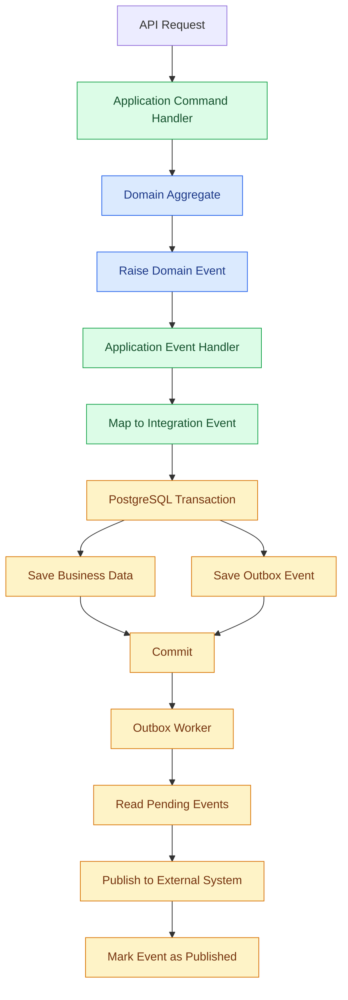

# Transactional Outbox

## 1. Purpose

The transactional outbox solves an important problem: how can we save business data and reliably publish an event at the same time?

Consider a customer placing an order.

The application needs to:

1. Save the order in PostgreSQL.
2. Notify another system that the order was placed.

There is a problem if these operations are performed separately.

### Scenario A: Database succeeds, publishing fails

```text
Save Order       SUCCESS
Publish Event    FAILED
```

The order exists, but the external system never receives the notification.

### Scenario B: Publishing succeeds, database fails

```text
Publish Event    SUCCESS
Save Order       FAILED
```

The external system receives an event for an order that does not exist.

Both scenarios can create inconsistent business data.

The transactional outbox pattern solves this problem by storing business changes and outgoing events in the same database transaction.

## 2. What Is the Transactional Outbox?

The outbox is a database table that temporarily stores integration events waiting to be published.

Instead of publishing an event directly, the application:

1. Executes the business operation.
2. Saves the business data.
3. Saves the integration event in the outbox table.
4. Commits everything in one transaction.

A background worker later reads the outbox and processes pending events.

If the transaction fails, neither the business changes nor the outbox event is committed.

## 3. Architecture



The important rule:

**Business data and the corresponding outbox record must be committed in the same PostgreSQL transaction.**

## 4. Domain Events vs Integration Events

The outbox stores integration events, not necessarily domain events.

These concepts have different responsibilities.

### Domain Event

Used inside the application.

Example:

```rust
pub struct OrderPlaced {
    pub order_id: OrderId,
    pub customer_id: CustomerId,
}
```

### Integration Event

Used to communicate with another application.

Example:

```rust
pub struct OrderPlacedIntegrationEvent {
    pub event_id: Uuid,
    pub order_id: Uuid,
    pub customer_id: Uuid,
    pub occurred_at: DateTime<Utc>,
}
```

An application handler maps the internal domain event to an integration event.

This prevents external systems from depending on internal domain models.

## 5. Outbox Database Table

The initial implementation uses a PostgreSQL table.

Example:

```sql
CREATE TABLE outbox_messages (
    id UUID PRIMARY KEY,
    event_type VARCHAR(255) NOT NULL,
    payload JSONB NOT NULL,

    occurred_at TIMESTAMPTZ NOT NULL,
    created_at TIMESTAMPTZ NOT NULL DEFAULT NOW(),

    published_at TIMESTAMPTZ,
    attempts INTEGER NOT NULL DEFAULT 0,

    next_attempt_at TIMESTAMPTZ,
    last_error TEXT,

    status VARCHAR(30) NOT NULL DEFAULT 'pending'
);
```

The table stores:

| Column | Purpose |
|---|---|
| id | Unique event identifier |
| event_type | Integration event name |
| payload | Event data in JSON format |
| occurred_at | When the business event happened |
| created_at | When the record was created |
| published_at | When publishing succeeded |
| attempts | Number of processing attempts |
| next_attempt_at | Earliest retry time |
| last_error | Last processing error |
| status | Current processing state |

Possible statuses:

- pending
- processing
- published
- failed

The status transitions should be controlled by the worker.

## 6. Saving an Outbox Event

The application saves the business changes and outgoing event together.

Example:

```rust
let mut tx = pool.begin().await?;

let result = async {
    order_repository.save(&mut tx, &order).await?;

    outbox_repository
        .save(&mut tx, &integration_event)
        .await?;

    Ok::<(), ApplicationError>(())
}
.await;

match result {
    Ok(()) => tx.commit().await?,
    Err(error) => {
        tx.rollback().await?;
        return Err(error.into());
    }
}
```

Both repositories use the same PostgreSQL transaction.

If either operation fails, the transaction must not commit.

## 7. Outbox Worker

The worker processes pending messages.

Its responsibilities:

1. Find pending events.
2. Claim events for processing.
3. Publish events to the configured destination.
4. Mark successful events as published.
5. Record failures.
6. Schedule retries.

For the initial version, the worker can run inside the application as a background task.

It does not require a separate distributed infrastructure component.

## 8. Claiming Events Safely

The worker must prevent multiple workers from processing the same event simultaneously.

PostgreSQL provides row locking with `FOR UPDATE SKIP LOCKED`.

Example:

```sql
WITH selected AS (
    SELECT id
    FROM outbox_messages
    WHERE status = 'pending'
      AND (
          next_attempt_at IS NULL
          OR next_attempt_at <= NOW()
      )
    ORDER BY created_at
    LIMIT 100
    FOR UPDATE SKIP LOCKED
)
UPDATE outbox_messages AS o
SET status = 'processing',
    attempts = attempts + 1
FROM selected
WHERE o.id = selected.id
RETURNING o.*;
```

This query claims a batch of events without blocking other workers from processing different rows.

In a production implementation, claim and lease management must also handle worker crashes.

For example, use a `locked_until` timestamp so events left in processing can become eligible again after a worker disappears.

## 9. Publishing Events

The worker passes each integration event to a publisher abstraction.

Example:

```rust
#[async_trait]
pub trait IntegrationEventPublisher: Send + Sync {
    async fn publish(
        &self,
        event: IntegrationEvent,
    ) -> Result<(), PublishError>;
}
```

For the initial version, the publisher can support:

- HTTP webhooks.
- Internal application integrations.
- A simple logging publisher for development.

The publisher implementation belongs to infrastructure.

The application should not depend directly on HTTP clients or a particular messaging provider.

## 10. Marking Events as Published

After successful publishing:

```sql
UPDATE outbox_messages
SET status = 'published',
    published_at = NOW(),
    last_error = NULL
WHERE id = $1;
```

Published records should be retained for a defined period before cleanup.

Do not delete events immediately after publishing because they are useful for troubleshooting and auditing.

## 11. Failure and Retry Strategy

Publishing can fail for several reasons:

- External service unavailable.
- Network timeout.
- HTTP 500 response.
- Rate limiting.
- Temporary authentication failure.

The worker should retry transient failures.

Example retry schedule:

| Attempt | Retry delay |
|---|---|
| 1 | 5 seconds |
| 2 | 30 seconds |
| 3 | 2 minutes |
| 4 | 10 minutes |
| 5 | 30 minutes |

Add random jitter to avoid multiple workers retrying simultaneously.

After the configured maximum attempts, mark the event as failed and raise an operational alert.

Permanent failures, such as invalid event payloads, should not be retried indefinitely.

## 12. At-Least-Once Delivery

The transactional outbox normally provides at-least-once delivery.

This means an event can be published more than once.

Consider this situation:

1. Worker publishes an event successfully.
2. External system receives the event.
3. Worker crashes before marking it as published.
4. Another worker retries the event.

The external system may receive the same event again.

This is expected behavior.

The solution is idempotent event consumption.

Every integration event should have a unique event ID.

Consumers should use this ID to identify previously processed events.

Never assume exactly-once delivery across independent systems.

## 13. Consumer Idempotency

External consumers should maintain a record of processed event IDs.

Example:

```sql
CREATE TABLE processed_integration_events (
    event_id UUID PRIMARY KEY,
    processed_at TIMESTAMPTZ NOT NULL DEFAULT NOW()
);
```

The consumer checks the event ID before applying business changes.

The check, business operation, and processed-event record should be committed in the same transaction whenever they share a database.

This prevents duplicate processing from creating duplicate business effects.

## 14. Ordering

The initial outbox implementation does not guarantee global event ordering.

For example:

```text
OrderPlaced
PaymentCompleted
OrderShipped
```

Different workers or retries may change the order in which events arrive.

If ordering matters, introduce an explicit ordering strategy.

Possible approaches:

- Aggregate ID.
- Aggregate version.
- Per-aggregate sequence number.
- Sequential processing for a particular event stream.

Do not impose global ordering unless the business requires it.

## 15. Security

Integration events must not expose unnecessary information.

Follow these rules:

- Include only required fields.
- Never publish passwords or authentication secrets.
- Avoid sensitive payment information.
- Validate event payloads.
- Authenticate external webhook requests.
- Use HTTPS.
- Protect outbox access with appropriate database permissions.
- Avoid logging complete sensitive payloads.

## 16. Monitoring

Monitor the outbox worker using structured logs and metrics.

Useful metrics:

| Metric | Purpose |
|---|---|
| Pending events | Processing backlog |
| Failed events | Events requiring attention |
| Processing duration | Worker performance |
| Retry count | External service reliability |
| Oldest pending event | Processing delay |
| Publishing success rate | Delivery health |

An event stuck in processing should be detected and recovered using its lease expiration.

## 17. Cleanup and Retention

Published and failed events should not remain in the table forever.

Define a retention policy.

For example:

- Published events: retain for 7–30 days.
- Failed events: retain until reviewed or explicitly resolved.
- Old processing records: recover after lease expiration.

These are initial operational defaults, not permanent business requirements.

Cleanup should run in controlled batches to avoid unnecessary database load.

## 18. What We Will Not Implement Now

The initial implementation does not require:

- Kafka.
- RabbitMQ.
- Redis.
- Distributed event brokers.
- Event sourcing.
- A separate messaging platform.
- Complex distributed workflow engines.

PostgreSQL provides the storage and coordination required for the initial outbox implementation.

## 19. Future Improvements

As the system grows, we can introduce:

- Dedicated background worker process.
- Message broker integration.
- Webhook delivery management.
- Dead-letter management.
- Per-aggregate event ordering.
- Event schema versioning.
- Operational dashboards.
- Advanced retry policies.

These improvements should be driven by actual integration requirements.

## 20. Summary

The transactional outbox ensures that business changes and outgoing integration events are recorded together.

For `bio-com`, the initial strategy is:

- PostgreSQL outbox table.
- Same transaction for business data and outbox records.
- Lightweight background worker.
- Explicit publisher abstraction.
- At-least-once delivery.
- Idempotent consumers.
- Bounded retries.
- Structured monitoring.
- No message broker for now.

This gives `bio-com` a reliable foundation for future integrations without unnecessary infrastructure.
